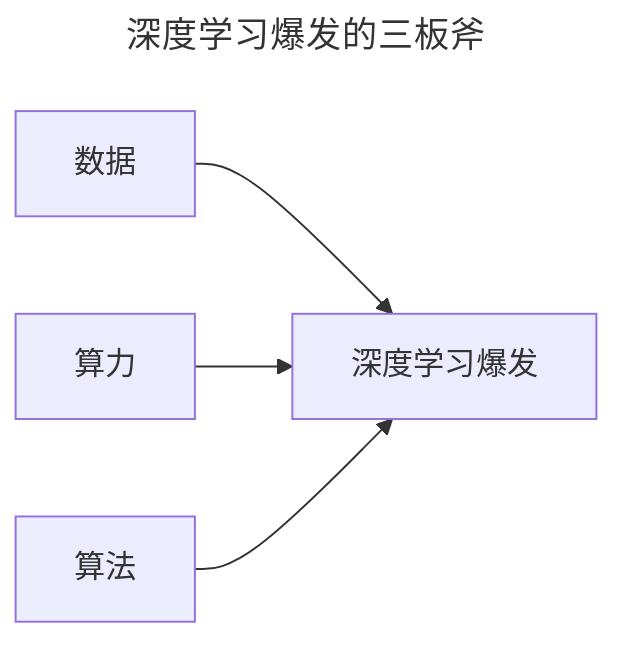

> 作者：轻松学AI
> 日期：2026-10-18
> 风格：通俗科普
> 状态：待发布

# 从零开始学深度学习 #01：深度学习为什么"深"？

同样是 8 个神经元一层。一个网络只叠 1 层，另一个叠 3 层。扔给它们同一条任务——把两条纠缠在一起的螺旋线分开。

浅层那个，准确率卡在 76%。深层那个，92.5%。

多出来的两层，到底多学了什么？答案先给：每一层只学上一层已经提炼出的特征——深度=层层抽象，不是把浅层网络多复制几层。这是《从零开始学深度学习》系列要带你搞懂的第一件事。

如果你之前跟过《从零开始学机器学习》，还记得结尾那篇说过"后面单独开一个深度学习的系列"——就是现在这个。机器学习系列带你手写过感知机、反向传播、MLP，那套地基在这里全部继续用，我不会重复讲。这个系列要做的，是往前走：卷积、循环、注意力、Transformer，还有让深层网络"学得动"的那一整套训练技巧。

## 一、这个系列要带你走多远

这个系列 22 篇，路线如下。


整个系列 22 篇，一条主线，不绕弯。每篇只打一个技术点，讲透为止，代码都在配套仓库 `dl-from-scratch` 里，能跑、能改、能复现。你不需要一口气读完，按顺序走就行，每篇都假设你只懂上一篇。

现在回到今天的主角：那个"深"字。

## 二、从"手写规则"到"自己学特征"

先回忆一下机器学习的本质。上一篇系列里我们反复说过：训练模型，就是在一堆参数里，找一组让"猜错程度"最小的值。

关键卡点从来不是"怎么找参数"，而是"喂给模型的输入长什么样"。

经典机器学习时代，这一步靠人。要让程序识别图片里的猫，工程师得先自己设计特征：边缘用 Canny 算子提、关键点用 SIFT 提、颜色用直方图统计……这些特征喂给 SVM 或决策树，模型才有东西可学。换句话说，机器只负责最后一步"分类"，前面"看什么"全得人来定。

这条路的天花板很明显：人的精力有限，能手工设计的特征就那么多，还很难通用。为图片设计的特征，换个语音任务就全废了。

深度学习改的就是这件事。它把"设计特征"这一步也交给网络自己学——输入的原始像素直接进网络，网络自己一层层折腾出有用特征，最后顺带把分类也做了。这个思路有个正式名字，叫**表示学习**：不再让人规定数据该怎么表示，让模型自己找。


一句话：以前是老师帮你划重点，现在是让学生自己学会怎么划重点。

## 三、"深"到底深在哪：一层层提炼抽象

那"深度"在这里起什么作用？

先把最常见的误解说破：深度 ≠ 多复制几层。深度真正的含义，是**每一层都在学上一层特征的特征**，一层比一层抽象。


拿识别一张猫的照片说事。第一层可能只学到最原始的边缘、色块；第二层把这些边缘拼成简单的形状，比如圆形、折角；第三层把形状组合成部件——眼睛、耳朵、胡须；再往后，网络把"有眼睛、有耳朵、有胡须"合在一起，判断出"这是猫"。


浅层模型做不到这件事，是因为它只有一个"台阶"，被迫从像素一步跳到"猫"。这一步跨得太大，单层能表达的关系又太有限，于是只能靠工程师把中间所有台阶提前铺好——那又绕回了手工特征。

深层网络等于自己铺了一条从像素到猫的完整台阶，每一步只学一小段，加起来却能做到单层做不到的事。

:::formula 深层网络 = 层层变换
y = f₃( f₂( f₁(x) ) )
x：原始输入 ｜ f₁、f₂、f₃：每一层的变换 ｜ y：最终输出
:::

这就是"深"的数学本质：把一次复杂的映射，拆成一串简单映射的叠加。每层只负责一小步，合起来却能表达很复杂的东西。

## 四、做个实验：浅层 vs 深层，差距一目了然

光说不够，跑个实验。

我造了一个经典难题：两条螺旋线缠在一起，每条是一类。这玩意儿线性不可分，是故意拿来刁难网络的。然后我搭了两个网络，都用 Tanh 激活，每层都恰好 8 个神经元——唯一区别是，浅层只有 1 个隐藏层，深层有 3 个。

```python
# 浅层：1 个隐藏层
shallow = nn.Sequential(
    nn.Linear(2, 8), nn.Tanh(),
    nn.Linear(8, 1),
)

# 深层：3 个隐藏层
deep = nn.Sequential(
    nn.Linear(2, 8), nn.Tanh(),
    nn.Linear(8, 8), nn.Tanh(),
    nn.Linear(8, 8), nn.Tanh(),
    nn.Linear(8, 1),
)
```

两个网络用同样的 Adam、同样的迭代轮数，喂同样的数据。结果：


浅层那 8 个神经元，使出全力也只能拧出一个大概的圈，中间乱成一团，76.2%。深层多叠了两层，同样的宽度，硬是把两条螺旋几乎完全分开，92.5%。

浅层 33 个参数，深层 177 个。参数是多了 5 倍，但关键不在这——两个网络每一层都只有 8 个神经元，深层赢在"多叠了两层"，不是"某一层塞了更多神经元"。这就是"深"在起作用。

## 五、为什么深能赢：每层只负责一小步

原因前面已经埋下了：深层网络把难题拆成了三步。

浅层要"一步到位"——8 个神经元必须在一次非线性变换里，直接把两条螺旋掰开。这一步要求太高，8 个神经元做不到，只能给出一个折中的模糊边界。

深层不用急。第一层先把数据做个初步扭曲，第二层在这个基础上再扭一下，第三层再收尾。每一层只解决"让下一层更好办一点"这个小目标，8 个神经元就够用了。三步叠加，把单层干不成的事干成了。

可以这么想：一条复杂的生产流水线，靠的不是某个全能工人，而是把工序拆开，每个工人只拧一颗螺丝。螺丝拧得简单，但整条线装出来的是复杂产品。


看损失曲线也能看出差别。深层的损失一路往下，浅层的早早触底就不动了——它想学，但结构注定了再努力也就到这了。

顺带说一个待验证的猜想：同样是增加容量，竖着加深往往比横着加宽更划算。不过今天的实验没控制参数量——深层 177 个、浅层 33 个，差的这 5 倍也可能是因素之一。要严格验证"深 > 宽"，得让两边参数量一致再比，这正好是后面留的思考题。

## 六、但深不是白来的：三个前提缺一不可

既然深这么好，为什么 2012 年之前没人这么干？

因为"深"是有代价的。网络一深，训练立刻冒出三个拦路虎：梯度要么消失要么爆炸、优化器不够给力、数据不够模型就过拟合。这三件事不解决，网络越深反而越烂。

好消息是，这三件事在 2012 年前后正好都被解决了——它们对应着深度学习爆发的三板斧：**数据、算力、算法**。下一篇就带你细看这三板斧是怎么凑齐的。



动手之前，留道思考题：把浅层网络加宽到 100 个神经元，能追上只有 8 个神经元的深层网络吗？你可以改 `dl-from-scratch` 仓库里的 `intro/deep_vs_shallow.py` 自己试试，答案下一篇揭晓。

深度学习的"深"，本质是层层提炼特征的能力。从下一篇开始，我们正式进场，先看这个能力为什么 2012 年才爆发。

- [《动手学深度学习》第 1 章：引言](https://zh.d2l.ai/chapter_introduction/index.html)
- [《深度学习》花书 第 1 章：Introduction](https://www.deeplearningbook.org/contents/intro.html)
- [3Blue1Brown：神经网络系列](https://www.3blue1brown.com/topics/neural-networks)
- [配套仓库 dl-from-scratch](https://github.com/Joneyao/dl-from-scratch)
