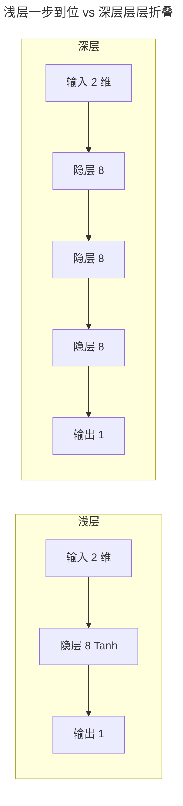
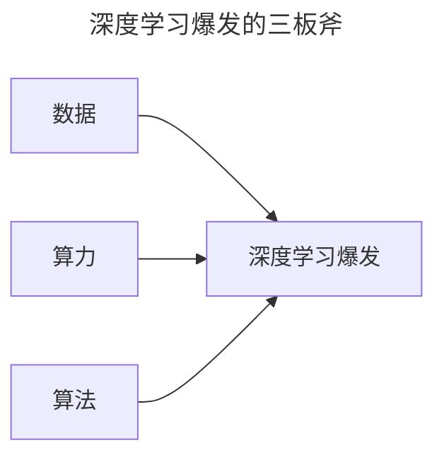
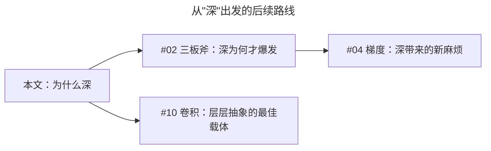

> 作者：轻松学AI
> 日期：2026-10-18
> 风格：通俗科普
> 状态：待发布

# 从零开始学深度学习 #01：深度学习为什么"深"？

同样是 8 个神经元一层。一个网络只叠 1 层，另一个叠 3 层。扔给它们同一条任务——把两条纠缠在一起的螺旋线分开。

浅层那个，准确率卡在 76%。深层那个，92.5%。

多出来的两层，到底多学了什么？答案先给：每一层只学上一层已经提炼出的特征——深度=层层抽象，不是把浅层网络多复制几层。这是《从零开始学深度学习》系列要带你搞懂的第一件事。

如果你跟过《从零开始学机器学习》，还记得结尾说过"后面单独开一个深度学习的系列"——就是现在这个。机器学习系列带你手写过感知机、反向传播、MLP，那套地基全部继续用。这个系列 22 篇，一条主线：卷积、循环、注意力、Transformer，以及让深层网络"学得动"的训练技巧。


现在回到今天的主角：那个"深"字。

## 一、问题由来：手工设计特征，卡住了二十年

先回忆机器学习的本质：训练模型，就是在一堆参数里，找一组让"猜错程度"最小的值。真正的卡点从来不是"怎么找参数"，而是"喂给模型的输入长什么样"。

经典机器学习时代，这一步靠人。要让程序识别图片里的猫，工程师得先自己设计特征：边缘用 Canny 算子提、关键点用 SIFT 提、颜色用直方图统计。这些特征喂给 SVM 或决策树，模型才有东西可学。机器只负责最后一步"分类"，前面"看什么"全得人来定。

这个成本具体有多高？拿 SIFT 说：Lowe 花了几年打磨出这一套手工特征，为的是让关键点对缩放、旋转、光照都稳定。可它只对"这一小类视觉问题"有效——换个语音任务，整套作废，得从头再设计。每个领域都要养一批工程师手工造特征，人力成本顶到天花板；人的先验也有上限，造出来的特征很难通用。

深度学习改的就是这件事：把"设计特征"这一步也交给网络自己学。原始像素直接进网络，网络自己一层层折腾出有用特征，最后顺带把分类也做了。这个思路有个正式名字，叫**表示学习**——不再让人规定数据该怎么表示，让模型自己找。


## 二、核心直觉：把"划重点"交给学生自己

一句话讲清表示学习：以前是老师帮你划重点，现在是让学生自己学会怎么划重点。

深度在这里起的作用，是"台阶"。浅层模型只有一个台阶，被迫从像素一步跳到"猫"，这一步跨得太大；深层网络自己铺了一条从像素到猫的完整台阶，每一步只学一小段。


拿识别一张猫的照片说事。第一层可能只学到最原始的边缘、色块；第二层把这些边缘拼成简单的形状，比如圆形、折角；第三层把形状组合成部件——眼睛、耳朵、胡须；再往后，网络把"有眼睛、有耳朵、有胡须"合在一起，判断出"这是猫"。


## 三、机制：深度=函数组合，层叠为什么比加宽狠

直觉讲完，把"为什么有效"掰开说。深层网络的数学本质，是把一次复杂的映射拆成一串简单映射的叠加：

:::formula 深层网络 = 层层变换
y = f₃( f₂( f₁(x) ) )
x：原始输入 ｜ f₁、f₂、f₃：每一层的变换 ｜ y：最终输出
:::

为什么"一串"比"一步"强？原因有两层：数学的和因果的。

数学这层：每个带 ReLU 这类分段线性激活的神经元，本质是拿一条分界线把输入空间"折一刀"。加宽就是多划几条线；层叠更狠——第二层是在第一层已经折过的空间上继续折，新折痕和前面所有折痕交叉叠加。这个结论有严格论文支撑（Montúfar 等，2014）：同样数量的神经元，串成多层能表达的函数比平铺一层多出指数级的量。这就是"深"的数学红利，加宽给不了。

因果这层：真实数据本身就有层次。图片是"像素→边缘→形状→部件→对象"，语音是"音素→音节→词→句"。层层组合正好对上这个层次，所以深层学得顺；浅层只有一步，逼它硬跨所有层次，才跨不动。

可以这么想：一条复杂流水线，靠的不是某个全能工人，而是把工序拆开，每个工人只拧一颗螺丝。螺丝拧得简单，整条线装出来的却是复杂产品。深度同理——每层只解决"让下一层更好办一点"，8 个神经元就够，三步叠加，干成单层干不成的事。


## 四、手写核心：两段代码，看"深"和"浅"差在哪

光说不练不行，把网络写出来。两个网络都用 Tanh 激活，每层恰好 8 个神经元，唯一区别是隐藏层层数：

```python
# 浅层：1 个隐藏层
shallow = nn.Sequential(
    nn.Linear(2, 8), nn.Tanh(),
    nn.Linear(8, 1),
)

# 深层：3 个隐藏层
deep = nn.Sequential(
    nn.Linear(2, 8), nn.Tanh(),
    nn.Linear(8, 8), nn.Tanh(),
    nn.Linear(8, 8), nn.Tanh(),
    nn.Linear(8, 1),
)
```

逐行看：`nn.Linear(2, 8)` 把 2 维输入线性映射到 8 维，`nn.Tanh()` 加一层非线性，把结果"折"一下。浅层到这里就急着 `Linear(8, 1)` 出结果了——8 个神经元必须在这一次变换里把两条螺旋掰开。深层不慌，它把 `Linear(8, 8) → Tanh` 连做三次：每层的输入是上一层已经折过的 8 维特征，再折一次。注意，深层每层还是 8 个神经元，多的只是"多绕了两道"，不是"某层塞了更多神经元"。



## 五、实验：同一道螺旋题，76.2% 对 92.5%

光写不跑是耍流氓。用一条经典难题：两条螺旋线缠在一起，每条是一类。这玩意儿线性不可分，专门拿来刁难网络。两个网络用同样的 Adam、同样的迭代轮数，喂同样的数据，结果：


浅层那 8 个神经元使出全力，也只能拧出一个大概的圈，中间乱成一团，**76.2%**。深层多叠了两层，同样的宽度，硬是把两条螺旋几乎完全分开，**92.5%**。

差距不只是准确率：浅层 33 个参数，深层 177 个，多了 5 倍。但关键不在这——两个网络每层都只有 8 个神经元，深层赢在"多叠了两层"，不是"某层更宽"。


损失曲线更直白：深层的损失一路往下，浅层的早早触底就不动了。它想学，但结构注定了再努力也就到这。

## 六、边界与代价：深不是白来的，小数据下还会帮倒忙

既然深这么好，为什么 2012 年之前没人这么干？因为"深"有代价。网络一深，训练立刻冒出三个拦路虎：梯度要么消失要么爆炸、优化器不够给力、数据不够就过拟合。这三件不解决，网络越深越烂。好消息是它们在 2012 年前后正好都被解决了——对应深度学习爆发的三板斧：**数据、算力、算法**。



再补一个最容易踩空的边界：**小数据下，深度无用，甚至有害**。数据少的时候，深层网络参数多，又没那么多样本去约束，过拟合来得飞快，效果可能还不如 SVM 或浅层 MLP。这也是为什么很多表格数据、结构化数据的比赛里，XGBoost、LightGBM 这类树模型常年压着深度网络打——数据没有层次结构、样本又少，深度网络那套层层抽象的优势根本发挥不出来。

还有一点别忽略：深度不是"一定比宽强"。配套仓库里我们实测过，把浅层网络加宽到 40 个神经元（161 参数，比深层的 177 还少一点），螺旋上拿到 **90.5%**，而 3 层深度网络是 92.5%，只微弱领先。深度的价值在"层层抽象"这个结构，不是参数排布上的绝对优势；加宽也能逼近，只是深的表达方式更贴合数据的层次。

## 七、一个常见误解：深度 ≠ 多复制几层

最容易搞错的一步：以为"深"就是把浅层网络多复制几层，层数上去了就厉害。

不是。深度的含义是**每一层都在学上一层特征的特征**，一层比一层抽象。如果叠的层之间没有"提炼"——比如全是线性层叠线性层——那叠 100 层也等价于 1 层：线性函数的复合还是线性，多叠的层是白叠的。深度要起效，前提是每层带非线性、层与层在真正提炼，而不是无脑复制。


## 八、延伸：这个"深"字，后面怎么展开

"深"能层层提炼特征，这件事本身说清楚了。但它带出一串新问题，正是后面几篇的主线：

- 深为什么偏偏 2012 年才爆发？下一篇讲三板斧（数据、算力、算法）是怎么凑齐的。
- 深带来的第一个新麻烦是梯度消失/爆炸，让"加深"一度是死路，这是 #04。
- 层层抽象最趁手的载体是卷积，它把"局部、共享、层层堆"做到了极致，这是 #10。



动手之前留道思考题：把浅层网络加宽到 100 个神经元，能追上 3 层的深度网络吗？加宽到 40 个就到 90% 了——你可以在 `dl-from-scratch` 仓库的 `intro/deep_vs_shallow.py` 里自己跑跑看。

深度学习的"深"，本质是层层提炼特征的能力。下一篇，正式进场看三板斧。

- [《动手学深度学习》第 1 章：引言](https://zh.d2l.ai/chapter_introduction/index.html)
- [《深度学习》花书 第 1 章：Introduction](https://www.deeplearningbook.org/contents/intro.html)
- [Montúfar et al., 2014: On the Number of Linear Regions of Deep Neural Networks](https://arxiv.org/abs/1402.1869)
- [3Blue1Brown：神经网络系列](https://www.3blue1brown.com/topics/neural-networks)
- [配套仓库 dl-from-scratch](https://github.com/Joneyao/dl-from-scratch)
