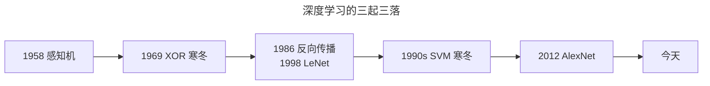
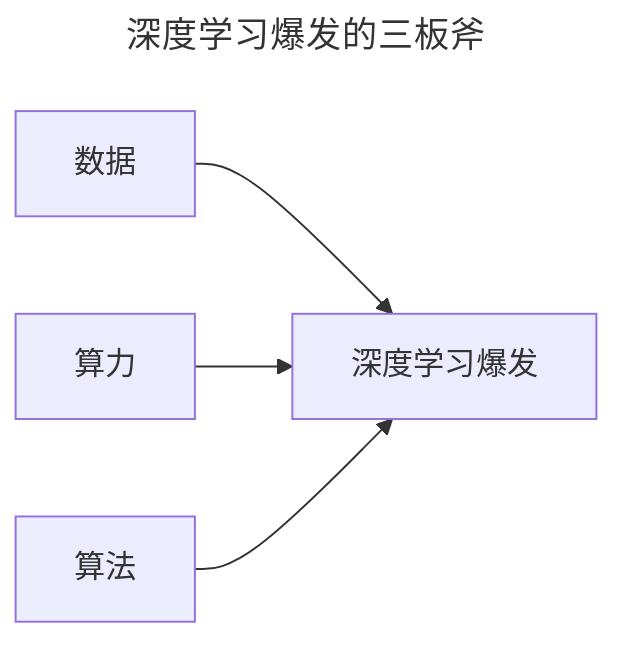
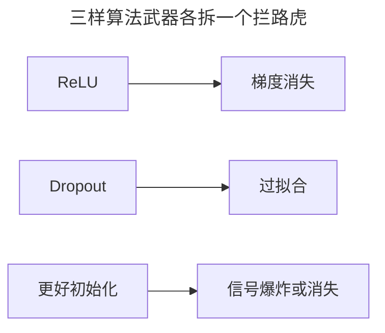
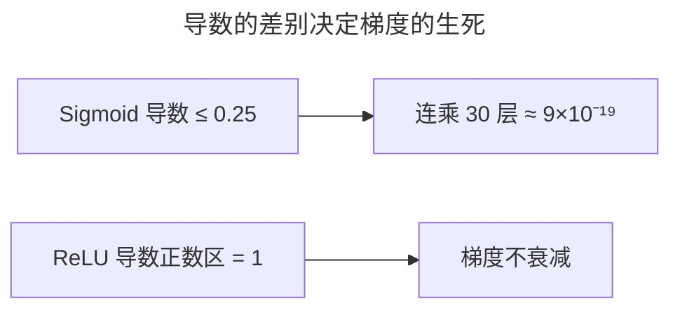
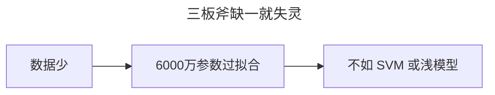
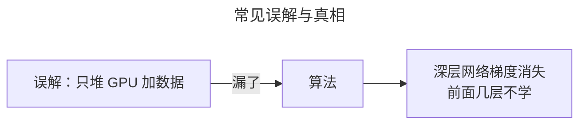
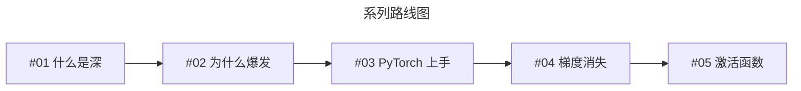

> 作者：轻松学AI
> 日期：2026-10-18
> 风格：通俗科普
> 状态：待发布

# 从零开始学深度学习 #02：深度学习的爆发时刻

2010 年，全世界最好的图像识别系统，看一张图片报 Top-5 错误率 28.2%——它给的 5 个猜测里，有近三成机会连边都没沾上。

2012 年，这个数字被砍到 16.4%。出手的是一个叫 AlexNet 的深度神经网络。从那一年起，深度学习从学术圈的冷板凳，一夜之间变成整个科技行业的主角。

上一篇讲了"深"是什么——层层提炼特征。更实际的问题是：这套东西 1980 年代就想出来了，为什么偏偏 2012 年才炸？

## 一、问题由来：一个迟到了 30 年的爆发

先破除一个误会：深度学习不是 2012 年才发明的。它的一生其实是三起三落。

第一起，1958 年罗森布拉特做出感知机，媒体当时吹得天花乱坠；第一落，1969 年明斯基和帕珀特写了本《感知机》，证明单层感知机连"异或"这种最简单的逻辑都学不会，研究经费瞬间断流。第二起，1986 年反向传播发表，1998 年 LeNet 已经能识别手写数字；第二落，SVM、决策树这些"省数据"的算法更稳，神经网络被晾在一边，一晾就是十年。第三起，才是 2012 年的 AlexNet。



中间那段寒冬，d2l 里说得很直白，就两个原因：**训练太贵**，以及**数据太小**。

上世纪末的计算机，算力弱得可怜；那时测试算法的流行数据集，是费舍尔 1932 年的鸢尾花——150 个样本。手写数字 MNIST 的 6 万张，在那时已经被当成"海量"。这点数据喂给要海量参数的神经网络，就像用一杯水去灌一亩地。

## 二、核心直觉：三样东西凑齐了

一句话概括 2012 年的爆发：**数据、算力、算法，三样东西第一次同时到位**。缺一个都不行。


你可以把深度学习想成一台很挑食的机器：它要海量数据当原料，要 GPU 当发动机，还要几个让发动机不熄火的小技巧。1980 年代的人手里只有图纸，没有原料和发动机，造不出机器；2010 年代，三样终于凑齐。



## 三、机制：为什么偏偏是这三样，而且缺一不可

数据、算力、算法是一条流水线上的三个环节，任何一个断了，另外两个都白搭。

先说数据。深度网络为什么特别"吃"数据？因为它参数多。AlexNet 有 6000 万个参数，也就是 6000 万个旋钮要调；参数多，能拟合的图案就多——这既是能力，也是风险。训练数据不够时，6000 万个旋钮会把这 150 个样本直接背下来，训练集上误差趋近 0，测试集上错得一塌糊涂，这就是过拟合。数据够大（ImageNet 有 120 万张训练图），才能把这么多参数"钉"在真正有规律的位置上。

再说算力。就算数据够了，6000 万个参数乘 120 万张图，意味着训练要反复做海量的矩阵乘法：前向算一遍、反向再算一遍，梯度下降要跑几千轮，每轮都碰一遍全部参数。这个计算量早十年的 CPU 根本扛不住。GPU 的几千个核心把矩阵乘法并行化，才把"训练五到六天"从一个笑话变成现实。

最后说算法，这是最容易被忽略的一板斧。深层网络训练有三个死穴：梯度消失、优化不动、过拟合。2010 年前后，三样武器各自到位——ReLU 治梯度消失，Dropout 治过拟合，更好的初始化让信号不衰减不爆炸。



其中最关键的是 ReLU。反向传播的梯度逐层连乘，老的 Sigmoid 导数最大只有 0.25，一层乘 0.25，30 层就是 0.25 的 30 次方，约等于 9 乘 10 的负 19 次方——前面几层梯度小到等于 0，那几层根本没在学。ReLU 把导数在正数区拉回恒定的 1，连乘才不至于衰减到消失。

三者耦合的逻辑就在这：**数据是原料，算力是发动机，算法是那套让原料真正变成能力的工艺**。缺哪个都炸不起来。


这张图两条线都是对数刻度——每向上走一格，是涨了 10 倍。数据规模从 1970 年的几百条，涨到 2020 年的万亿条；算力涨得更猛，从每秒 10 万次浮点运算，到每秒 10 的 15 次方。关键的转折在 2010 年之后：数据够了，算力也够了，"深度"这种又吃数据又吃算力的路子，才第一次有了用武之地。

## 四、手写核心：ReLU 为什么能救梯度

嘴上说"导数最大 0.25"没感觉，写几行代码算一算。这段 Python 直接对比 Sigmoid 和 ReLU 的导数：

```python
import numpy as np

def sigmoid(x):
    return 1 / (1 + np.exp(-x))

def relu(x):
    return np.maximum(0, x)

s = sigmoid(0.0)
print(f"Sigmoid 导数最大值: {s * (1 - s):.2f}")   # 0.25

x = np.linspace(-5, 5, 1000)
relu_grad = (x > 0).astype(float)
print(f"ReLU 导数(正数区): {relu_grad.max():.1f}")  # 1.0

print(f"0.25 连乘 30 次 = {0.25 ** 30:.2e}")        # 8.67e-19
```

输出：

```
Sigmoid 导数最大值: 0.25
ReLU 导数(正数区): 1.0
0.25 连乘 30 次 = 8.67e-19
```



每一行在干嘛：`s * (1 - s)` 是 Sigmoid 导数的标准公式，在 x=0 处取到最大，正好是 0.25；`(x > 0)` 是 ReLU 的导数——正数取 1、负数取 0，所以最大值是 1；最后那行 `0.25 ** 30` 模拟的是梯度穿过 30 层网络后的处境。8.67e-19 就是"梯度消失"的数值长相，小到等于 0。这么一看就懂了：ReLU 真正换掉的，是那个让梯度一路衰减的乘法因子。

## 五、实验：ImageNet 2012 的真实数字

万事俱备，只欠一个让全世界看到的舞台。这个舞台叫 ImageNet 挑战赛——一个 1400 万张标注图片的数据集，每年比谁识别错误率最低。

2010 年、2011 年的冠军，用的还是人工设计特征的老路子，错误率卡在 25% 以上纹丝不动：2010 年 28.2%，2011 年 25.8%。


然后 AlexNet 来了，把 2012 年的 Top-5 错误率一刀砍到 16.4%。这个数字背后是实打实的成本：6000 万参数、8 层网络（5 个卷积层加 3 个全连接层），用两块 GTX 580 显卡训练了五到六天才跑完。

更刺激的是后面的走势：错误率一路往下，2015 年 ResNet 干到 3.57%，超过人类的识别水平。从 28% 到 3.5%，前后不过五年。这场比赛之后，资本、人才、算力疯狂涌入，一直涌到今天的大模型时代。

## 六、边界与代价：三板斧换不来万能

把话说全。深度学习 2012 年的爆发，是它终于在条件齐的地方起飞了，不代表它从此在哪都赢。

边界很清楚：数据少的时候，深度网络照样过拟合、照样失灵——6000 万个参数在 150 个样本面前，只会背书不会推理。上百万张图片的标注成本，也只有大公司烧得起，小团队根本凑不齐这个数据量。而且 AlexNet 的成功里混着大量工程调参：学习率怎么设、数据怎么增强、网络怎么初始化，论文里没写出来的坑一大堆。



反过来想，这也解释了深度学习为什么最先在"大厂加大图加大算力"的赛道上爆发，而不是在医疗小样本场景里。三板斧是起飞的条件，不是包赢的承诺。今天的大模型时代重新验证了这句话：模型越吃数据、越吃算力，门槛就越高，马太效应越明显。

## 七、一个最常犯的误解

很多人把 2012 年的故事简化成一句："不就是堆更多 GPU、灌更多数据吗？"

漏掉了最要命的一半：算法。如果只有数据和算力，没有 ReLU、Dropout、好初始化这几样东西，网络一深梯度就消失，前面几层根本不学，再多 GPU 也只是空转。1980 年代就有人想过堆大网络，但堆深了根本训不动。2012 年的转折，恰恰是一堆"小改进"在同一个时间窗口凑齐了，把"深层网络学不动"这个拦路虎给拆了。



## 八、延伸：接下来去哪

爆发的原因讲完了，下一篇开始动手：正式上手 PyTorch——今天所有深度学习的通用工具，也是这个系列后面所有代码的地基。

再往后，那三样让深层网络"学得动"的算法武器，会一个个拆开讲：梯度消失的数学（#04）、激活函数（#05）、初始化（#06）……理解它们，才看得懂后面那些更复杂的东西在解决什么问题。



**结语**

深度学习 2012 年的爆发，本质是一次"天时地利人和"：

天时，是数据终于够大；地利，是 GPU 让算力够便宜；人和，是那几样让深层网络"学得动"的算法技巧刚好成熟。

三样缺一不可。这也解释了为什么 1980 年代的学者们早就看到了这条路，却只能眼睁睁等上三十年。

- [《动手学深度学习》第 1 章：引言](https://zh.d2l.ai/chapter_introduction/index.html)
- [AlexNet 论文：ImageNet Classification with Deep Convolutional Neural Networks](https://papers.nips.cc/paper/2012/hash/c399862d3b9d6b76c8436e924a68c45b-Abstract.html)
- [《深度学习》花书 第 1 章：Introduction](https://www.deeplearningbook.org/contents/intro.html)
- [反向传播原始论文：Learning representations by back-propagating errors (Nature, 1986)](https://www.nature.com/articles/323533a0)
- [ImageNet 数据集官网](https://image-net.org/)
