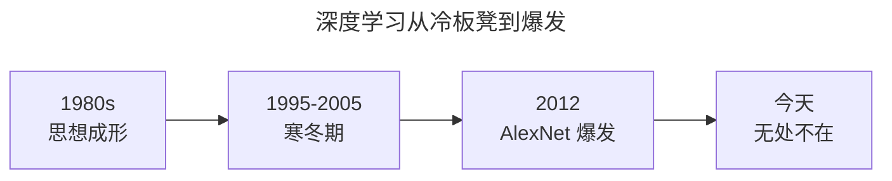
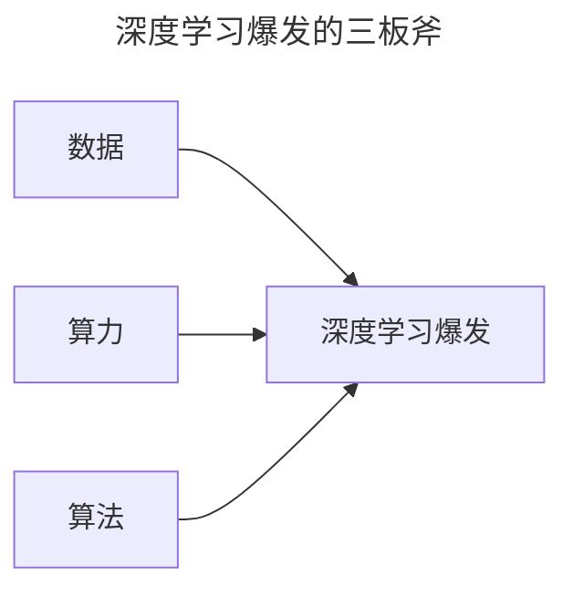
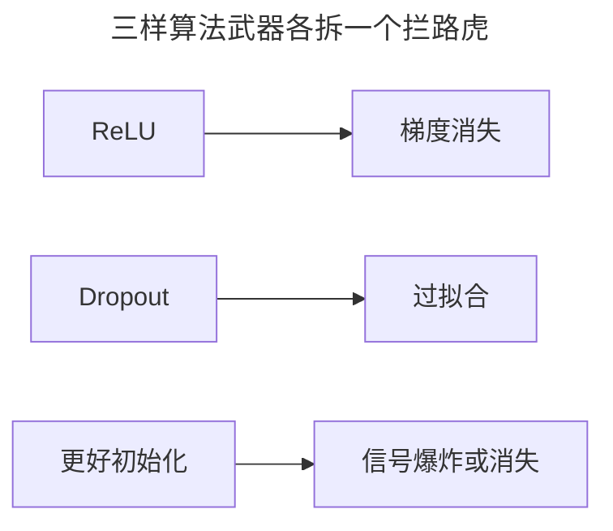

> 作者：轻松学AI
> 日期：2026-10-18
> 风格：通俗科普
> 状态：待发布

# 从零开始学深度学习 #02：深度学习的爆发时刻

2010 年，全世界最好的图像识别系统，看一张图片报 Top-5 错误率 28.2%——也就是它给的 5 个猜测里，有近三成机会连边都没沾上。

2012 年，这个数字被砍到 16.4%。

出手的是一个叫 AlexNet 的深度神经网络。从那一年起，深度学习从学术圈的冷板凳，一夜之间变成了整个科技行业的主角。

上一篇我们讲了深度学习的"深"是什么——层层提炼特征。这一篇回答另一个更实际的问题：这套东西 1980 年代就想出来了，为什么偏偏 2012 年才炸？

## 一、一个迟到了 30 年的爆发

先破除一个误会：深度学习不是 2012 年才发明的。

卷积神经网络的鼻祖 LeNet 在 1998 年就能识别手写数字；反向传播算法 1986 年就发表；再往前，感知机 1958 年就有了。思想早就在那，缺的是让它跑起来的条件。

中间那段"寒冬期"，d2l 里说得很直白，就两个原因：**训练太贵**，以及**数据太小**。

上世纪末的计算机，算力弱得可怜，内存也不够；而那时测试算法的流行数据集，是费舍尔 1932 年的鸢尾花——150 个样本。手写数字 MNIST 的 6 万张，在那时已经被当成"海量"。这点数据喂给需要海量参数的神经网络，就像用一杯水去灌一亩地。

同期，SVM、决策树这类"省数据"的算法反而更稳。所以神经网络被晾在一边，一晾就是十年。

## 二、三样东西凑齐了

时间来到 2010 年代，情况变了。有三个变量同时到位，缺一个都不行。

**数据**：互联网公司崛起，几亿用户在产生行为数据，数据集从"万级"跳到"亿级"。**算力**：GPU 普及，浮点运算能力几十年涨了几个数量级。**算法**：一批让深层网络"学得动"的技巧被发明出来。

这张图里两条线都是对数刻度——每向上走一格，是涨了 10 倍。数据规模从 1970 年的几百条，涨到 2020 年的万亿条；算力涨得更猛，从每秒 10 万次浮点运算，到每秒 10 的 15 次方。

关键的变化在 2010 年之后：数据够了，算力也够了，这时候"深度"这种又吃数据又吃算力的路子，才第一次有了用武之地。

## 三、算法上那三件小事

别小看"算法"这一板斧。很多人以为 2012 年就是"堆更多 GPU、灌更多数据"，其实还有几件"小事"在背后默默发力。

回想上一篇说的：网络一深，训练立刻冒出三个拦路虎——梯度消失、优化不动、过拟合。这三个问题不解决，网络再深也白搭。恰恰在 2010 年前后，三样武器各自到位：

- **ReLU 激活函数**：一个"正数原样过、负数归零"的简单函数，解决了 Sigmoid 的梯度消失。
- **Dropout**：训练时随机关掉一半神经元，解决了过拟合。
- **更好的初始化**：让信号从第一层传到最后一层不衰减不爆炸。

这三样东西，正是接下来几篇（#04 到 #09）要逐个拆开讲的主角。它们单看都不起眼，合起来却把"深层网络学不动"这个拦路虎给拆了。

这也是深度学习最反直觉的地方：让历史转折的，不是某个惊天动地的算法，而是一堆"小改进"刚好在同一个时间窗口凑齐。

## 四、ImageNet 2012：那个"出圈"的瞬间

万事俱备，只欠一个让全世界看到的舞台。这个舞台叫 ImageNet 挑战赛。

ImageNet 是一个有 1400 万张标注图片的数据集，每年办一次比赛，比谁家模型识别图片的错误率最低。2010 年、2011 年的冠军，用的还是人工设计特征的老路子，错误率卡在 25% 以上，几乎纹丝不动。

然后 AlexNet 来了。同样是这个比赛，2012 年它把 Top-5 错误率从 25.8% 一刀砍到 16.4%。这不是"进步了一点"，是硬生生把别人几年没啃动的硬骨头啃掉了一大块。

更刺激的是接下来几年的走势：错误率一路往下，2015 年 ResNet 干到 3.57%，超过了人类的识别水平。从 28% 到 3.5%，前后不过五年。

这场比赛之后，再没人怀疑深度学习是未来。资本、人才、算力开始疯狂涌入，一直涌到今天的大模型时代。

**结语**

所以，深度学习 2012 年的爆发，本质是一次"天时地利人和"：

天时，是数据终于够大；地利，是 GPU 让算力够便宜；人和，是那几样让深层网络"学得动"的算法技巧刚好成熟。

三样缺一不可。这也解释了为什么 1980 年代的学者们早就看到了这条路，却只能眼睁睁等上三十年。

从下一篇开始，我们就不讲故事了，正式上手 PyTorch——它是今天所有深度学习的通用工具，也是我们这个系列后面所有代码的地基。

- [《动手学深度学习》第 1 章：引言](https://zh.d2l.ai/chapter_introduction/index.html)
- [AlexNet 论文：ImageNet Classification with Deep Convolutional Neural Networks](https://papers.nips.cc/paper/2012/hash/c399862d3b9d6b76c8436e924a68c45b-Abstract.html)
- [《深度学习》花书 第 1 章：Introduction](https://www.deeplearningbook.org/contents/intro.html)
