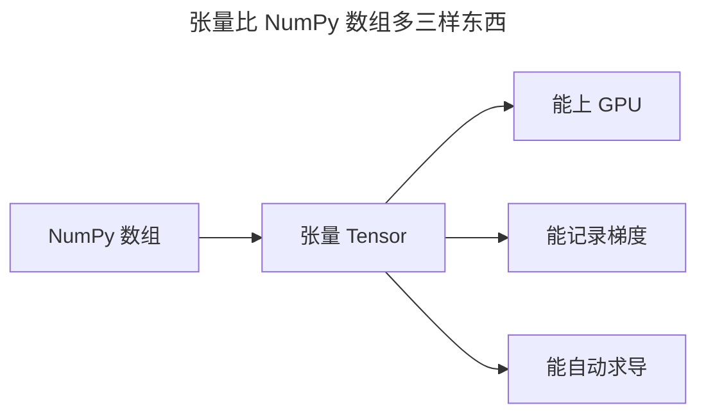
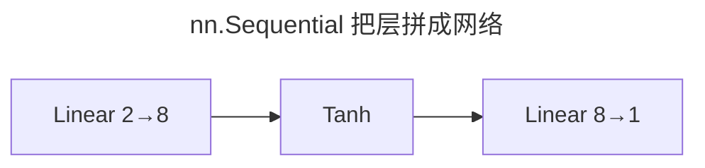
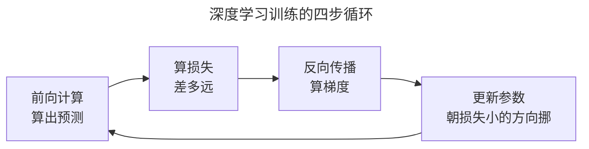

> 作者：轻松学AI
> 日期：2026-10-18
> 风格：通俗科普
> 状态：待发布

# 从零开始学深度学习 #03：PyTorch 快速上手

前面两篇讲了"深度学习为什么强""它为什么 2012 年才爆发"。从现在起，我们把话说落到代码上。

整个系列后面所有代码，都用同一个工具：PyTorch。这一篇带你把它最核心的三样东西摸一遍——张量、自动求导、nn.Module，最后拼出一个最小训练循环。学完这篇，你就有了读懂后面每一篇代码的能力。

## 一、张量：深度学习的"通用货币"

深度网络里流动的，从头到尾只有一样东西——张量（Tensor）。

你可以把张量想成"能上 GPU 的多维数组"。它跟 NumPy 的数组几乎是一回事：一维张量是向量，二维是矩阵，三维往上就是高维数组。一张彩色图片，就是 `高 × 宽 × 3 通道` 的三维张量；一个批次的 64 张图，就是四维张量。

```python
import torch

x = torch.tensor([[1.0, 2.0], [3.0, 4.0]])
print(x.shape)   # torch.Size([2, 2])
```

张量之所以是"通用货币"，在于它带着三样 NumPy 数组没有的东西：


**能在 GPU 上算、能记录梯度、能自动求导**。后两样，就是下一节的主角。

## 二、autograd：你只写前向，反向它自动算

回忆《从零开始学机器学习》里我们手推反向传播的狼狈——对着链式法则一层层往回算偏导。PyTorch 把这件事自动化了，它的名字叫 autograd（自动求导）。

原理其实没变，还是链式法则。你只需声明哪些张量"需要求导"（`requires_grad=True`），然后照常写前向计算，最后调一句 `.backward()`，梯度就自动算好了。

```python
x = torch.tensor(3.0, requires_grad=True)
y = x * x + 2 * x + 1      # y = x² + 2x + 1
y.backward()
print(x.grad)              # 8.0，因为 dy/dx = 2x + 2 = 8
```


`y = x² + 2x + 1` 在 `x=3` 处的导数，手算是 `2×3 + 2 = 8`，autograd 给的也是 8。它不是魔法，只是把我们手推链式法则那套，做成了每次前向计算时顺手记录的一张"计算图"。

这张计算图记着"谁参与了谁的计算"。反向传播时，就沿着这张图从结果一路倒推回输入，把每个张量的梯度填上。你看到的每一行，底层都还是上一篇手写的那个反向传播。

## 三、nn.Module：把网络搭成乐高

有了张量和自动求导，理论上你能从零写出任何网络。但每写一层都要手动管一堆权重张量、手动写前向，太啰嗦。

PyTorch 给了个积木：`nn.Module`。每个层（`nn.Linear` 线性层、`nn.Tanh` 激活）都是一块乐高积木，你用 `nn.Sequential` 把它们按顺序拼起来，就得到了一个网络。

```python
import torch.nn as nn

model = nn.Sequential(
    nn.Linear(2, 8), nn.Tanh(),    # 输入 2 维 → 8 个隐藏神经元
    nn.Linear(8, 1),               # → 1 个输出
)
```

这就是上一篇实验里那个"浅层网络"的完整定义，三行。


`nn.Linear(2, 8)` 会自动创建 2×8 的权重矩阵和 8 个偏置，`nn.Tanh` 负责非线性。你不需要手动管任何一个权重——但你要知道它们就在那，这正是第一篇说的"参数"。

`model(x)` 一调用，数据就自动按顺序流过每一层，这就是前向传播。

## 四、训练循环：深度学习的最小骨架

张量、自动求导、网络都齐了，最后拼成训练。任何深度学习的训练，都逃不出下面这个四步循环：



用上一篇的"拟合一条直线"做个最小示范。我们要找一条 `y = wx + b` 的直线，让它尽量贴合数据——这其实就是一个只有两个参数的网络。

```python
w = torch.tensor(0.0, requires_grad=True)
b = torch.tensor(0.0, requires_grad=True)

for _ in range(500):
    loss = torch.mean((w * X + b - y) ** 2)   # 均方误差
    loss.backward()                            # 算梯度
    with torch.no_grad():
        w -= 0.05 * w.grad                     # 沿梯度反方向更新
        b -= 0.05 * b.grad
        w.grad.zero_(); b.grad.zero_()         # 清空梯度，准备下一轮
```

这段代码里没有魔法：`loss.backward()` 算出梯度，`w -= 0.05 * w.grad` 就是上一篇手写的梯度下降，只不过现在求导是自动的。


左图是拟合出的直线，右图是损失一路下降。500 轮迭代，两个参数从 0 出发，自动找到了最优的 `w≈2、b≈1`。

**结语**

到这儿，PyTorch 的核心你已经摸完了：张量是数据，autograd 管求导，nn.Module 搭网络，四步循环做训练。

后面每一篇——不管是卷积、循环还是注意力——都只是在这个骨架上，换上不同的"层"而已。下一篇我们回到主线，去拆第一个让深层网络"学得动"的关键：梯度消失与梯度爆炸。

- [PyTorch 官方教程：60 Minute Blitz](https://pytorch.org/tutorials/beginner/deep_learning_60min_blitz.html)
- [PyTorch 官方教程：Learn the Basics](https://pytorch.org/tutorials/beginner/basics/intro.html)
- [配套仓库 dl-from-scratch（intro/pytorch_basics.py）](https://github.com/Joneyao/dl-from-scratch)
