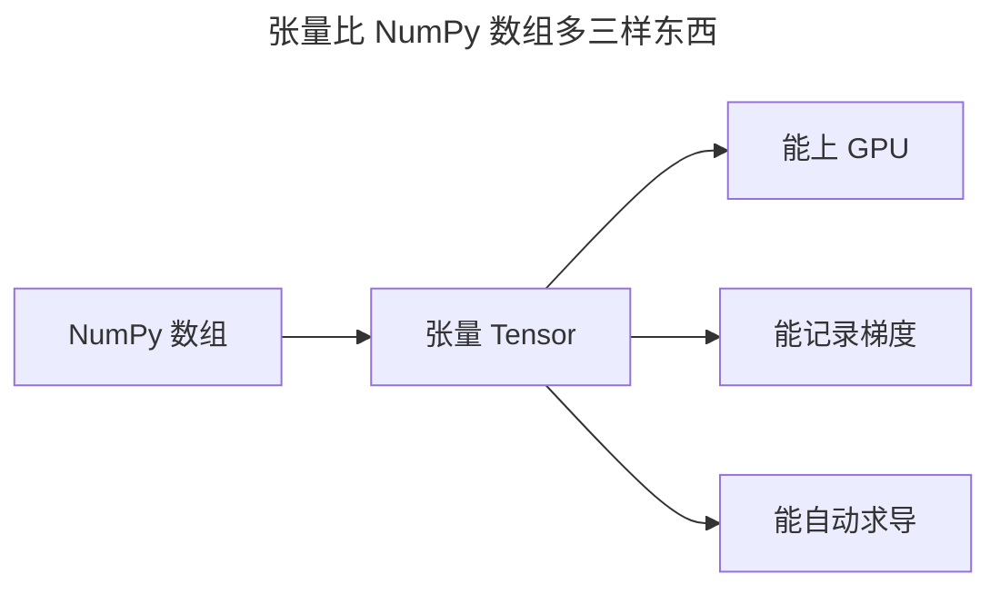
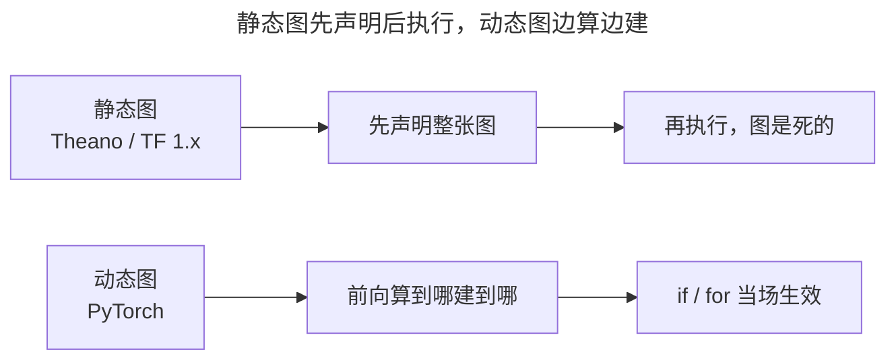
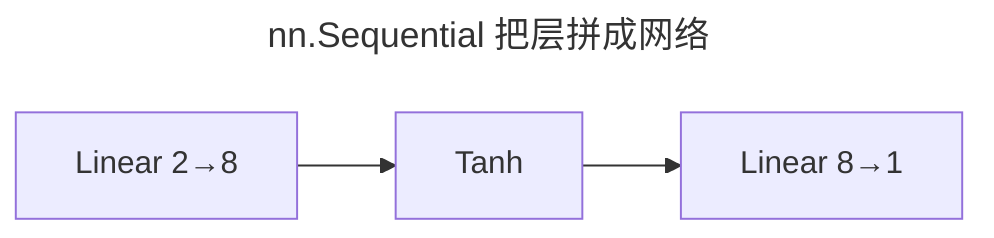
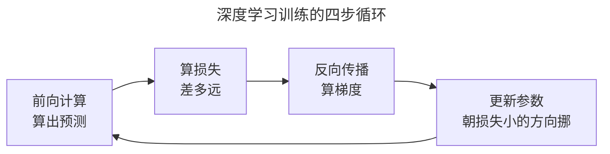
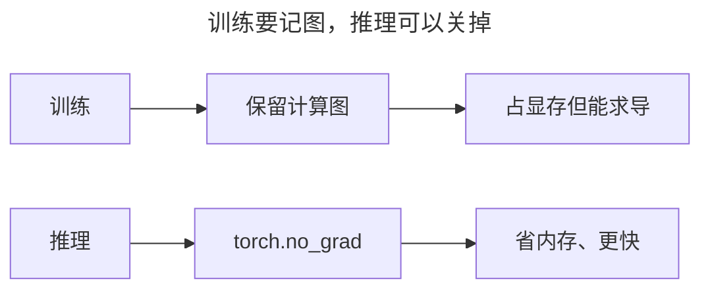
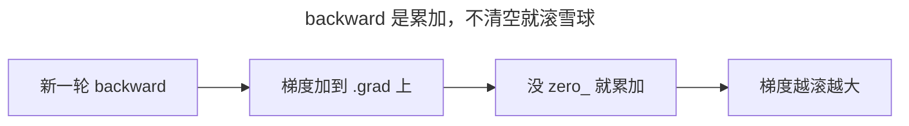
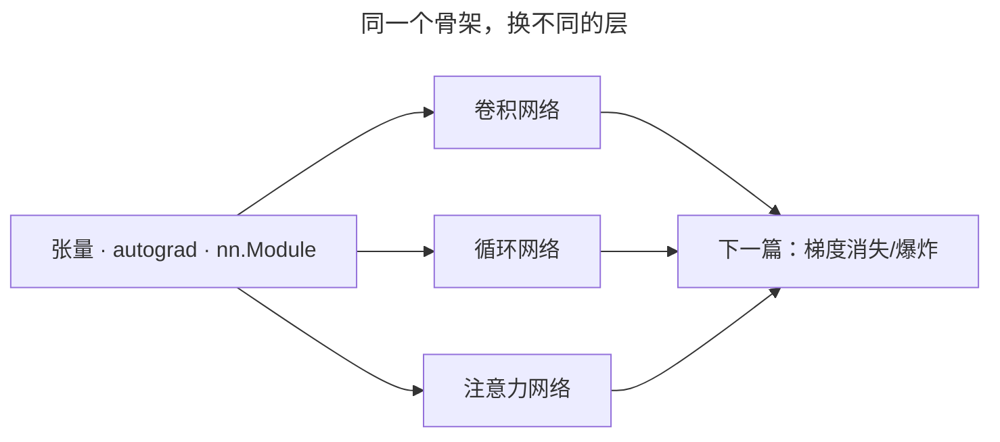

> 作者：轻松学AI
> 日期：2026-10-18
> 风格：通俗科普
> 状态：待发布

# 从零开始学深度学习 #03：PyTorch 快速上手

前面两篇讲了"深度学习为什么强""它为什么 2012 年才爆发"。从现在起，我们把话说落到代码上。

整个系列后面所有代码，都用同一个工具：PyTorch。这一篇带你把它最核心的三样东西摸一遍——张量、自动求导、nn.Module，最后拼出一个最小训练循环。学完这篇，你就有了读懂后面每一篇代码的能力。

## 一、问题由来：从"配置地狱"到像写 Python

最早的一批工具里，Theano 2007 年就有了，它要求你先把整张计算图"声明"出来，再往里面喂数据——图是死的，想在代码里写个 if 判断都不行。到了 2013 年前后，最常用的是 Caffe：改一个网络结构，你得去写一份叫 prototxt 的配置文件，几十上百行，层与层靠名字串起来，漏一个字段就报错，还报得不清不楚。

TensorFlow 2015 年出来，好用了不少，但 1.x 时代走的还是"先定义图、再开个会话去执行"的老路，print 一个中间值都得绕一大圈。真正让写深度学习回到"写普通 Python"的，是 2016 年 Facebook 放出的 PyTorch：你在哪一行写前向，计算图就在哪一行当场搭好。这个差别，就是第三节要讲的动态图与静态图。


## 二、核心直觉：数据是张量，反向是"回放录像"

深度学习里从头到尾流动的，只有一样东西——张量（Tensor）。原文给它起了个名字叫"通用货币"，这个类比你先收着当辅助理解：张量就是"能上 GPU 的多维数组"，跟 NumPy 数组几乎一回事，一维是向量、二维是矩阵、三维往上就是高维数组。一张彩色图是"高 × 宽 × 3 通道"的三维张量，一批 64 张图就是四维张量。

```python
import torch

x = torch.tensor([[1.0, 2.0], [3.0, 4.0]])
print(x.shape)   # torch.Size([2, 2])
```

张量本身不新鲜，新鲜的是它比 NumPy 数组多带的三样东西：



能上 GPU、能记录梯度、能自动求导。后面两样才是重点，它俩凑出一个核心直觉——你只管写"从输入算出输出"这一段（前向），PyTorch 像录像一样把你每一步都记下来；等你要梯度了，把录像倒着放一遍，反向就自动算完了。你在《从零开始学机器学习》里手推链式法则的狼狈，它替你干了。

## 三、机制 why：动态图凭什么能"自动"求导

先把"自动"两个字说透。反向传播的数学还是链式法则，这个没变。PyTorch 干的事，是把"求导"这整件大活，拆成每个算子自带的一小段规则。

拿 `y = x*x + 2*x + 1` 说。前向时 PyTorch 不会把它当一句整算式，而是拆成三次小运算：`z1 = x*x`、`z2 = 2*x`、`y = z1 + z2 + 1`。每个小运算算完，顺手干两件事：把输入值存下来，再登记一个"我该怎么求导"的函数，内部叫 grad_fn。`x*x` 登记"对 x 求导得 2x"，`2*x` 登记"得 2"，加法登记"导数恒为 1，把上游梯度原样传下去"。

这些节点连起来，就是一张有向无环图。前向的先后顺序天然是拓扑序，反向倒着走一遍就行：每个节点拿到上游传来的梯度，乘上自己那一小段局部导数，再往下游传——这正是链式法则，只是被拆成了几十块可复用的积木。所以轮到 `x.grad` 时，它收到两路：`x*x` 那路给 `2x=6`，`2*x` 那路给 `2`，加起来正好 8。没魔法，就是把链式法则做成了流水线。

为什么这套东西在 PyTorch 里格外顺手，关键在"动态图"。Theano、TF 1.x 是静态图：先用代码把整张图声明出来，再单独开会话执行，声明和执行是两回事，你代码里的 if、for 不会按你写的样子长进图里，想 print 中间值得绕路。PyTorch 反过来——前向算到哪一行，图当场建到哪一行，Python 的 if/for 直接就是图的一部分，断点、print、改结构都是普通 Python 的体验。这条思路太顺，连 TensorFlow 自己都在 2019 年的 2.0 版转投了 eager（动态）模式。




## 四、手写核心 + 对照：一句 backward，手算对上 8

光说不练不算数。下面是全文最该亲手敲一遍的四行：

```python
x = torch.tensor(3.0, requires_grad=True)
y = x * x + 2 * x + 1      # y = x² + 2x + 1
y.backward()
print(x.grad)              # 8.0，因为 dy/dx = 2x + 2 = 8
```

一行行看。`requires_grad=True` 是那句话的开关："这个 x 我要梯度，前向时把它的计算图记下来"；`y.backward()` 触发反向，从 y 一路倒推回 x，把每个张量的 `.grad` 填上；最后 `x.grad` 就是结果。手算对照：`y = x² + 2x + 1` 的导数是 `2x + 2`，x=3 代入得 8，机器给的也是 8。它对上的那一刻，你对"自动求导"才算真的踏实了。


## 五、实验 + 真实数字：500 轮拟合一条直线

三样东西齐了，拼个真实验。先用 `nn.Module` 把网络搭起来——每个层都是一块乐高，`nn.Sequential` 把它们按顺序接成流水线：

```python
import torch.nn as nn

model = nn.Sequential(
    nn.Linear(2, 8), nn.Tanh(),    # 输入 2 维 → 8 个隐藏神经元
    nn.Linear(8, 1),               # → 1 个输出
)
```

`nn.Linear(2, 8)` 背后自动建好 2×8 的权重矩阵和 8 个偏置，`nn.Tanh` 负责非线性。你一行参数没写，参数已经在里面了——这就是第一篇说的"参数"。



直线拟合用不着这么深，两个参数就够，找一条 `y = wx + b`：

```python
w = torch.tensor(0.0, requires_grad=True)
b = torch.tensor(0.0, requires_grad=True)

for _ in range(500):
    loss = torch.mean((w * X + b - y) ** 2)   # 均方误差
    loss.backward()                            # 算梯度
    with torch.no_grad():
        w -= 0.05 * w.grad                     # 沿梯度反方向更新
        b -= 0.05 * b.grad
        w.grad.zero_(); b.grad.zero_()         # 清空梯度，准备下一轮
```



500 轮、学习率 0.05，两个参数从 0 出发，每轮就四步：算预测、算损失（均方误差）、`backward()` 求梯度、沿梯度反方向挪一小步。跑到最后，`w` 收敛到约 2、`b` 收敛到约 1——这正是造数据时埋的真值，网络自动把它俩从 0 摸到了。


左图是拟合出的直线，右图是损失一路下降。你看到的每一行，底层都还是上一篇手写的那个反向传播，只不过现在求导是自动的。

## 六、边界与代价：autograd 的这笔账

自动求导省你的是时间，代价是它自己的时间和内存。为了反向时算得出来，前向必须把每一步的中间结果都留着——一个几十层的网络，这些"为求梯度而存的激活值"能占掉 GPU 显存的大头。训练时显存吃紧，很多时候不是模型参数太大，是这些中间值太多。

所以模型训好、只做推理的时候，autograd 就成了纯负担：梯度用不上了，还要为它付内存。PyTorch 的正解是 `torch.no_grad()` 和 `model.eval()`，把梯度记录整个关掉，省内存也快一截。刚才训练循环里那个 `with torch.no_grad():` 就是干这个的——更新参数这一步本身，不该进计算图。

动态图还有一层账：静态图能提前把整张图看一遍、做算子融合之类的优化，动态图是算到哪看到哪，优化空间小一点。真到部署，PyTorch 给的是 `torch.jit`/TorchScript，把动态图固化回静态图再去跑，就是去把性能找回来。所以动态图不是"永远更好"，是"开发时爽，部署时你可能得再固化一次"。



## 七、常见误解/陷阱：backward 是累加，不是覆盖

新手踩得最多的坑，是以为 `backward()` 会把新梯度写到 `.grad` 上。其实它是**累加**：第二次 `backward()`，新梯度会加到上一轮的结果上，不覆盖。所以训练循环每轮必须 `zero_()` 清空，否则梯度越滚越大，参数更新越来越离谱。

这个累加不是 bug，是为 RNN 这类"要把多个时间步的梯度加起来"的场景留的口子。对普通训练，它就是你要手动清的那道坎。记住一句：**每轮先清零，再反向**。



## 八、延伸：这套骨架装得下后面所有网络

到这儿，PyTorch 的核心你摸完了：张量是数据，autograd 管求导，nn.Module 搭网络，四步循环做训练。后面每一篇——卷积、循环、注意力——都只是在这个骨架上换不同的"层"，训练循环一个字不用改。

但别急着觉得大功告成。下一篇要拆的是第一个让深层网络"学得动"的关键：梯度消失与梯度爆炸。为什么网络一深就崩？autograd 辛辛苦苦算出来的梯度，可能根本传不回前面几层。带上这一篇的"计算图"和"链式法则"，下一篇你会看得更顺。



- [PyTorch 官方教程：60 Minute Blitz](https://pytorch.org/tutorials/beginner/deep_learning_60min_blitz.html)
- [PyTorch 官方教程：Learn the Basics](https://pytorch.org/tutorials/beginner/basics/intro.html)
- [PyTorch 官方文档：Autograd mechanics](https://pytorch.org/docs/stable/notes/autograd.html)
- [TensorFlow 官方：Eager execution](https://www.tensorflow.org/guide/eager)
- [配套仓库 dl-from-scratch（intro/pytorch_basics.py）](https://github.com/Joneyao/dl-from-scratch)
