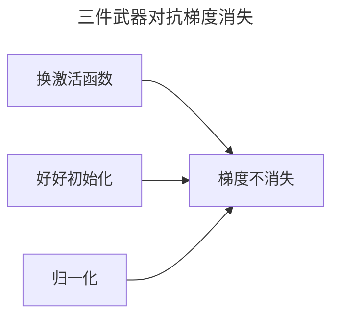

> 作者：轻松学AI
> 日期：2026-10-18
> 风格：通俗科普
> 状态：待发布

# 从零开始学深度学习 #04：梯度消失与梯度爆炸

## 一、先说清楚：这个问题为什么值得单开一篇

1990 年代，神经网络火过一轮，又迅速跌入寒冬。人们最直接的发现是：网络加深之后，不但没变强，反而**更难训练、甚至更差**。

当时的主流解释是"算力不够、数据不够"。但还有一个更隐蔽、也更致命的技术原因，藏在反向传播的数学里——**梯度消失**。它让"加深网络"这件事在很长一段时间里是条死路，直到 ReLU、好的初始化、归一化这几样东西陆续出现，才把这条路重新打通。

这一篇要拆的，就是梯度消失和它的反面梯度爆炸——它们本质是同一个数学机制的两个方向，理解了这一个机制，后面 #05 到 #09 那几篇"救梯度"的武器，你才看得懂它们在救什么。

## 二、直觉：一场传话游戏

回忆《从零开始学机器学习》里手推过的反向传播：误差从输出层出发，沿网络一层层往回传。每传一层，梯度就要乘以这一层的某个数。

想象一场传话游戏：第一个人说一句话，后面每个人把听到的话转述给下一个人。每传一次，信息就损失一点。传 30 个人之后，最后一个人听到的，已经和第一个人说的完全不是一回事了。

反向传播的梯度，就是这么一路"传话"回去的。每层都打个折扣，几十层下来，最前面几层收到的梯度，小到可以忽略——前面的层等于白搭了。

## 三、机制：梯度是怎么"乘"没的

直觉讲完，把数学摆出来，你会看到"连乘"这两个字到底意味着什么。

假设一个 L 层的网络，损失对第 1 层权重的梯度，按链式法则展开，是这么一长串连乘：

:::formula 梯度沿层的连乘
∂L/∂W₁ = ∂L/∂h_L · Π(l=2..L) ( W_l · σ'(z_l) )
L：总层数 ｜ W_l：第 l 层权重 ｜ σ'：激活函数导数 ｜ Π：连乘符号
:::

关键在中间那个连乘号 Π。每一项是"这一层的权重 × 激活函数导数"。深度网络的梯度，就是这个连乘的结果。

于是两件事就注定了：

- 每一项都**小于 1**，几十项乘下来，结果指数衰减 → **梯度消失**。
- 每一项都**大于 1**，几十项乘下来，结果指数膨胀 → **梯度爆炸**。

所以"消失"和"爆炸"不是两个问题，是同一个连乘公式的两个方向。它们的共同根子，是深层网络里信号在传递时**失控地衰减或放大**。

## 四、为什么 Sigmoid 特别容易消失

连乘公式里，每一项的"激活函数导数"是重灾区。而历史上最常用的 Sigmoid，导数天生就小。

Sigmoid 把任意输入压到 0 到 1 之间，它的导数最大只有 0.25：

:::formula Sigmoid 的导数上限
sigmoid'(x) ≤ 0.25
sigmoid'：导数 ｜ 对任何输入 x，导数值都不超过四分之一
:::

这 0.25 就是"每层乘的数"。一个 30 层的 Sigmoid 网络，梯度在最前面一层被连乘了 30 个 0.25：

:::formula 梯度消失的数学
0.25³⁰ ≈ 9 × 10⁻¹⁹
连乘 30 个 0.25，结果小到可以忽略不计
:::

更糟的是"饱和区"。Sigmoid 在输入很大或很小时，输出会贴平在 0 和 1 上，导数趋近于 0：

真实训练里，激活值经常掉进饱和区，于是那"每层乘的数"连 0.25 都不到，往往只有 0.01、0.001。消失得比理论上还快。

## 五、实验：前面几层形同虚设

光推导不够直观，跑一个真实网络看看。

配套仓库里搭了两个 20 层的全连接网络，唯一区别是激活函数：一个用 Sigmoid，一个用 ReLU。前向、反向各算一次，然后打印每一层权重的梯度范数——这个数代表"这一层到底学到了多少"。

实测数字很残酷：Sigmoid 网络**第一层的梯度范数是 1.7 × 10⁻¹⁸**，而输出端第 20 层是 11.7——差了整整 19 个数量级。最前面几层的梯度在数值上几乎就是 0，它们**根本没在学**，整个网络退化成只有最后几层在工作。

ReLU 这边得诚实说一句：这次实验里它第一层的梯度也是 0，原因是随机初始化下前几层的 ReLU 输入全是负数、被"置零"了——这是 ReLU 自己的新毛病（死神经元），下一篇 #05 专门讲。但 ReLU 正数区导数恒为 1，至少不会像 Sigmoid 那样每层固定打个 0.25 的折。这正是它后来取代 Sigmoid 的原因之一。

## 六、爆炸：另一个极端

消失的反面是爆炸。如果每层乘的数大于 1，比如权重初始化得太大，几十次连乘下来，梯度会指数膨胀：

表现就是损失值突然变成 NaN——数值溢出了，训练直接崩掉。

工程上对付爆炸，除了"好好初始化"（#06），还有一招**梯度裁剪**（gradient clipping）：一旦梯度的范数超过某个阈值，就把它整体等比缩小，硬性压回安全范围。这招在 RNN 里尤其常用，#15 讲 RNN 时会再碰到它。

## 七、一个常见误解：梯度消失 ≠ "学得慢"

很多人以为，梯度消失只是让网络"学得慢一点，多训几轮就好了"。

不是的。梯度消失的本质，是**前面几层的梯度趋近于 0**——不是"学得慢"，而是"根本没在学"。多训几轮没用，因为梯度永远是 0，参数根本不动。这就是为什么当年加深网络不是"变慢"，而是"变差"：前面的层是死的，网络退化成了只有最后几层在工作的浅网络。

## 八、解法藏在三个地方

好消息是，这个问题有救，而且救它的三样东西，就是接下来三篇的主角：

- **换激活函数**：ReLU 的导数在正数区恒为 1，不再有 0.25 的衰减。
- **好好初始化**：让每层"乘的那个数"一开始就接近 1，信号不衰减也不爆炸。
- **归一化**：在每层之间把信号"拉回"标准分布，从根上阻止它跑偏。

三样武器解决的是连乘公式里的三个不同环节——下一篇先讲第一样：激活函数。一个"正数原样过、负数归零"的简单函数，怎么就成了深度学习复兴的关键功臣。

- [《动手学深度学习》4.8 数值稳定性和模型初始化](https://zh.d2l.ai/chapter_multilayer-perceptrons/numerical-stability-and-init.html)
- [《深度学习》花书 第 8 章：深度模型中的优化](https://www.deeplearningbook.org/contents/optimization.html)
- [配套仓库 dl-from-scratch（training/gradient_flow.py）](https://github.com/Joneyao/dl-from-scratch)
