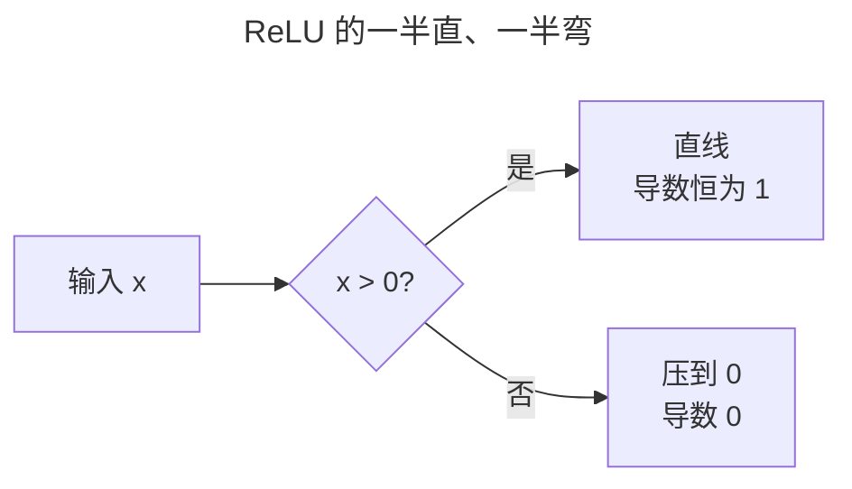
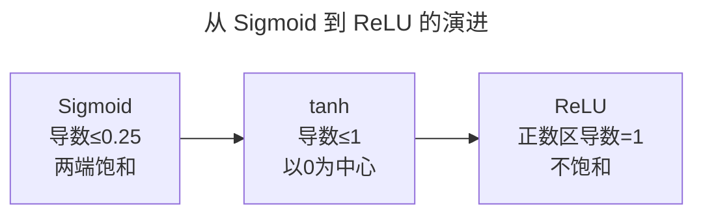
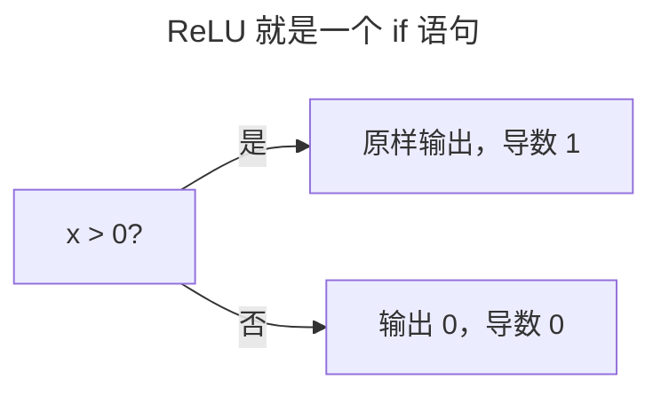
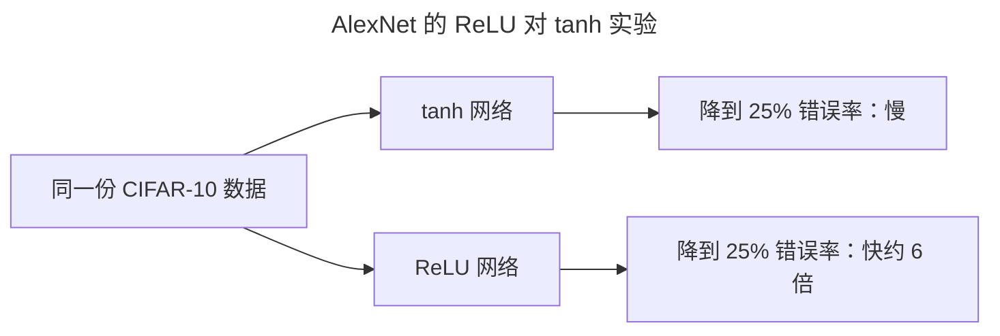
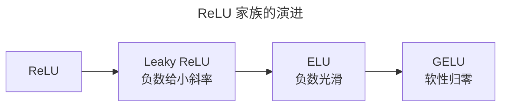
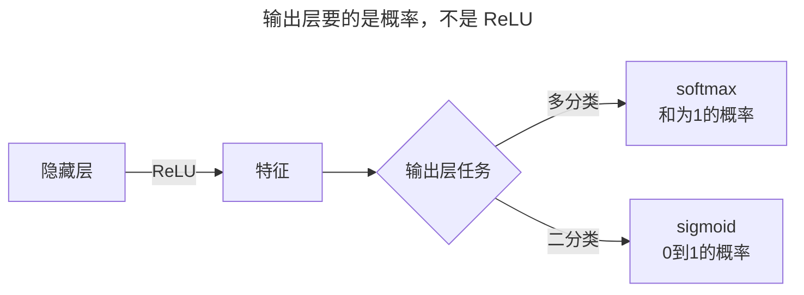
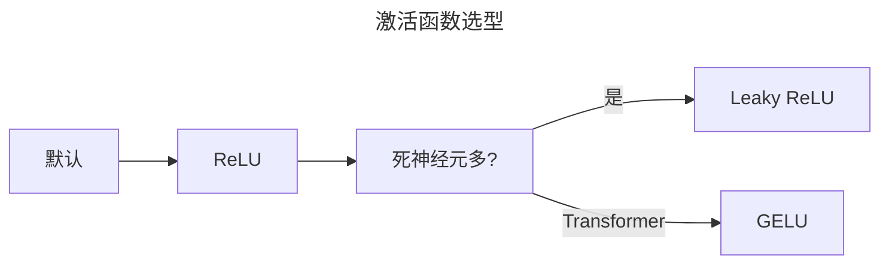

> 作者：轻松学AI
> 日期：2026-10-18
> 风格：通俗科普
> 状态：待发布

# 从零开始学深度学习 #05：激活函数

上一篇把梯度消失的账算清楚了：头号元凶是 Sigmoid 的导数太小，每层打个 0.25 的折扣，几十层连乘下来，梯度小到可以忽略。解法之一，就是换个激活函数。

这个"换"字背后，是一段从 Sigmoid 到 tanh 再到 ReLU 的演进史，也是一堆"非线性到底怎么加"的取舍。ReLU 凭什么成了默认选项、它什么时候会翻车，答案都藏在这里。

## 一、问题由来：非线性是从哪来的

没有激活函数，无论叠多少层 Linear，整个网络都还是一个线性变换。

回忆第一篇搭过的网络：`nn.Linear` 层做的事，是加权求和。把很多个 Linear 首尾相接、中间什么都不加——叠得再多，整个网络依然等价于一个 Linear。原因很硬：线性变换的复合还是线性变换，这是矩阵乘法决定的，没得商量。


可现实里的数据边界，大多是弯的。第一篇里那两条纠缠的螺旋，一条直线根本分不开，非得靠一层层 Tanh 叠出来的非线性，才能画出弯曲的分割线。激活函数就是深度网络能"深"下去的物理前提，缺了它，再深的网络也只是个线性模型。

## 二、核心直觉：一半直、一半弯的管子

把 ReLU 想象成一根管子：右半边笔直，信号进去多少出来多少，导数恒为 1，梯度像走高速一样畅通；左半边在零点拐了个急弯，一把压到 0，导数也是 0。



它聪明的地方在于——弯曲只发生在负数半边。深度网络最怕每层都给信号"打折"，几十层下来信号就没了。ReLU 让正数信号一层层原样穿过、不衰减，这才是它敢说自己"不饱和"的底气。


换个更土的说法：ReLU 就是个开关闸门，正数放行、负数关死。这个类比落到代码里，就是一行 if。

## 三、机制：Sigmoid → tanh → ReLU 的进化史

先看 Sigmoid 为什么必然消失。它的导数有个公式：σ'(x) = σ(x)·(1 − σ(x))。σ(x) 永远在 0 到 1 之间，两个小于 1 的数相乘，最大值就是 0.25，出现在 x = 0 那一点。为什么导数这么小？因为 Sigmoid 干的活，是把任意大的输入硬塞进 0 到 1 的窄缝里——输入跑到 ±3 以外，输出已经贴平在 0 或 1 上不动了，斜率自然趋近 0。这个"贴平"就是饱和：函数两端挤扁了，导数在饱和区直接归零。

tanh 是 Sigmoid 的亲兄弟，tanh(x) = 2σ(2x) − 1，形状一模一样，只是把输出从 [0,1] 平移到了 [−1,1]。它带来两个实打实的改进：一是输出以 0 为中心、正负对称，梯度回传时不会全朝一个方向偏；二是导数上限从 0.25 提到了 1。但 tanh 两端照样饱和——输入一大，导数还是归零。所以 tanh 只是症状减轻，病根没除。


左图是各函数形状，右图是导数。Sigmoid 的导数（红虚线区）最高点也只有 0.25，两侧迅速跌向 0；tanh 的导数峰值提到 1，但两端同样塌下去；只有 ReLU 的正数区是一条平直的 1。

ReLU 的思路不同——它绕开饱和区，压根不去改良饱和区。它不压缩正数，正数区就是恒等函数，导数恒为 1。梯度消失的公式里，每层要乘一个"小于 1 的数"；ReLU 让正数区这个乘数恰好等于 1，连乘项里就再也没有 0.25 这种东西了。几十层连乘下来，梯度还是原样。这才是它干掉梯度消失的根本原因。



代价也藏在这个公式里：负数区导数恒为 0，输出也是 0。一个神经元的输入如果永远是负的，它就永远不产生输出、也永远收不到梯度，权重从此一动不动——这就是死神经元。死得很安静：初始化得不好，或者学习率太大把权重冲飞，都可能让一批神经元集体躺平。

## 四、手写核心：一行 if 语句

ReLU 的全部定义，一行就写完：

```python
def relu(x):
    return x if x > 0 else 0   # 正数原样过，负数归零
```

这一行怎么读：对每个输入 x 问一句"大于 0 吗"，是就原样返回，不是就返回 0。实际工程里更常用向量化写法 `np.maximum(0, x)`，对一整批数据同时做这件事。



反向传播时，导数就是那句判断本身：x > 0 的地方导数等于 1，x ≤ 0 的地方等于 0。所以正数区梯度原样穿过，负数区梯度被清零。注意这个"清零"是双向的——前向输出是 0，反向梯度也是 0，两头都断了。

:::formula ReLU 的导数
relu'(x) = 1  (x > 0) ｜ 0  (x ≤ 0)
正数区导数恒为 1，梯度不再消失
:::

## 五、实验：25% 错误率，6 倍速度

2012 年 AlexNet 的论文做了一个直接对比：同一份 CIFAR-10 数据，一个网络用 tanh，一个用 ReLU。结果写得很硬：ReLU 网络把训练错误率降到 25%，比 tanh 快了约 6 倍。这个 6 倍是实打实的训练速度——达到同样的 25% 错误率，ReLU 需要的迭代次数是 tanh 的六分之一。



更直观的是上一篇的梯度实测：一个 20 层的 Sigmoid 网络，第一层梯度范数只有 1.7 × 10⁻¹⁸，输出端第 20 层是 11.7，差了整整 19 个数量级——前面几层形同虚设。换成 ReLU，正数区导数恒为 1，不再每层固定打 0.25 的折，前面的层终于学得动了。

## 六、边界与代价：死神经元和它的家族

ReLU 不是免费的。最大代价就是死神经元：负数区导数恒 0，一旦某个神经元的输入恒为负，它从此收不到梯度，变成一个永远输出 0 的僵尸，占着参数量却干不了活。

死神经元在高学习率下尤其常见——学习率太大，权重一步更新太猛，可能把一大批神经元的输入直接推到负数区，再也翻不了身。所以用 ReLU 时，学习率和初始化都得留神，别指望死掉的神经元能自己"活过来"。

为了救死神经元，人们给它续了条命：



- **Leaky ReLU**：负数区不再归零，给一个很小的斜率（比如 0.01），让死掉的神经元还能收到一丁点梯度。
- **ELU**：负数区输出一个光滑的负值，让输出均值更接近 0。
- **GELU**：现在 Transformer 里的标配，不粗暴地"负数归零"，而是按高斯分布的概率软性决定"过不过"，更平滑、更适合深层大模型。

这些改良各有取舍，但万变不离其宗：正数区保持导数接近 1，同时尽量减少负数区的死神经元。

## 七、常见误解：把 ReLU 铺到输出层

最容易搞错的一点，是以为 ReLU 这么好，就该一路用到输出层。

不行。ReLU 的输出是 [0, +∞)，一个没有上限的数，它天然不是概率。分类任务的输出层要的是概率分布：多分类用 softmax，把所有分数压成和为 1 的概率；二分类用 sigmoid，把分数压成 0 到 1 之间的概率。这些活 ReLU 干不了。



所以规则是：隐藏层默认 ReLU，输出层按任务换成 softmax 或 sigmoid。别因为 ReLU 是隐藏层默认，就把它一路铺到最后。

## 八、延伸：怎么选，以及下一篇的钩子

实战里的默认值很朴素：搭网络不知道用什么，先上 ReLU；发现大批神经元输出恒为 0（死掉了），换 Leaky ReLU；Transformer 这类现代架构，直接用 GELU。



但激活函数选对，只是救梯度的第一步。下一篇讲第二件武器：权重初始化。权重一开始取多大，直接决定信号第一轮前向会不会一头扎进饱和区、或者炸成 NaN——选对激活函数，还得配上对的初始值，网络才活得下去。

隐藏层默认 ReLU，分类输出层用 softmax/sigmoid，出现大量死神经元再换 Leaky ReLU。有一点是确定的：别再默认用 Sigmoid 当隐藏层激活了——它在深层网络里的饱和问题，已经被 ReLU 家族取代。

- [《动手学深度学习》4.1 多层感知机（激活函数）](https://zh.d2l.ai/chapter_multilayer-perceptrons/mlp.html)
- [《深度学习》花书 第 6 章：深度前馈网络](https://www.deeplearningbook.org/contents/mlp.html)
- [GELU 论文：Gaussian Error Linear Units](https://arxiv.org/abs/1606.08415)
- [AlexNet 论文：ImageNet Classification with Deep Convolutional Neural Networks](https://papers.nips.cc/paper/4824-imagenet-classification-with-deep-convolutional-neural-networks)
- [配套仓库 dl-from-scratch（training/activation.py）](https://github.com/Joneyao/dl-from-scratch)
