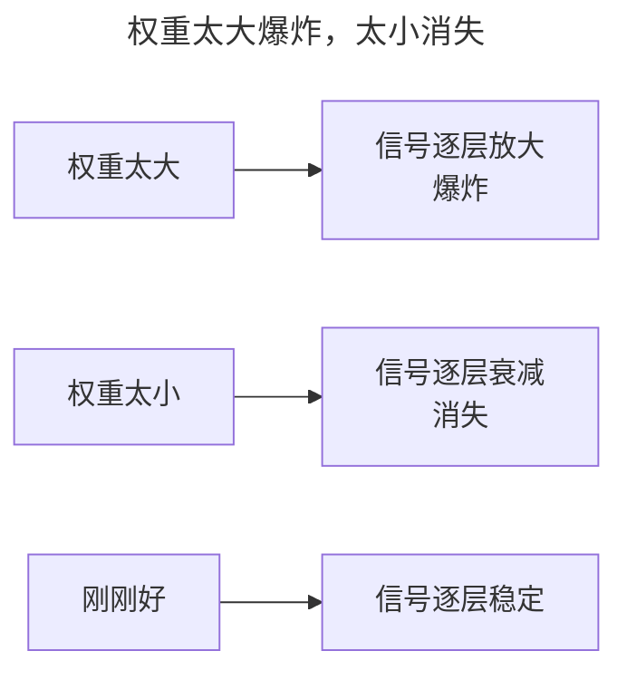

> 作者：轻松学AI
> 日期：2026-10-18
> 风格：通俗科普
> 状态：待发布

# 从零开始学深度学习 #06：权重初始化

训练一个深度网络，第一件事是给所有权重赋一个初始值。这件事看起来不起眼——随便给个随机数不就行了？

不行。权重一开始取多大，直接决定网络是能学还是直接报废。这一篇讲清楚为什么，以及两套经典的初始化方案：Xavier 和 He。

## 一、初始化的目标：让信号不衰减不爆炸

回忆 #04 的结论：深层网络的梯度是逐层连乘的，每层乘的那个数是"激活函数导数 × 权重"。

如果权重一开始取得太大，信号前向传播时越传越大，最后爆炸；取得太小，信号越传越小，最后消失。无论哪种，网络都训练不起来。

所以初始化的目标非常明确：**让信号在穿过每一层之后，方差保持不变**。不放大、不缩小，一路稳稳地传到最后一层。

## 二、一个朴素的想法，藏着大坑

最简单的做法是"标准正态分布"初始化——每个权重取一个均值为 0、方差为 1 的随机数。

听起来没问题？坑就藏在这里。一个神经元如果接收 n 个输入，它做的是 `w₁x₁ + w₂x₂ + … + wₙxₙ` 的加权求和。每个 `wx` 的方差都贡献一份，n 个加起来，输出的方差是输入的 n 倍。

所以一层 256 个输入，信号每过一层方差就放大 256 倍。几十层下来，爆炸得渣都不剩。

## 三、Xavier 与 He：把方差"配平"

解决思路是把初始化的方差，和"这一层有多少输入输出"挂上钩，让加权求和后的方差不变。两套经典方案由此而来：

:::formula Xavier / Glorot 初始化
方差 = 2 / (fan_in + fan_out)
fan_in：本层输入数 ｜ fan_out：本层输出数 ｜ 配合 Tanh / Sigmoid
:::

:::formula He / Kaiming 初始化
方差 = 2 / fan_in
fan_in：本层输入数 ｜ 专门配合 ReLU
:::

为什么 He 和 Xavier 不一样？因为 ReLU 会把一半的神经元"归零"，信号在正数区只剩一半在传。为了补偿这个"减半"，He 初始化把方差放大了一倍（用 `2/fan_in` 而不是 `1/fan_in`）。

## 四、做个实验：三种初始化的下场

跑一个 20 层的网络，对比三种初始化——默认、Xavier、He，然后打印每一层输出的标准差。

结果一目了然。默认初始化下，信号没几层就衰减到接近 0（对数刻度下直线坠落）；Xavier 好一些，但因为配的是 ReLU，还是慢慢衰减；只有 He 初始化，让信号从第一层到第 20 层都稳稳待在 1 附近。

这就是为什么现在 PyTorch 的 `nn.Linear` 默认就用 Kaiming（He）初始化——不是随便挑的，是这套方差分析算出来的最优解。

## 五、初始化是"发射前校准"

可以把初始化想成发射火箭前的校准：角度差一度，飞得越远偏得越多。权重初始化就是给训练"校准起点"——起点对了，梯度下降才有机会收敛；起点错了，再好的优化器也拉不回来。

到这儿，我们已经解决了梯度消失的两样武器：激活函数（ReLU 让导数不衰减）和初始化（让信号方差不变）。下一篇讲第三样：归一化。它不靠"一开始就设对"，而是在每一层之间实时地"拉一把"信号。

- [《动手学深度学习》4.8 数值稳定性和模型初始化](https://zh.d2l.ai/chapter_multilayer-perceptrons/numerical-stability-and-init.html)
- [He 初始化论文：Delving Deep into Rectifiers](https://arxiv.org/abs/1502.01852)
- [Xavier 初始化论文：Understanding the difficulty of training deep feedforward neural networks](http://proceedings.mlr.press/v9/glorot10a.html)
- [配套仓库 dl-from-scratch（training/init.py）](https://github.com/Joneyao/dl-from-scratch)
