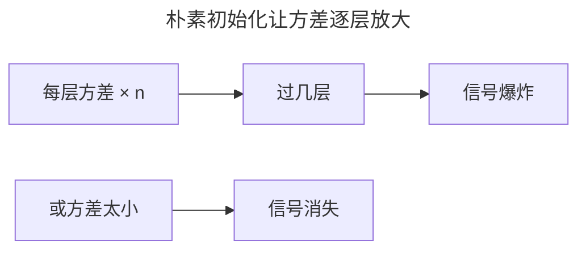
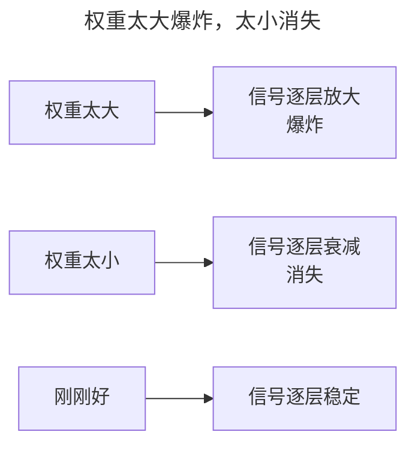
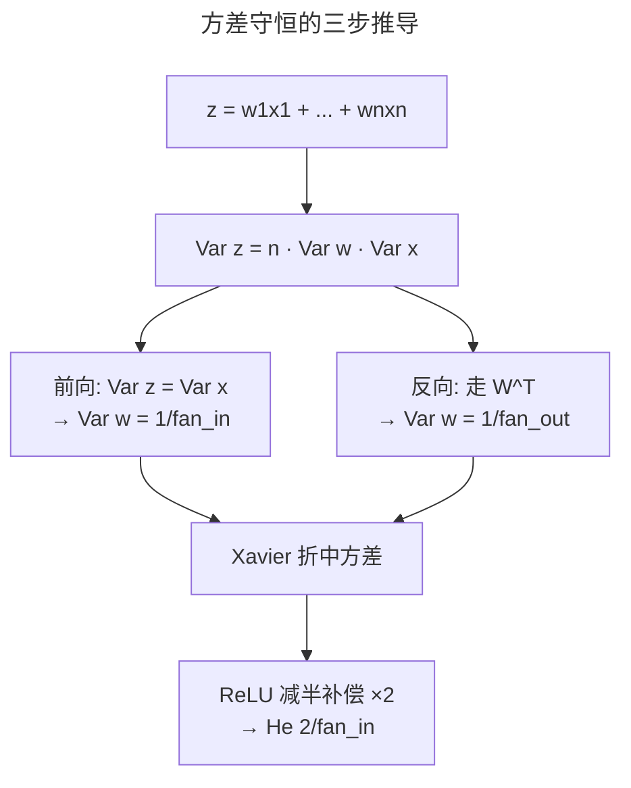
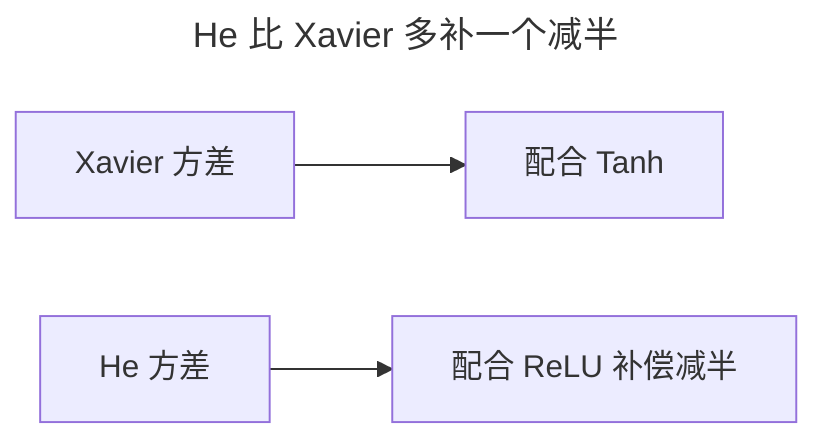
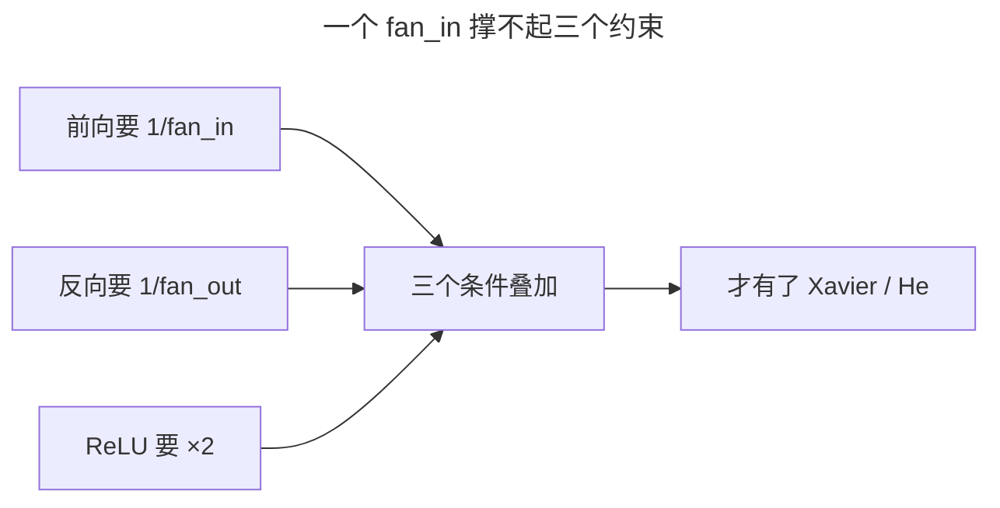
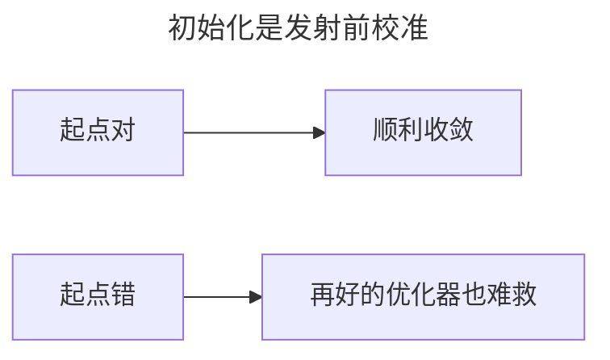

> 作者：轻松学AI
> 日期：2026-10-18
> 风格：通俗科普
> 状态：待发布

# 从零开始学深度学习 #06：权重初始化

训练一个深度网络，第一件事是给所有权重赋一个初始值。这件事看起来不起眼——随便给个随机数不就行了？

不行。权重一开始取多大，直接决定网络是能学还是直接报废。


这一篇讲清楚为什么，以及两套经典的初始化方案：Xavier 和 He。

## 一、问题由来：随手初始化为什么翻车

90 年代那轮神经网络寒冬，#04 讲过技术主因之一是梯度消失。但梯度消失的种子，往往在训练还没开始时就埋下了——埋在你给权重赋值的那一下。

当年的做法很糙：要么全初始化成 0，要么随便给一串小随机数，要么直接上标准正态。全 0 最坑：所有神经元算出同一个值、拿到同一份梯度，整个网络退化成一个神经元在反复复制。标准正态又太猛，方差取 1，n 个输入一加权，输出方差当场放大 n 倍。

结果就是，不加控制地加深网络，信号要么一路衰减到看不见，要么一路爆炸成 NaN，训练起不来。所以真正的问题只有一个：尺度到底取多大，才能让信号稳定地穿过每一层。



## 二、核心直觉：让方差"不增不减"

可以回到 #04 那张"传话"图：每一层都在把信号按某个倍数放大或缩小。初始化要做的，就是让这个倍数恰好是 1——信号穿过一层，方差既不涨也不掉。

再打个比方帮记忆：这就像发射火箭前的校准，角度差一度，飞得越远偏得越多。初始化就是给训练"校准起点"。



## 三、机制：一条方差公式推出两个方案

"让方差不变"听上去像句口号，其实它背后是一条能直接算出答案的式子。

拿一层线性变换来看，忽略偏置，就是 z = w₁x₁ + w₂x₂ + … + wₙxₙ。假设输入 x 的方差是 Var(x)，权重 w 的方差是 Var(w)，两者互相独立、均值都为 0。那么 z 的方差可以逐项拆开：

Var(z) = n · Var(w) · Var(x)

这条式子最关键：n 个输入的方差会线性叠加，每过一层就乘一个系数 n·Var(w)。标准正态里 Var(w)=1，一层 256 个输入，方差直接放大 256 倍，几十层下来爆炸得渣都不剩。

要让信号穿过去方差不变，也就是 Var(z) = Var(x)，就得让 n·Var(w) = 1，解出来 Var(w) = 1/n。这里的 n 就是这一层的输入数 fan_in。

但光看前向不够。反向传播时梯度走的是 W^T，等价地乘的是输出数 fan_out，反向要稳定就得 Var(w) = 1/fan_out。前向要 1/fan_in，反向要 1/fan_out，两边没法同时满足，Xavier 取了两者的调和平均：

:::formula Xavier / Glorot 初始化
方差 = 2 / (fan_in + fan_out)
fan_in：本层输入数 ｜ fan_out：本层输出数 ｜ 配合 Tanh / Sigmoid
:::

He 再往前多走一步：ReLU 会把负半边的输入直接清零，等于把信号方差砍掉一半。为了补回这一半，方差再乘 2，就从 1/fan_in 变成 2/fan_in：

:::formula He / Kaiming 初始化
方差 = 2 / fan_in
fan_in：本层输入数 ｜ 专门配合 ReLU
:::

你看，两个公式没有一条是拍脑袋定的，全是从"方差守恒"这一个要求一步步推出来的。



## 四、手写核心：把公式落成几行代码

上面两条公式，落到代码里其实就几行。下面这段分别实现 Xavier 和 He，用的是 PyTorch 的初始化接口：

```python
import math
import torch.nn as nn

def xavier_init(weight):
    # fan_in 是输入数，fan_out 是输出数
    fan_in, fan_out = nn.init._calculate_fan_in_and_fan_out(weight)
    std = math.sqrt(2.0 / (fan_in + fan_out))
    nn.init.normal_(weight, mean=0.0, std=std)

def he_init(weight):
    fan_in, _ = nn.init._calculate_fan_in_and_fan_out(weight)
    std = math.sqrt(2.0 / fan_in)
    nn.init.normal_(weight, mean=0.0, std=std)
```

`_calculate_fan_in_and_fan_out` 算出权重矩阵的两个维度，行是 fan_in、列是 fan_out。`sqrt(2/(fan_in+fan_out))` 就是 Xavier 的方差开根号——正态分布填的是标准差，所以方差要开方。`normal_` 按均值 0、标准差 std 就地填充权重。He 那一版只取 fan_in，把 `2/` 留在分子里，正是补 ReLU 减半的那一倍。两段代码唯一的差别，就藏在分母里那个 fan_out 上。



## 五、实验：三种初始化的下场

光推导不够直观，配套仓库搭了个 20 层全连接网络，分别用默认、Xavier、He 三种初始化，打印每一层输出的标准差。


结果很扎眼（配套仓库实测）：默认初始化下信号从 0.58 一路衰减到 0.04；Xavier 更糟——它按 tanh/sigmoid 设计，用在 ReLU 上补偿不足，20 层后跌到 0.001；只有 He，信号稳稳待在 1.4 附近，从第一层到第 20 层都不衰减。

这也是为什么现在 PyTorch 的 nn.Linear 默认就用 Kaiming（He）初始化——这套方差分析一路算出来的就是它。

## 六、边界与代价：初始化不是万能药

这几套公式都有前提假设，一旦不满足，结论就打折。Xavier 假设激活近似线性，配 ReLU 会补偿不足，上面实验里跌到 0.001 就是证据；反过来 He 配 tanh/sigmoid 又会补偿过头，方差略有盈余。

更深一层，公式只保证"方差"这个二阶量不变，管不住分布的形状和均值漂移。就算方差对了，ReLU 还是可能让大量神经元长期输出 0，掉进 #05 讲的死神经元。

真正的转折在 Batch Normalization 出现之后。BN 在每层之后把激活重新拉回标准分布，等于每一层都在实时"拉一把"信号，于是初始化尺度错一点也无所谓——网络对初始化的敏感度大幅下降，初始化从"必须算准"退化成"别离谱就行"。但 BN 也不是免费的：它依赖 batch 大小、训练和推理时行为不一致、还多一笔计算开销。所以在没有 BN 的老式深层网络、或者对初始化格外敏感的架构里，Xavier 和 He 依然是第一道防线。


## 七、常见误解：一个 fan_in 撑不起三个约束

最容易搞错的一点，是把"前向方差守恒"当成唯一目标，以为答案就是 Var(w) = 1/fan_in。其实那条推导只照顾了前向这一半：反向还有 fan_out 的约束，ReLU 还有砍半的约束。Xavier 和 He 之所以比 1/fan_in 复杂，正是因为要同时平衡前向、反向、激活函数这三个条件。只记住一个 fan_in，碰到 tanh 网络或极不对称的全连接层，照样会翻车。



## 八、延伸：管好起点，剩下的交给归一化

到这儿，救梯度的两样武器已经集齐：激活函数（ReLU 让导数不衰减）和初始化（让信号方差不变）。初始化管的是"起点"，像发射前校准——起点对了，梯度下降才走得下去；起点错了，再好的优化器也拉不回来。



下一篇讲第三样：归一化。它不靠"一开始就设对"，而是在每一层之间实时地把信号拉回正轨，正好补上初始化管不到的那段"路"。

- [《动手学深度学习》4.8 数值稳定性和模型初始化](https://zh.d2l.ai/chapter_multilayer-perceptrons/numerical-stability-and-init.html)
- [He 初始化论文：Delving Deep into Rectifiers](https://arxiv.org/abs/1502.01852)
- [Xavier 初始化论文：Understanding the difficulty of training deep feedforward neural networks](http://proceedings.mlr.press/v9/glorot10a.html)
- [配套仓库 dl-from-scratch（training/init.py）](https://github.com/Joneyao/dl-from-scratch)
