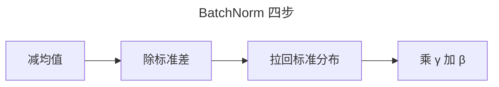
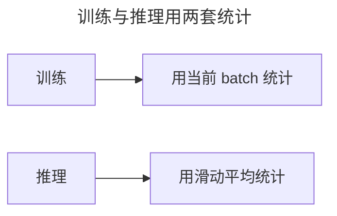
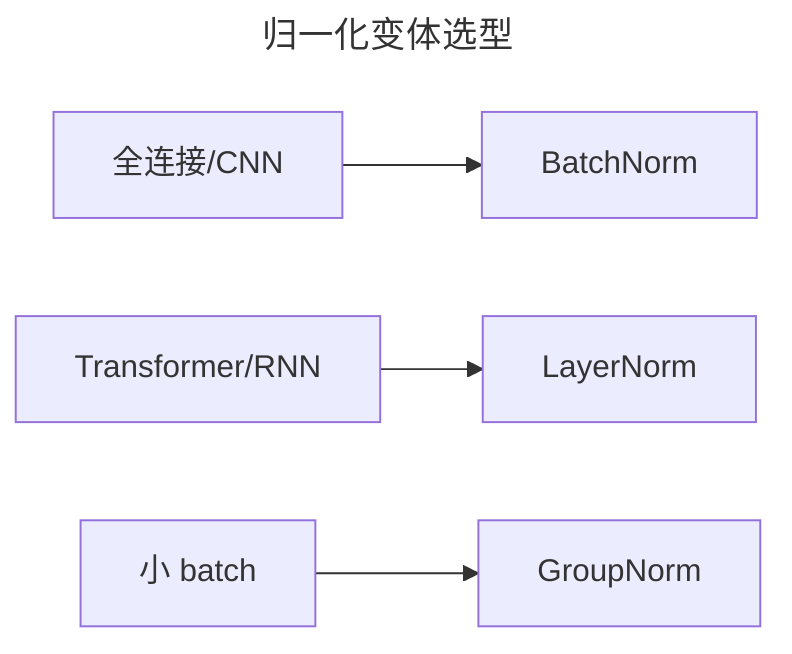

> 作者：轻松学AI
> 日期：2026-10-18
> 风格：通俗科普
> 状态：待发布

# 从零开始学深度学习 #07：归一化——BatchNorm 把信号拉回稳定区

前两篇讲了两样"防梯度消失"的武器：ReLU 激活函数、He 初始化。它们有个共同点——靠"一开始就设对"来稳住信号。

这一篇讲第三样，思路完全不同：不指望一开始设对，而是在网络每一层之间，**实时地把信号拉回标准分布**。


这就是归一化，代表作 BatchNorm。

## 一、问题：信号会在层间悄悄跑偏

即便初始化做对了，训练一跑起来，信号还是可能跑偏。

因为随着权重不断更新，每一层输出的分布会跟着变。前面一层的分布一变，后面一层的输入分布也跟着变，后面那层就得不断去"适应"新分布。这种连锁反应有个学名，叫"内部协变量偏移"。


结果是训练变慢、变不稳，学习率一大就崩。

## 二、BatchNorm：在层之间装"稳压器"

BatchNorm 的思路直白：不管上一层输出什么分布，我在这一层前面先做个标准化——减均值、除标准差，把它硬拉回"零均值、单位方差"。

手写一个 BatchNorm 的前向，其实就三步：




```python
mean = x.mean(axis=0)           # 1. 算 batch 均值
var  = x.var(axis=0)            # 2. 算 batch 方差
x_hat = (x - mean) / (var + eps) ** 0.5   # 3. 标准化
out = gamma * x_hat + beta      # 4. 再乘缩放加平移
```

最后一步很关键：标准化之后，还要乘一个可学习的 `gamma`、加一个可学习的 `beta`。为什么？因为强行拉回零均值单位方差，可能会丢掉网络的表达能力。`gamma` 和 `beta` 让网络能自己决定"拉回到什么程度"。

## 三、一个容易踩的坑：训练和推理不一样

BatchNorm 有个反直觉的地方：它在训练和推理时，行为是**两套**。

训练时，batch 里有一批样本，可以算这批样本自己的均值方差。但推理时


，可能一次只来一个样本，没有"批"可以算——这时就得用训练阶段攒下来的"滑动平均"（running mean / running var）来代替。

这也是为什么你会在很多模型加载报错里看到 "BatchNorm: expected more than 1 value per channel"——那是把训练和推理模式搞混了。

## 四、实验：加不加 BatchNorm，差别很大

搭两个同样的网络，一个加 BatchNorm，一个不加，喂同一份数据，看损失曲线。


加 BatchNorm 的网络，损失一路顺畅往下；不加的，收敛又慢又抖。这就是"稳压器"的作用——信号稳了，学习率可以调大，训练也快得多。

## 五、BatchNorm 之外还有谁

BatchNorm 在普通全连接和 CNN 里是标配，但它有局限：batch 太小（比如 batch=1）时，"批内统计"不稳定。于是有了别的变体：

- **LayerNorm**：不在 batch 维度归一化，而是在单个样本的特征维度归一化。Transformer 里用的就是它——因为 Transformer 的输入序列长短不一，LayerNorm 更稳。
- **GroupNorm**：把通道分组后组内归一化，小 batch 场景下比 BatchNorm 更稳。

选择原则一句话：全连接和 CNN 默认 BatchNorm，Transformer 和 RNN 用 LayerNorm。




到这里，防梯度消失的三件武器齐了：ReLU、He 初始化、归一化。下一篇换个角度，讲怎么让梯度下降"下坡下得更快"——优化器。

- [BatchNorm 论文：Batch Normalization](https://arxiv.org/abs/1502.03167)
- [《动手学深度学习》7.5 批量规范化](https://zh.d2l.ai/chapter_convolutional-modern/batch-norm.html)
- [LayerNorm 论文：Layer Normalization](https://arxiv.org/abs/1607.06450)
- [配套仓库 dl-from-scratch（training/normalization.py）](https://github.com/Joneyao/dl-from-scratch)
