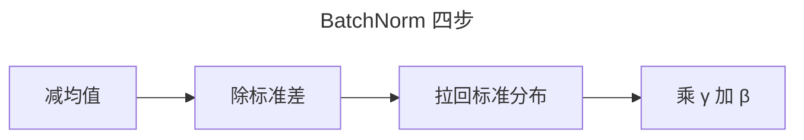
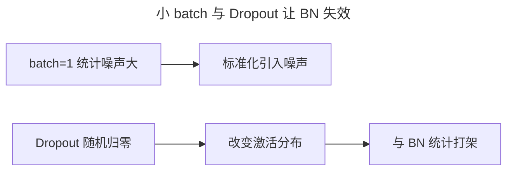
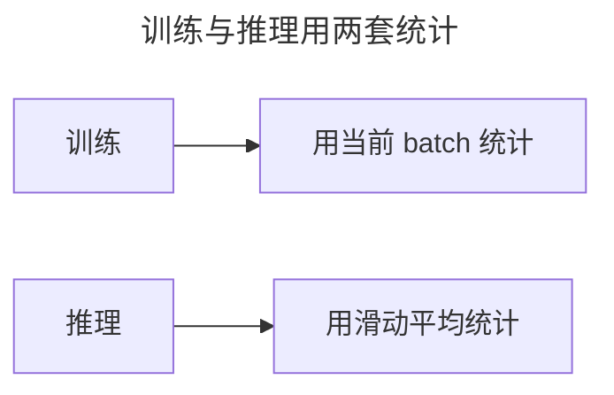
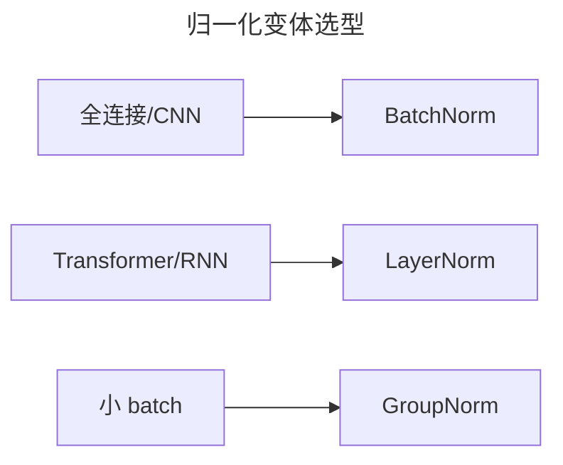

> 作者：轻松学AI
> 日期：2026-10-18
> 风格：通俗科普
> 状态：待发布

# 从零开始学深度学习 #07：归一化——BatchNorm 把信号拉回稳定区

前两篇讲了两样"防梯度消失"的武器：ReLU 激活函数、He 初始化。它们有个共同点——靠"一开始就设对"来稳住信号。

这一篇讲第三样，思路完全不同：不指望一开始设对，而是在网络每一层之间，实时地把信号拉回标准分布。


这就是归一化，代表作 BatchNorm。

## 一、问题由来：初始化对了，信号照样会跑偏

即便初始化做对了，训练一跑起来，信号还是可能跑偏。

原因不复杂：权重每更新一步，每一层输出的分布就跟着变一次。前面一层的分布一变，后面一层的输入分布也跟着变，后面那层就得不停地"适应"新分布。这个连锁反应有个学名，叫"内部协变量偏移"。不过这个解释后来受到质疑，有研究认为 BN 真正奏效更可能是让损失面变平滑——机制至今仍在讨论，这里先把它当成一个便于理解的直觉。

ReLU 和 He 初始化这两样武器，管的是"一开始"：起点对了，却管不住训练途中权重乱动带来的漂移。结果是训练变慢、变不稳，学习率稍微一大就崩。


## 二、核心直觉：在层之间装一台稳压器

把 BatchNorm 想成每层之间装的一台稳压器：进来的电压忽高忽低，稳压器把它稳住，再交给下一级。

对应到网络里，就是不管上一层输出什么分布，在这一层前面先做个标准化——减均值、除标准差，把它硬拉回"零均值、单位方差"。上一层怎么折腾，到了下一层门口，信号永远是差不多的形状。


## 三、机制：为什么"拉平分布"真的能救命

这一节只回答一个问题：为什么有效。答案分两层——尺度解耦、损失面平滑。

先说尺度解耦。假设某一层的权重整体放大了 5 倍，它输出的激活值也跟着放大 5 倍，下一层的输入尺度就变了，梯度也可能乱掉。但中间夹一个 BN，这 5 倍在"减均值、除标准差"里就被消掉了：均值被减掉，尺度被标准差除掉，下一层看到的分布几乎没变。也就是说，BN 让"前面层权重是放大还是缩小"这件事，对后面层几乎不再有影响，前面层可以放心更新，不会把后面层带沟里。

第二层是损失面平滑。后来有研究者专门验证过这件事（Santurkar 等人 2018 年的论文），核心结论是：BN 真正起作用的，是让损失函数的地形变平缓，内部协变量偏移这条解释则被否掉了。损失面越陡，沿某个方向迈一步，梯度变化就越剧烈，学习率稍微大一点就越过谷底、震荡甚至发散；损失面越平，梯度变化慢，就能迈更大的步子。BN 把每层输入固定在一个稳定尺度里，等于把损失对参数的敏感度压低了，梯度的大小和方向都更"温顺"，于是可以安全地用大得多的学习率。


## 四、手写核心 + 对照

手写一个 BatchNorm 前向，其实就四步：

```python
mean = x.mean(axis=0)           # 1. 算 batch 均值
var  = x.var(axis=0)            # 2. 算 batch 方差
x_hat = (x - mean) / (var + eps) ** 0.5   # 3. 标准化
out = gamma * x_hat + beta      # 4. 再乘缩放加平移
```

一行行拆：

- `x.mean(axis=0)`、`x.var(axis=0)`：沿 batch 维（axis=0）算，对"这一批样本"在每一个特征上分别取均值方差。
- 第三步减均值除标准差：把每个特征掰成"均值为 0、标准差为 1"。
- `eps` 是个极小常数（比如 1e-5），防止方差为 0 时除以 0。
- 第四步乘 `gamma` 加 `beta`：这是关键。强行拉回标准分布会丢掉表达能力——比如 Sigmoid 在均值 0 附近最敏感，把所有特征都压到 0 附近反而限制网络。`gamma`、`beta` 是可学习参数，让网络自己决定"拉回到什么程度"。



## 五、实验：加不加 BatchNorm，差别很大

搭两个同样的网络，一个加 BatchNorm 一个不加，喂同一份数据看损失曲线。


配套仓库实测：训练 800 轮后，加 BatchNorm 的损失降到 0.0003，不加的停在 0.0009，三倍差距。更明显的是稳定性——加 BN 的曲线一路顺畅往下，不加的又慢又抖。背后就是上一节说的损失面变平滑：学习率能调大，步子迈得开，收敛自然快。

## 六、边界与代价：它不是万能药

BatchNorm 好用，但有几个场景它反而添乱。

第一，小 batch 直接失效。BN 靠"这一批样本"的均值方差做标准化，batch 一大统计才靠谱。batch=1 或 batch=2 时，就一两个样本，算出来的均值方差噪声极大，标准化本身就在引入噪声，训练反而不稳。显存不够只能塞小 batch 的场景，别硬上 BN，换 GroupNorm 或 LayerNorm。

第二，和 Dropout 打架。Dropout 每次随机把一部分神经元归零，会改变激活分布；BN 又依赖对激活分布做统计。两者叠在相邻层，训练时 BN 学到的统计和推理时 Dropout 关闭后的分布对不上，方差估计出现系统性偏差，精度反而掉。一般做法是别在同一层挨着用。

第三，它也有代价。每层 forward 都要多算一遍 batch 统计，还要维护 running mean、running var 两套状态，训练和推理逻辑不一致，工程上就多一处要小心的地方——下一节的报错就是这么来的。



## 七、一个最容易踩的坑：训练和推理是两套

BN 最反直觉的地方，是它在训练和推理时行为完全两套。

训练时，batch 里有几十上百个样本，直接用这批样本自己的均值方差。推理时可能一次只来一个样本，没有"批"可算，必须用训练阶段攒下来的"滑动平均"（running mean / running var）代替。

很多人栽在模式切换上：该切 eval 没切，或者反过来。于是你会看到经典报错 "BatchNorm: expected more than 1 value per channel"——这是把推理当训练跑，又只喂了一个样本，batch 统计算不出来。记住一句：训练用 batch 统计，推理用滑动平均，别混。



## 八、延伸：还有谁，以及下一步

BatchNorm 在全连接和 CNN 里是标配，但小 batch 的局限催生了别的变体：

- **LayerNorm**：不在 batch 维度归一化，而在单个样本的特征维度归一化。Transformer 里用的就是它，因为序列长短不一，LayerNorm 更稳。
- **GroupNorm**：把通道分组后组内归一化，小 batch 场景下比 BatchNorm 更稳。

一句话选型：全连接和 CNN 默认 BatchNorm，Transformer 和 RNN 用 LayerNorm。



到这里，防梯度消失的三件武器齐了：ReLU、He 初始化、归一化。下一篇换个角度，讲怎么让梯度下降"下坡下得更快"——优化器。

- [BatchNorm 论文：Batch Normalization](https://arxiv.org/abs/1502.03167)
- [How Does Batch Normalization Help Optimization?](https://arxiv.org/abs/1805.11604)
- [《动手学深度学习》7.5 批量规范化](https://zh.d2l.ai/chapter_convolutional-modern/batch-norm.html)
- [LayerNorm 论文：Layer Normalization](https://arxiv.org/abs/1607.06450)
- [配套仓库 dl-from-scratch（training/normalization.py）](https://github.com/Joneyao/dl-from-scratch)
