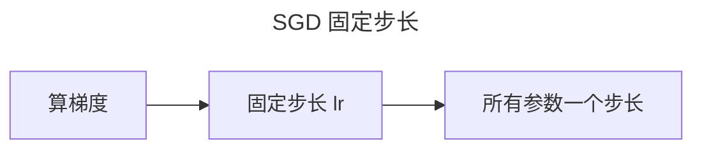
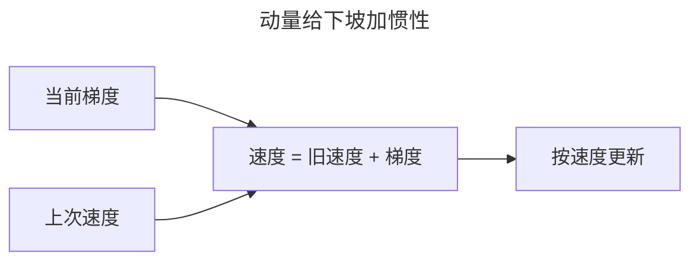
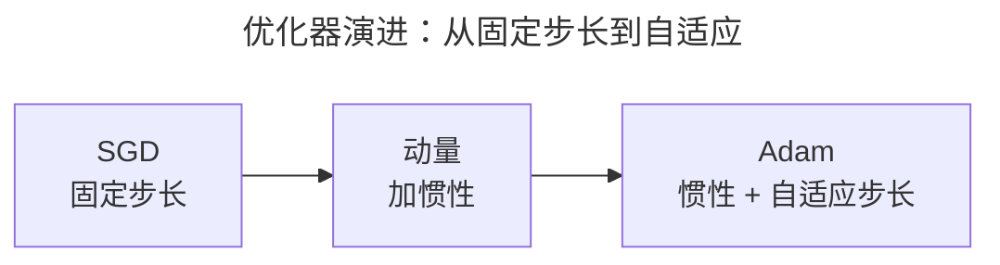
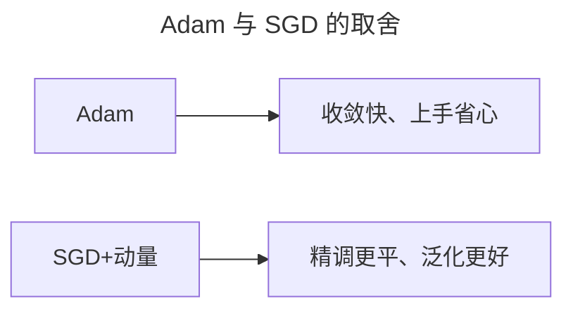
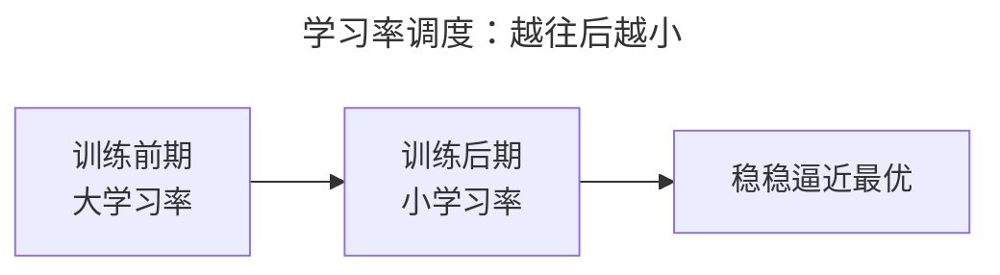

> 作者：轻松学AI
> 日期：2026-10-18
> 风格：通俗科普
> 状态：待发布

# 从零开始学深度学习 #08：优化器——从 SGD 到 Adam

前面几篇都在解决"让网络学得动"——激活函数、初始化、归一化，都是在稳信号、防梯度消失。

这一篇讲"学得快不快"。梯度算出来了，该沿着什么方向、迈多大步去更新参数？这就是优化器的活。


## 一、SGD：最朴素的走法

优化器里最古老、最简单的，就是随机梯度下降（SGD）。它的更新规则一句话：

```python
w = w - lr * grad
```

沿着梯度（损失下降最快的方向）的反方向，迈一个固定大小的步子，步长就是学习率 `lr`。

SGD 能用，但有两个毛病。第一，它对所有参数用同一个学习率，


可不同参数的"地形"不一样。第二，它只盯着当前这一步的梯度，遇到坑坑洼洼的损失曲面，容易来回震荡。

## 二、动量：给下坡加"惯性"

第一个改良是动量（Momentum）。想法很形象：给下坡的小球加惯性，


让它不只是被当前梯度推着走，还带着上一次的速度往前冲。

```python
v = momentum * v + grad   # 累积速度
w = w - lr * v            # 按速度更新
```

好处很明显：在山谷里震荡时，惯性能帮它冲过小坑；在平坦地带，惯性能让它持续前进而不至于停下。

## 三、Adam：给每个参数"私人定制"步长

再进一步，是现在最常用的 Adam。它把两个想法合在一起：动量（记住方向）+ 自适应步长（每个参数单独调步长）。



自适应步长的核心：观察每个参数的梯度历史。如果某个参数一直在大幅震荡，就把它的步长调小；如果一直很平稳，就把步长调大。相当于每个参数都有一个"私人订制"的学习率。

Adam 的一个关键细节是"偏差修正"：刚开始训练时，动量和方差的估计都偏向 0，Adam 会做个修正，让前几步的更新不至于太小。

## 四、实验：病态函数上的三种走法

拿一个"病态"的二次函数做实验——它在 x 方向很陡、y 方向很平缓。这种地形最考验优化器：SGD 在一个方向上震荡、另一个方向上龟速，而 Adam 能两全。


左图是参数在二维平面上的移动轨迹，右图是损失下降。SGD 绕了一大圈才逼近最优点，Adam 几乎直捣黄龙。这就是为什么现在训练深度网络，十有八九默认 Adam。

## 五、Adam 也不是万能

讲到这里得说句公道话：Adam 不是"永远更好"。

它收敛快、上手省心，适合大多数场景。但在某些需要"精确收敛到最后"的任务里


（尤其是一些老派的计算机视觉训练），SGD + 动量 + 精心调的学习率，反而能找到更"平"、泛化更好的最优点。Adam 有时候会"过早停在一个不够好的点"。

所以实战里没有标准答案。一个实用的默认：**先上 Adam，快速把模型训到能用；如果发现卡在精度瓶颈，再试 SGD + 动量细调。**

## 六、别忘了学习率调度

最后补一个常被忽略的点：学习率不该从头到尾一成不变。

训练后期，参数已经接近最优，如果还迈大步，容易在最优附近来回跳、过不去。


所以通常要"学习率调度"——训练越往后，学习率越小。常见做法有阶梯式衰减、余弦退火等。

优化器 + 学习率调度，合起来决定了"下山"的效率和最终能到多低。下一篇讲最后一个训练地基的话题：正则化，也就是怎么防止网络"背答案"。

- [Adam 论文：Adam: A Method for Stochastic Optimization](https://arxiv.org/abs/1412.6980)
- [《动手学深度学习》11 优化算法](https://zh.d2l.ai/chapter_optimization/index.html)
- [《深度学习》花书 第 8 章：深度模型中的优化](https://www.deeplearningbook.org/contents/optimization.html)
- [配套仓库 dl-from-scratch（training/optimizer.py）](https://github.com/Joneyao/dl-from-scratch)
