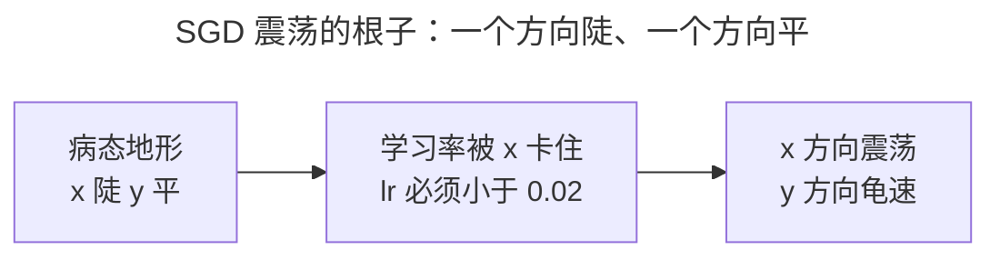
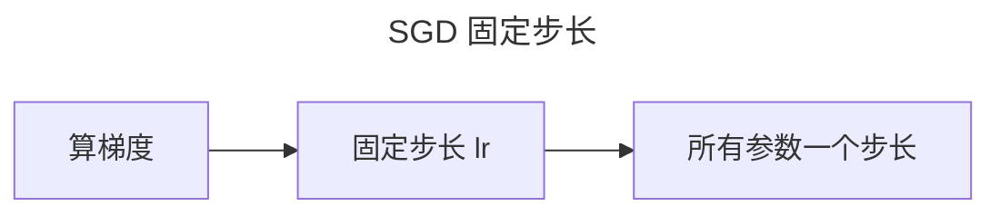
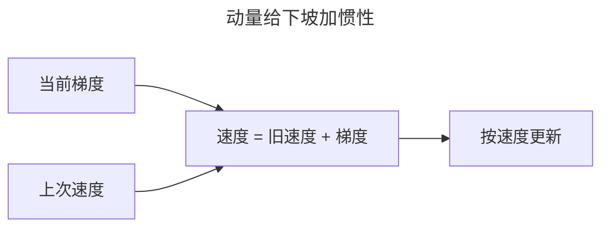
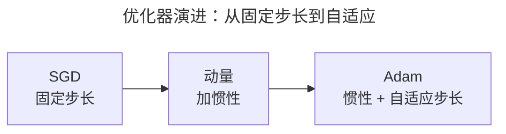
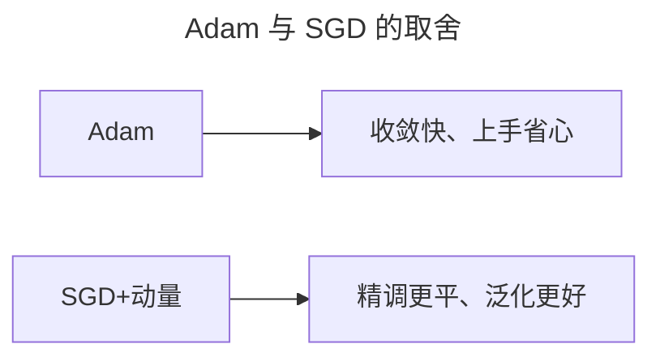
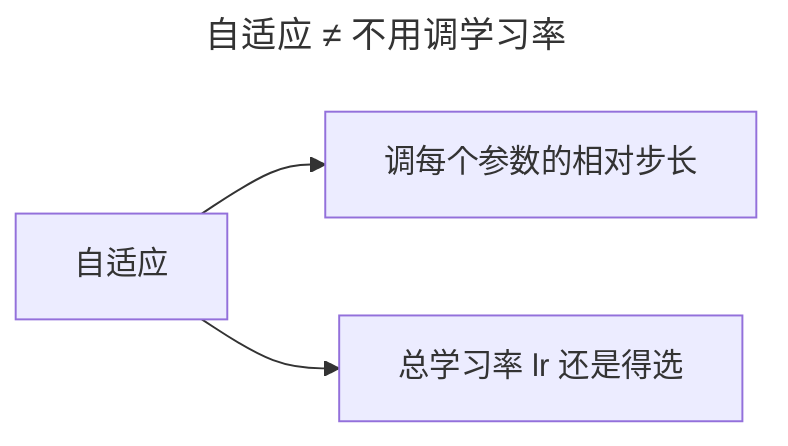
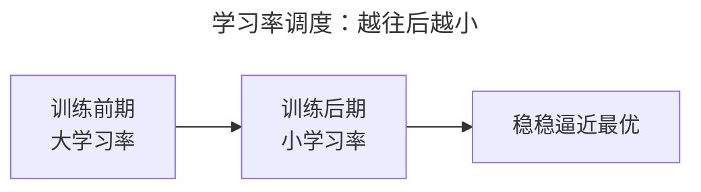

> 作者：轻松学AI
> 日期：2026-10-18
> 风格：通俗科普
> 状态：待发布

# 从零开始学深度学习 #08：优化器——从 SGD 到 Adam

## 一、先说清楚：优化器在解决什么问题

前面几篇在解决"让网络学得动"——激活函数、初始化、归一化，都是在稳信号、防梯度消失。现在换个前提：假设梯度能稳定地算出来，剩下的问题就变成"拿到了梯度，该沿着它迈多大一步"。

最原始的做法是梯度下降（GD）：每一步用**全部**数据算一次梯度，再更新参数。数据一大，这一步算得太贵，跑一轮要等半天，根本没法用。于是有了随机梯度下降（SGD）：每次随机抓一小批样本估一个梯度就更新。快是快了，代价是这个梯度是"估"出来的，带噪声——在坑坑洼洼的损失曲面上，它常常来回震荡、走不动。

"优化器"这个词，统称的就是"拿到梯度之后，怎么把它变成一次参数更新"的那套策略。往下拆三层：SGD 的震荡、动量的惯性、Adam 的自适应。


## 二、直觉：蒙着眼下山

优化这件事，可以想象成蒙着眼下山。


你只能靠脚底感受坡度，每迈一步都往当前最陡的方向走。这个"最陡的方向"就是负梯度方向；迈多大的步子，就是学习率。蒙着眼的问题在于：你看不到山的全貌，只能走一步看一步——步子迈大了会冲过谷底，迈小了又爬得慢。后面讲的动量、自适应，其实都是在给这个"瞎子"加一点方向感和节奏感，让他别在同一个坑里反复横跳。

## 三、机制：震荡、惯性、自适应，各自的数学

先看 SGD 的震荡到底怎么来的。假设损失是一个"病态"的二次函数 L = ½(100x² + y²)：x 方向曲率 100，很陡；y 方向曲率 1，很平。梯度下降在 x 方向的更新是 x ← x − lr·100x，要收敛必须 lr < 2/100 = 0.02，否则 x 直接发散。于是学习率被最陡的方向死死卡在 0.02 以下。可 y 方向呢？y ← y − lr·y，每次只挪 lr 那么一点，lr 一压小，y 方向就蜗牛爬。一个方向在震荡、另一个方向在龟速，这就是 SGD 在病态地形上的死结。

动量（Momentum）的想法很形象：给下坡的小球加惯性，让它不光被当前梯度推着走，还带着上一次的速度往前冲。翻译成数学，更新式 v = βv + g 是个指数加权平均：把 v 展开就是 v = g_t + βg_{t−1} + β²g_{t−2} + …。梯度一直同号的方向（比如 y 方向），这些项同向累加，等效步长被放大到 lr/(1−β)，β=0.9 时就是 10 倍；梯度来回变号的方向（x 方向），正负项互相抵消，被"平均掉"了。一句话：动量在一致的方向上放大、在震荡的方向上压低，正好治了上面的死结。

Adam 再进一步，给每个参数单独记两个数：一阶矩 m 是梯度的移动平均，二阶矩 v 是梯度**平方**的移动平均，更新时步长写成 lr·m/(√v+ε)。v 衡量的是"这个参数历史波动的幅度"：一直大幅震荡的参数 √v 大，步长自动被压小；一直平稳的参数 √v 小，步长自动放大。这等于把"x 陡 y 平"这类量级差异直接归一化掉，不用你再为每个方向单独调学习率。



## 四、手写核心：这几行代码在干嘛

最朴素的 SGD，一行：

```python
w = w - lr * grad
```

`grad` 是这一小批样本估出来的梯度，`lr` 是学习率，`w` 沿负梯度方向挪 `lr` 那么远。毛病就出在"所有参数共用同一个 `lr`、而且只看当前这一批"。



动量加一个速度 `v`，把方向记下来：

```python
v = momentum * v + grad   # 累积速度：旧速度 × momentum + 当前梯度
w = w - lr * v            # 按累积后的速度更新，而不是裸梯度
```

`momentum`（常用 0.9）决定旧速度保留多少。第一行就是上面说的指数加权平均；第二行用平滑后的方向更新，冲过小坑、持续前进。



Adam 是动量和自适应的叠加：

```python
m = b1 * m + (1 - b1) * grad           # 一阶矩：梯度的移动平均
v = b2 * v + (1 - b2) * grad**2       # 二阶矩：梯度平方的移动平均
m_hat = m / (1 - b1**t)                # 偏差修正：t 小时把 m 拉回正常量级
v_hat = v / (1 - b2**t)
w = w - lr * m_hat / (sqrt(v_hat) + eps)   # 每个参数单独缩放步长
```

`b1=0.9`、`b2=0.999`、`eps=1e-8` 是论文给的经验值，几乎不用动。前两行是"记方向 + 记波动"，最后一行 `sqrt(v_hat)` 在分母，就是"波动大的参数走小步"。



## 五、实验：病态函数上的三种走法

拿刚才那个病态函数 L = 100x² + y² 实测（配套仓库 `training/optimizer.py` 里的 `make_quadratic(100, 1)`），起点取 (10, 10)，目标是损失降到 1e-3 以下。实测数字如下：

- SGD：x 方向太陡，学习率被卡在 0.01 以下，取 lr=0.005，要 **573 步**才达标——几乎每一步都在陡坡上左右横跳，y 方向只能一点一点蹭。
- 动量：lr=0.01、β=0.9，**105 步**达标，快了约 5 倍。
- Adam：lr=0.5，**82 步**达标，而且 lr 从 0.1 换到 0.5 都能收敛——对学习率远没有 SGD 那么娇气。


左图是参数在二维平面上的移动轨迹，右图是损失下降。SGD 绕了一大圈才逼近最优点，Adam 几乎直捣黄龙。这就是为什么现在训练深度网络，十有八九默认 Adam。

## 六、Adam 的代价：它不总是赢

讲到这里得说句公道话：Adam 不是"永远更好"。

它收敛快、上手省心，代价藏在泛化里。Wilson 等人 2017 年的论文《The Marginal Value of Adaptive Gradient Methods in Machine Learning》在 CIFAR-10 上做过对比：Adam 在训练集上收敛更快，但最终的**测试**误差高于 SGD（带动量）。原因是自适应方法更容易停在"锐利"的极小点，SGD 找到的极小点更"平"——平的点对参数扰动不敏感，换个测试集不容易崩，泛化就更好。

另一个代价更隐蔽：Adam 每一步的步长被 √v 限制在一个量级里，它不会像 SGD 那样靠学习率调度把步长真正压到很小，所以"精确收敛到最后"这件事上它常常力不从心，停在离最优差一点的地方。



所以实战里没有标准答案。一个实用的默认：**先上 Adam，快速把模型训到能用；卡在精度瓶颈，再换 SGD + 动量细调。**

## 七、一个最常见的误解：Adam 自适应 = 不用管学习率

很多人以为 Adam 里的"自适应"就是"学习率自动调好了，不用管"。真不是。

自适应调整的是**每个参数的相对步长**——波动大的走小步、平稳的走大步，不是把 `lr` 这个总开关替你包办了。默认的 lr=1e-3 换个任务、换个 batch size，常常照样要调，调错了一样训不动。Adam 省的是"为几十万个参数逐个调步长"的力气，没省"选一个合适的学习率"这件事。



## 八、延伸：学习率调度、AdamW，以及下一篇

学习率不该从头到尾一成不变。训练后期参数已经接近最优，还迈大步，就容易在最优附近来回跳、过不去。所以通常要"学习率调度"——训练越往后，学习率越小，常见做法有阶梯式衰减、余弦退火。



顺带提一嘴 AdamW：它把"权重衰减"从 L2 正则里拆出来单独做，是 Adam 的正统改良，现在训练大模型基本默认用它。优化器 + 学习率调度，合起来决定了"下山"的效率和最终能到多低。下一篇讲最后一个训练地基的话题：正则化，也就是怎么防止网络"背答案"。

- [Adam 论文：Adam: A Method for Stochastic Optimization](https://arxiv.org/abs/1412.6980)
- [Wilson 2017：The Marginal Value of Adaptive Gradient Methods in Machine Learning](https://arxiv.org/abs/1705.08292)
- [《动手学深度学习》11 优化算法](https://zh.d2l.ai/chapter_optimization/index.html)
- [《深度学习》花书 第 8 章：深度模型中的优化](https://www.deeplearningbook.org/contents/optimization.html)
- [配套仓库 dl-from-scratch（training/optimizer.py）](https://github.com/Joneyao/dl-from-scratch)
