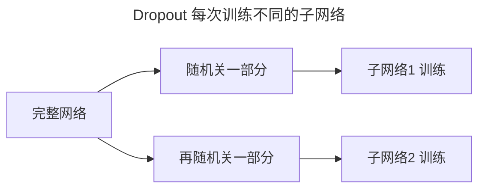
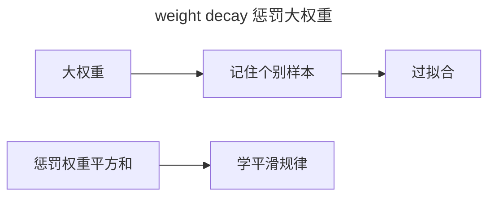
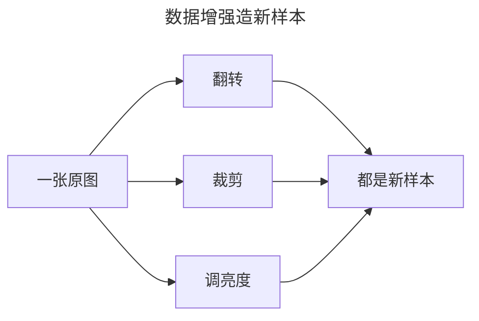
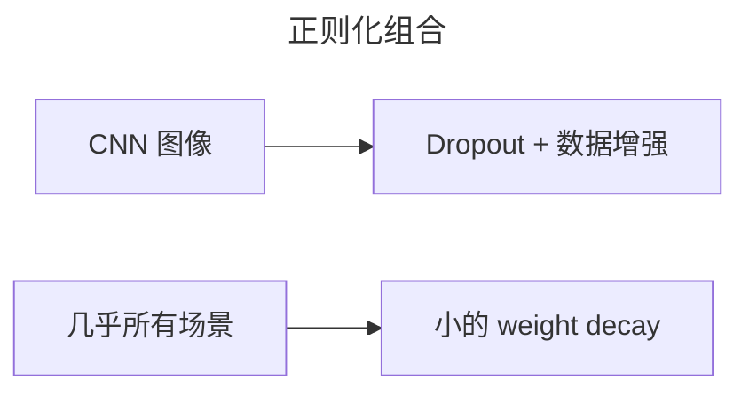

> 作者：轻松学AI
> 日期：2026-10-18
> 风格：通俗科普
> 状态：待发布

# 从零开始学深度学习 #09：正则化——防止网络"背答案"

这是"训练地基"的最后一篇。前面解决了"学得动"（防梯度消失）和"学得快"（优化器），这一篇解决"学得好"——怎么防止网络过拟合。

过拟合你在《从零开始学机器学习》里见过：模型在训练集上表现完美，换个新数据就崩。深度网络的过拟合更凶，因为它参数动辄百万千万，天生有"背下整个训练集"的能力。


## 一、先看清楚过拟合长什么样

用老办法做个实验：拿一个三次多项式当真实规律，用不同阶数的多项式去拟合。


横轴是多项式阶数。阶数越高，训练误差越低（蓝线一路往下），但测试误差（红线）过了某个点就开始抬头——这就是过拟合：模型把训练数据里的噪声也"背"下来了。

对付它的武器，主要有三样：Dropout、weight decay、数据增强。

## 二、Dropout：随机关掉一半神经元

Dropout 的想法简单粗暴：训练时，每一轮随机关掉一部分神经元（把它们输出置 0），让它们"这轮不参与"。

```python
mask = (random > p) / (1 - p)   # 随机保留一部分，并放大补偿
out = x * mask
```

为什么要除以 `1 - p`？因为关掉一半神经元后，输出总和变小了，要放大补偿回来，让"开了的神经元"平均贡献不变。

它为什么有效？直觉很妙：每次随机关一部分，等于每次都在训练一个**不同的子网络**。训到最后，相当于成千上万个子网络在"投票"。一个网络背下了答案，但换个随机组合就露馅了，所以整体上很难过拟合。



注意，Dropout 只在训练时开，推理时关——推理要用完整网络。

## 三、weight decay：惩罚"大权重"

第二样是 weight decay，也叫 L2 正则化。思路是：在损失函数里加一项，惩罚权重的平方和。

:::formula weight decay 的损失
loss = 原始损失 + λ · Σ w²
λ：正则强度 ｜ Σw²：所有权重平方和
:::

为什么要惩罚大权重？因为"背答案"的网络，往往依赖某些极端大的权重去记住特定样本。


让权重普遍小一点，网络就倾向于学"平滑、普适"的规律，而不是记住个别特例。

## 四、数据增强：造更多"新样本"

第三样最直观：数据不够，就"造"数据。

对图像来说，同一张猫的照片，翻转一下、裁一角、调调亮度、加点点噪声——本质还是那只猫，


但对网络来说就是全新的训练样本。这些变体强迫网络学会"猫"的本质特征（有耳朵、有胡须），而不是记住某张特定图片的像素。

数据增强直接扩大有效数据量，但并非零成本——每次前向都要实时做翻转、裁剪，训练时间明显变长；而且增强过头会出问题，比如 MNIST 把 6 旋转成 9，就把标签也破坏了。

## 五、实战怎么组合

三样武器不是二选一，实战里通常一起上：




- CNN 图像任务：Dropout（加在全连接层）+ 数据增强（翻转/裁剪）是标配。
- 几乎所有场景：weight decay 默认开一个小的 λ（比如 1e-4）。
- 数据量很小、怕过拟合：优先数据增强，再叠 Dropout。

到这里，"训练地基"这一批六篇（#04 到 #09）就全部讲完了。我们解决了深度网络训练的三大难题：学得动、学得快、学得好。

从下一篇开始，正式进入深度学习最经典的应用架构——卷积神经网络 CNN。前面这几篇的每一件武器，都会在那里反复派上用场。

- [Dropout 论文：Dropout: A Simple Way to Prevent Neural Networks from Overfitting](https://jmlr.org/papers/v15/srivastava14a.html)
- [《动手学深度学习》4.6 暂退法（Dropout）](https://zh.d2l.ai/chapter_multilayer-perceptrons/dropout.html)
- [《深度学习》花书 第 7 章：正则化](https://www.deeplearningbook.org/contents/regularization.html)
- [配套仓库 dl-from-scratch（training/regularization.py）](https://github.com/Joneyao/dl-from-scratch)
