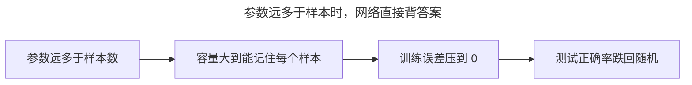
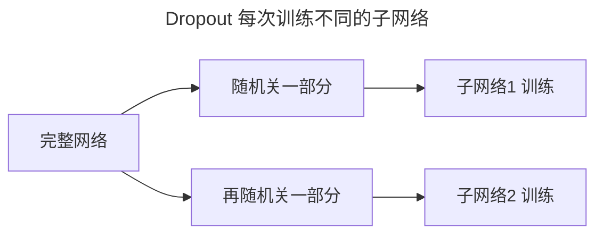
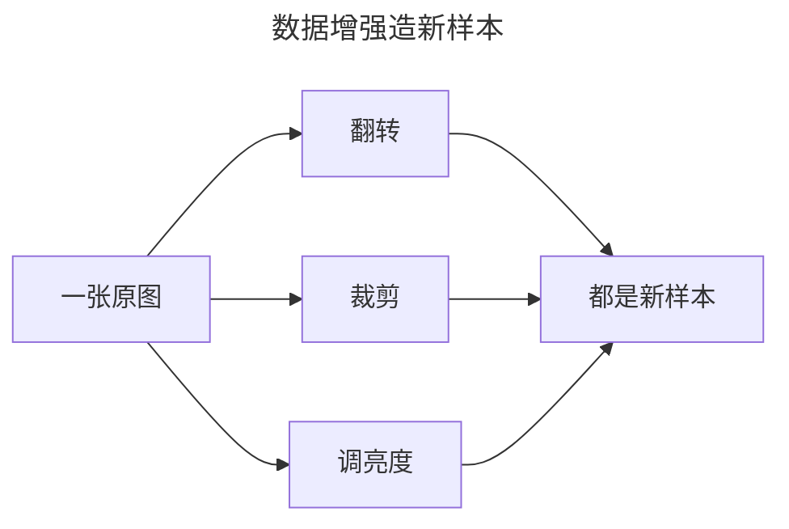
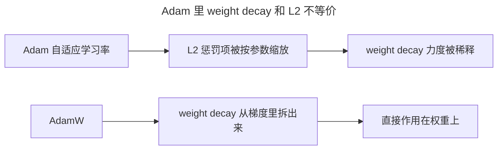
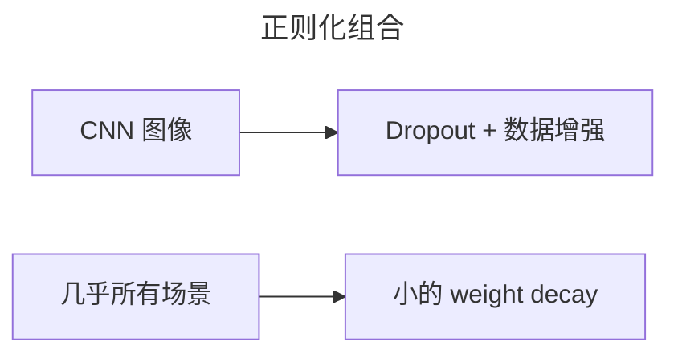

> 作者：轻松学AI
> 日期：2026-10-18
> 风格：通俗科普
> 状态：待发布

# 从零开始学深度学习 #09：正则化——防止网络"背答案"

这是"训练地基"的最后一篇。前面解决了"学得动"（防梯度消失）和"学得快"（优化器），这一篇解决"学得好"——怎么防止网络过拟合。

## 一、为什么深度网络特别容易"背答案"

过拟合你在《从零开始学机器学习》里见过：模型在训练集上表现完美，换个新数据就崩。深度网络的过拟合更凶，因为它参数动辄百万千万，天生有"背下整个训练集"的能力。

这个"凶"到底有多严重，用两个数就能说清。VGG-16 这种十几年前的老网络，参数有 1.38 亿个；而 CIFAR-10 这个常用基准，训练集只有 5 万张图——参数个数是样本数的 2700 多倍，等于每个样本能分到几千个参数去专门"记"它。更硬的证据来自 2017 年一篇著名论文（Zhang 等，《Understanding Deep Learning Requires Rethinking Generalization》）：把 CIFAR-10 的标签随机打乱，深度网络照样能把训练误差压到 0，但测试正确率跌回 10%——10 个类别，跟随机瞎猜一模一样。这说明参数足够多时，"背答案"是网络的本能，不是哪一次学歪了。

传统机器学习那套正则化（给线性回归加个 L2）压不住这种量级的容量：参数比样本多几个数量级时，模型几乎总能找到一条零训练误差的路，问题是那条路在新数据上必然翻车。



对付它的武器，主要有三样：Dropout、weight decay、数据增强。

## 二、核心直觉：背答案 vs 理解


一个学生考前把真题全背下来，考原题满分，换道变形题就抓瞎；另一个学生吃透了公式怎么来，题目怎么变都能做。不加以约束的深度网络，就是前一个学生——它记住的是训练集本身，而不是背后的规律。

"背答案"这个类比很贴地气，但它只是帮你记住方向的辅助。要真说清正则化为什么有用，得往下看数学：背答案和理解的差别，落到参数上到底是什么。

## 三、机制：正则化为什么真的有效

"加个惩罚项"谁都会照抄，知道它为什么有效，才知道什么时候该加、加多重。

先看 weight decay。它在损失里加一项 λ·Σw²：

:::formula weight decay 的损失
loss = 原始损失 + λ · Σ w²
λ：正则强度 ｜ Σw²：所有权重平方和
:::

为什么惩罚平方和就能防过拟合？很多人停在"大权重=背答案"这个直觉上，但严格的机制是概率的：**L2 正则化等价于给每个权重套一个均值为 0 的高斯先验，再求最大后验估计**。展开说，假设我们"先验地相信"权重就该集中在 0 附近、越大的权重越不可能出现，这个先验写作 P(w) ∝ exp(-w²/2σ²)。取对数、最大化后验概率，那项 -w²/(2σ²) 就变成损失里要最小化的 +λΣw²，其中 λ = 1/(2σ²)。

所以 λ 不是随便拧的"惩罚力度"，它对应"你多强烈地相信权重本来就该小"：λ 越大，先验越窄，权重被拉得越狠。而小权重的实际效果是，输出对输入的变化不敏感——输入动一点点，输出只动一点点，拟合出的函数是平滑的，不会在样本点之间剧烈抖动去贴噪声。weight decay 防过拟合的因果链是：先验 → 小权重 → 平滑函数 → 少记住噪声。


Dropout 走的是另一条路——集成投票。训练时每轮随机关掉一部分神经元，n 个神经元理论上能组合出 2ⁿ 种子网络，每轮训的其实是其中一个。训完相当于成千上万个子网络在投票：单个网络可能背下了答案，换一套随机组合就露馅，多数票自然倾向真正稳定的规律。集成能降方差，这是机器学习里的老结论，Dropout 用"随机关神经元"这种极低成本的近似把它实现了。

数据增强的"为什么"更直接：它把任务里天然的不变量——翻转、裁剪、调亮度之后标签不变——直接灌进训练分布，逼网络学"猫有耳朵、有胡须"这种本质特征，而不是记住某张图的像素。这比 L2 更强，因为它注入的是任务相关的先验，不是"权重该小"这种通用假设。

## 四、手写 Dropout：两行代码在干嘛

```python
mask = (random > p) / (1 - p)   # 随机保留一部分，并放大补偿
out = x * mask
```

第一行干两件事。`random > p` 生成 0/1 随机掩码：每个位置以概率 1-p 留下、以概率 p 置 0。除以 `1-p` 是补偿——被保留的神经元只剩原来的 (1-p) 那么多，把它们的输出放大 1/(1-p) 倍，输出的期望值才和关掉之前持平。第二行把掩码乘上去。

这个"除以 1-p"是 Dropout 的关键细节。不放大，训练和推理的激活尺度就对不上：训练时每个神经元平均只有 (1-p) 的概率在输出，推理时却全员上场，输出会整体偏大。除以 1-p 之后，训练和推理的期望一致，推理时直接把 Dropout 关掉、用完整网络就行，不用改任何东西。



注意，Dropout 只在训练时开，推理时关——推理要用完整网络。

## 五、实验：阶数升高，测试误差抬头

用老办法做个实验：拿一个三次多项式当真实规律，用不同阶数的多项式去拟合。


横轴是多项式阶数。阶数越高，训练误差越低（蓝线一路往下），但测试误差（红线）过了某个点就开始抬头——这就是过拟合：模型把训练数据里的噪声也"背"下来了。

这个实验虽简单，却把过拟合的典型特征画全了：训练误差和测试误差从某个点开始分道扬镳，两条线的"剪刀口"就是模型开始背噪声的地方。深度网络里同样有这道剪刀口，只是来得更早、张得更开——容量大得多。

## 六、代价：这三样都不是免费的

先说数据增强，它最"贵"。每一轮训练都要实时做翻转、裁剪、调亮度，这些操作本身要算力；而且传统上常在 CPU 上做、网络在 GPU 上跑，CPU 跟不上就成了瓶颈，训练时间明显变长。更隐蔽的代价是增强过头会破坏标签：MNIST 把 6 旋转 180 度就成了 9，标签却还是"6"，等于硬教网络学一个错的对应关系。

weight decay 的代价在另一头：λ 开太大，权重被压得太死，网络连该学的规律都学不动，直接从过拟合滑到欠拟合。它的边界很实在——永远要在"平滑到泛化好"和"灵活到拟合够"之间找平衡，没有一个一劳永逸的值。

Dropout 的代价是训练变慢、收敛变抖：每轮都在训不同的子网络，损失曲线上上下下，同样轮数下收敛到的训练精度通常比不开 Dropout 略低。这是刻意为之，换来测试集上更好的表现；但数据量足够大、本身就不怎么过拟合时，硬加 Dropout 只会拖后腿。



## 七、最容易踩的坑：Adam 里的 weight decay 变了味

一个特别容易搞错的地方：weight decay 和 L2 正则，在 SGD 里等价，在 Adam 里不等价。

原因出在 Adam 的自适应学习率。L2 是把惩罚项塞进梯度、跟着梯度一起被 Adam 按参数逐一缩放；一个本来就小的梯度，惩罚项被除得更小，weight decay 的力度就被稀释、走了样。所以后来专门出了 AdamW，把 weight decay 从梯度更新里单独拆出来、直接作用在权重上，才恢复了它本来的含义。用 Adam 还想做正则化的，认准 AdamW。



## 八、这三样怎么和前后文接上



实战里三样武器不是二选一，通常一起上：CNN 图像任务标配 Dropout（加在全连接层）+ 数据增强（翻转/裁剪）；几乎所有场景默认开一个小的 weight decay（比如 λ=1e-4）；数据量很小、怕过拟合，优先数据增强，再叠 Dropout。

到这里，"训练地基"这一批六篇（#04 到 #09）就全部讲完了，我们解决了深度网络训练的三大难题：学得动、学得快、学得好。从下一篇开始进入深度学习最经典的应用架构——卷积神经网络 CNN，这一篇里的每一件武器，都会在那里反复派上用场。

- [Dropout 论文：Dropout: A Simple Way to Prevent Neural Networks from Overfitting](https://jmlr.org/papers/v15/srivastava14a.html)
- [《动手学深度学习》4.6 暂退法（Dropout）](https://zh.d2l.ai/chapter_multilayer-perceptrons/dropout.html)
- [《深度学习》花书 第 7 章：正则化](https://www.deeplearningbook.org/contents/regularization.html)
- [配套仓库 dl-from-scratch（training/regularization.py）](https://github.com/Joneyao/dl-from-scratch)
