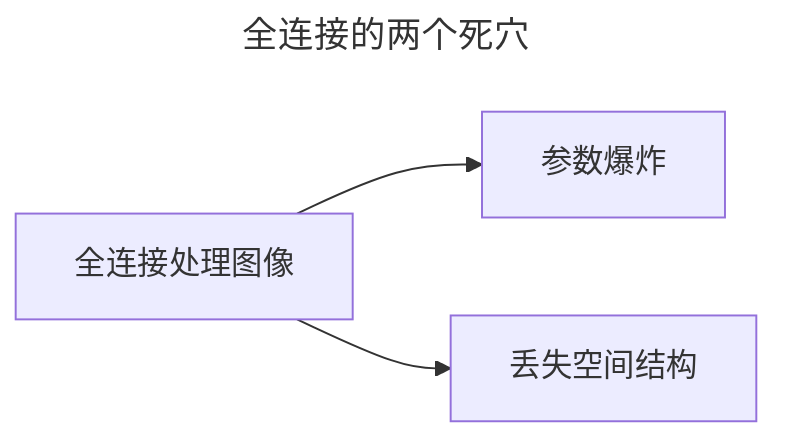
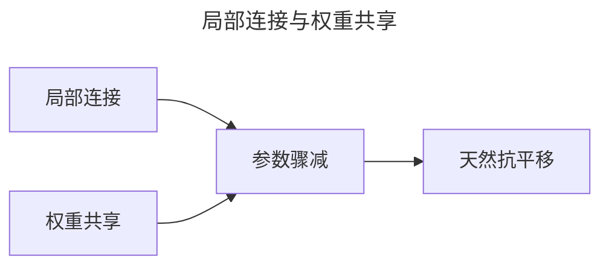
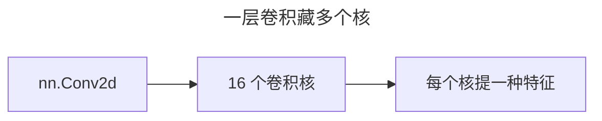

> 作者：轻松学AI
> 日期：2026-10-18
> 风格：通俗科普
> 状态：待发布

# 从零开始学深度学习 #10：卷积——CNN 的看家本领

前面九篇，我们把深度网络训练的地基打牢了。从这一篇开始，进入深度学习最经典、应用最广的架构——卷积神经网络，CNN。

CNN 的核心就一个词：卷积。搞懂它，后面 ResNet、目标检测、图像识别全都顺理成章。

## 一、全连接处理图像，有两个死穴

回忆前面搭的网络：`nn.Linear` 是全连接层，每个神经元连接上一层所有神经元。用它处理图像，问题立刻暴露。

第一，**参数爆炸**。一张 28×28 的灰度图有 784 个像素。


全连接层哪怕只接 128 个神经元，也要 784×128 ≈ 10 万个参数。换成 224×224 的彩色图（15 万像素），一层就是几千万参数，训练都训不动。

第二，更致命：**丢了空间结构**。全连接层把图片"拍平"成一长串数字，像素之间的上下左右关系全丢了。可在图像里，相邻像素才最有关系——一只猫的眼睛、鼻子是"挨在一起的局部"，不是散落的一堆像素点。

## 二、卷积：用一个小窗口扫过整张图

卷积的思路，恰恰针对这两个死穴。

它不是让每个神经元连接所有像素，而是用一个小窗口——叫**卷积核**——在图上从左到右、从上到下滑动。每滑到一个位置，就做一次"对应位置相乘再求和"，输出一个数。滑完整张图，就得到一张新的特征图。


手写一个最朴素的卷积，核心就一个双重循环：

```python
def conv2d_naive(x, kernel):
    for i in range(outH):
        for j in range(outW):
            region = x[i:i+kH, j:j+kW]      # 当前位置的窗口
            out[i, j] = (region * kernel).sum()   # 相乘求和
```

这个 `kernel`（卷积核）决定了这张特征图"提取什么"。换成不同的核，同一张图能提取出完全不同的东西。


左边是原图，中间用一个"拉普拉斯核"提取出了边缘，右边用一个"均值核"做的是模糊。同样是滑动相乘求和，换个核，就是天差地别的两种效果。

## 三、两个杀手锏：局部连接 + 权重共享

卷积能打败全连接，靠两个性质：

**局部连接**：每个输出只和窗口里那几个输入有关，不连接全图。这正是图像的规律——相邻像素才有强关联。

**权重共享**：同一个卷积核，扫遍整张图用的是同一组参数。一只猫的眼睛，不管出现在左上角还是右下角，用同一个"眼睛检测核"都能认出来。

这两个性质合起来，效果惊人：参数从"全连接的上百万"，骤降到"卷积核的几十个"。


而且因为同一把尺子到处量，CNN 天然对"物体挪了位置"不敏感——猫往左挪一点，卷积核照样能认出眼睛。

## 四、对照框架：一行调用

手写卷积是为了看懂原理。真写代码，PyTorch 一行搞定：

```python
import torch.nn as nn
conv = nn.Conv2d(in_channels=1, out_channels=16, kernel_size=3, padding=1)
```

这一个层里，藏着 16 个不同的卷积核（`out_channels=16`），每个核提取一种特征。


前面手写的双重循环，在这里被高度优化后封装了——但原理，还是那个"滑动相乘求和"。

下一篇讲卷积的另一半：池化、步长、感受野。卷积负责"提取什么特征"，它们负责"让网络看到多大的范围"。

- [《动手学深度学习》6.2 图像卷积](https://zh.d2l.ai/chapter_convolutional-neural-networks/conv-layer.html)
- [《深度学习》花书 第 9 章：卷积网络](https://www.deeplearningbook.org/contents/convnets.html)
- [3Blue1Brown：But what is a convolution?](https://www.3blue1brown.com/lessons/convolutions)
- [配套仓库 dl-from-scratch（cnn/conv.py）](https://github.com/Joneyao/dl-from-scratch)
