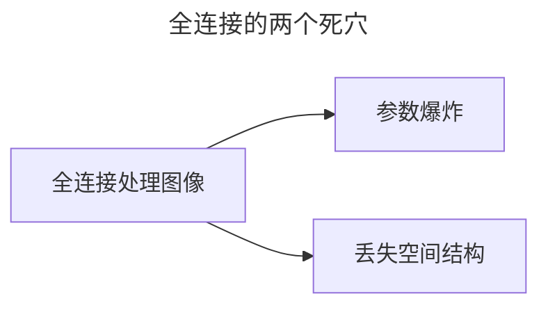
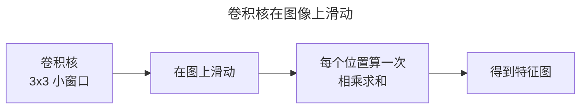
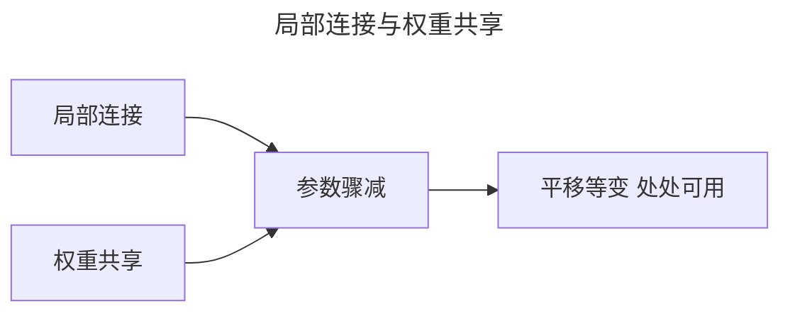
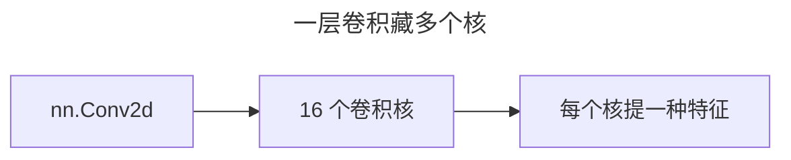

> 作者：轻松学AI
> 日期：2026-10-18
> 风格：通俗科普
> 状态：待发布

# 从零开始学深度学习 #10：卷积——CNN 的看家本领

## 一、先说清楚：CNN 是被"逼"出来的

前面九篇用的都是全连接网络（`nn.Linear`）。进入图像领域，全连接立刻暴露出两个"死穴"，逼着人发明了卷积。

第一，**参数爆炸**。一张 28×28 的灰度图有 784 个像素，全连接层哪怕只接 128 个神经元，就要 784×128 ≈ 10 万个参数。换成 224×224 的彩色图（约 15 万像素），一层就是几千万参数——算力根本扛不住，还极易过拟合。

第二，更致命：**丢了空间结构**。全连接层把图片"拍平"成一长串数字，像素之间的上下左右关系全没了。可图像里最要紧的恰恰是这种空间关系——猫的眼睛、鼻子是"挨在一起的局部"，不是散落的一堆像素点。



卷积神经网络（CNN）就是为了同时解决这两个死穴而生的。它的核心就一个词：卷积。

## 二、直觉：一把尺子到处量

卷积的思路，用一句话就能抓住：**用一个小窗口，在图上到处滑动，每个位置算一次"对应位置相乘再求和"**。


可以把它想成一把尺子（卷积核），在图上从左到右、从上到下滑动。每滑到一个位置，尺子盖住的那一小块区域，和尺子上的数"对应相乘、再加起来"，输出一个数。滑完整张图，就得到一张新的特征图。



这个"相乘再求和"的操作，数学上就叫卷积。别被名字吓住，本质就这么简单。

## 三、机制：为什么卷积能同时治两个死穴

直觉之后，看看它到底怎么对症下药。

**治"参数爆炸"——权重共享**：全连接层里，每个位置都有一组独立的权重；卷积里，同一个卷积核扫遍整张图，**用的是同一组参数**。一个 3×3 的卷积核只有 9 个参数（加个偏置 10 个），哪怕一层放 16 个卷积核，也才 160 个参数——对比全连接的 10 万个，少了 600 多倍。

**治"丢空间结构"——局部连接**：每个输出只和窗口里那几个输入有关，不连接全图。这正好符合图像的规律——相邻像素才有强关联，远处的像素彼此几乎无关。



这两个性质还带来一个意外之喜：因为同一个核到处用，同一个检测核在图上任何位置都能触发——这叫**平移等变**，猫往左挪一点，眼睛核照样能认出眼睛。

## 四、手写一个卷积

原理懂了，手写一个最朴素的卷积，核心就是一个双重循环：

```python
def conv2d_naive(x, kernel):
    for i in range(outH):
        for j in range(outW):
            region = x[i:i+kH, j:j+kW]        # 当前位置窗口
            out[i, j] = (region * kernel).sum()  # 相乘求和
```

外层两个循环遍历图上的每个位置，内层做一次"相乘求和"。整个卷积，就这三行。

关键在于 `kernel`（卷积核）里的数值——它决定了这张特征图"提取什么"。换成不同的核，同一张图能提取出完全不同的东西：


左边是原图，中间用一个"拉普拉斯核"提取出了边缘，右边用一个"均值核"做的是模糊。同样是滑动相乘求和，换个核，就是天差地别的两种效果。

## 五、一个反直觉的点：卷积核不是人设计的

看到"拉普拉斯核提边缘、均值核做模糊"，你可能会以为：CNN 就是工程师精心设计一堆卷积核，拼起来认图片。

恰恰相反。这是理解 CNN 最关键的一点：**在真正的 CNN 里，卷积核的数值不是人手写的，是训练时自己学出来的。**

手写拉普拉斯核只是为了让你直观感受"核决定特征"这个机制。真实的 CNN 里，几十上百个卷积核从随机数出发，通过反向传播一点点被"调"成能提边缘、提纹理、提形状的检测器——而这个学习过程，就是第一篇讲的"层层提炼特征"在图像上的具体化。

## 六、对照框架：一行调用

手写卷积是为了看懂原理。真写代码，PyTorch 一行搞定：

```python
import torch.nn as nn
conv = nn.Conv2d(in_channels=1, out_channels=16, kernel_size=3, padding=1)
```



这一个层里藏着 16 个不同的卷积核（`out_channels=16`），每个核学一种特征。前面手写的双重循环，在这里被高度优化后封装了——但原理，还是那个"滑动相乘求和"。

## 七、边界：卷积也不是万能的

最后说清卷积的边界，别把它神化。

- **平移等变 ≠ 平移不变**：卷积保证的是"核处处可用"（等变），不是"物体挪了位置、输出也不变"（不变）。真正的不变性要靠后面的池化、下采样来实现——这正是下一篇要讲的。
- **感受野有限**：一个 3×3 卷积核一次只看 9 个像素，要看更大的范围，要么加深（叠卷积层），要么靠池化。这也是"深度"在 CNN 里如此重要的原因之一。

下一篇讲卷积的另一半——池化、步长、感受野。卷积负责"提取什么特征"，它们负责"让网络看到多大的范围"，两者配合，才是完整的 CNN。

- [《动手学深度学习》6.2 图像卷积](https://zh.d2l.ai/chapter_convolutional-neural-networks/conv-layer.html)
- [《深度学习》花书 第 9 章：卷积网络](https://www.deeplearningbook.org/contents/convnets.html)
- [3Blue1Brown：But what is a convolution?](https://www.3blue1brown.com/lessons/convolutions)
- [配套仓库 dl-from-scratch（cnn/conv.py）](https://github.com/Joneyao/dl-from-scratch)
