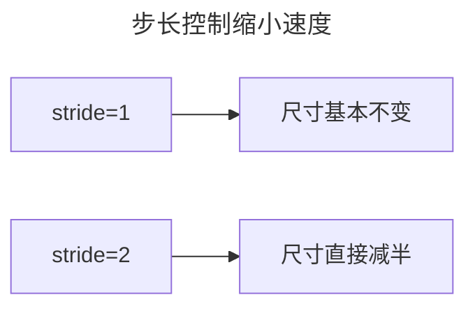
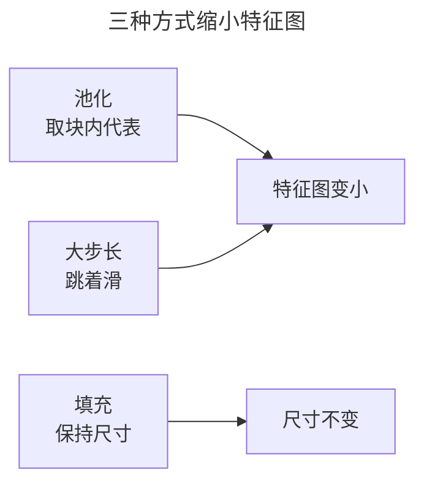
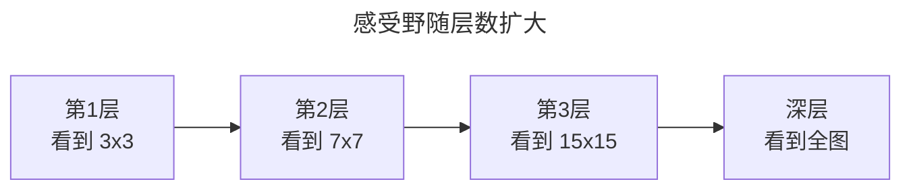

> 作者：轻松学AI
> 日期：2026-10-18
> 风格：通俗科普
> 状态：待发布

# 从零开始学深度学习 #11：池化、步长与感受野

上一篇讲了卷积——用小窗口在图上滑动提取特征。这一篇讲它身边的三样配套：池化、步长、感受野。

这三样回答了同一个问题：网络越往深走，怎么才能"既看细节，又看全貌"。

## 一、池化：每隔几格取个代表

卷积之后通常会接一个池化层。池化做的事很简单：把特征图划分成一个个小块，每块只保留一个"代表值"。

最大池化取块里的最大值，平均池化取块里的平均值。手写一个最大池化，和卷积一样是双重循环：

```python
def maxpool2d_naive(x, k=2, stride=2):
    for i in range(outH):
        for j in range(outW):
            out[i, j] = x[i*2:i*2+2, j*2:j*2+2].max()   # 2x2 块取最大
```

一个 2×2 的池化，把特征图长宽各砍一半。16×16 变成 8×8，再池化一次变 4×4。


池化有两个好处。第一，**降维**：特征图变小，后面层的参数和计算都大幅减少。第二，**平移不变**：某块里最大值的位置稍有偏移，取出来的最大值不变，网络对微小位移更鲁棒。

## 二、步长：一次走几格

步长（stride）是卷积和池化都有的一个参数，控制"窗口每次滑几格"。

步长为 1，窗口一格一格挪，特征图几乎不变小；步长为 2，窗口两格两格跳，特征图直接减半。


步长越大，特征图缩得越快。

它和池化的作用类似，都能缩小特征图。区别是：池化是"先算完整特征图再取代表"，步长是"干脆跳着滑"。两者常配合使用——卷积里用步长 1 保持细节，靠池化来降维。

## 三、填充：别让边缘信息白白丢掉

填充（padding）解决的是另一个问题：卷积会让特征图变小，边缘的像素被"滑到"的次数更少，信息容易丢。

做法是在原图四周补一圈 0，再卷积。这样边缘像素也能被完整滑到，特征图尺寸保持不变。



一句话记忆：`padding` 决定"要不要保住尺寸"，`stride` 和池化决定"缩多快"。

## 四、感受野：每个神经元"看到"多大范围

前面三样东西合起来，引出一个核心概念——**感受野**：某个神经元在原图上"看到"的区域有多大。

浅层神经元，每个只看到一小块（比如 3×3 卷积核那么大）。但每经过一次卷积 + 池化，感受野就往外扩一圈。堆到深层，一个神经元可能已经"看到"了整张图。



这就是 CNN 能"既看细节又看全貌"的秘密：浅层管细节（边缘、纹理），深层管全局（整个物体）。感受野从小到大，层次分明。

到这儿，CNN 的零件讲齐了：卷积提特征、池化降维、步长和填充控尺寸、感受野决定视野。下一篇把这些零件拼起来，看经典的 CNN 架构是怎么一步步堆出来的。

- [《动手学深度学习》6.3 填充和步幅](https://zh.d2l.ai/chapter_convolutional-neural-networks/padding-and-strides.html)
- [《动手学深度学习》6.5 汇聚层](https://zh.d2l.ai/chapter_convolutional-neural-networks/pooling.html)
- [配套仓库 dl-from-scratch（cnn/pooling.py）](https://github.com/Joneyao/dl-from-scratch)
