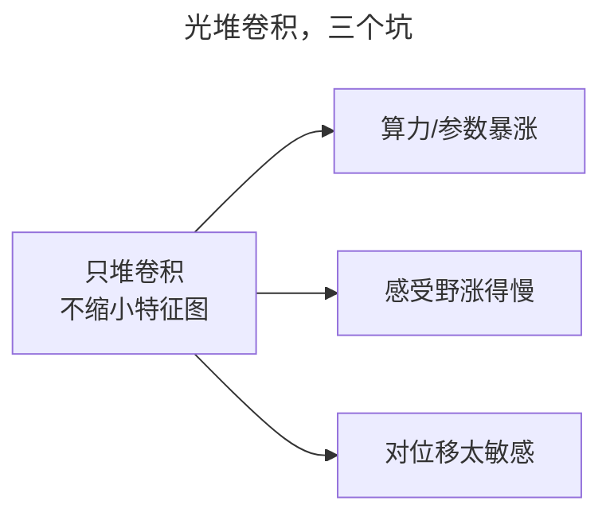
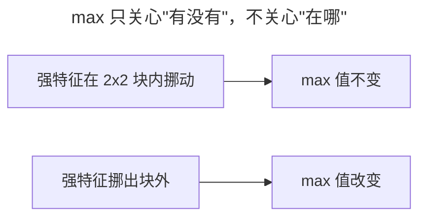
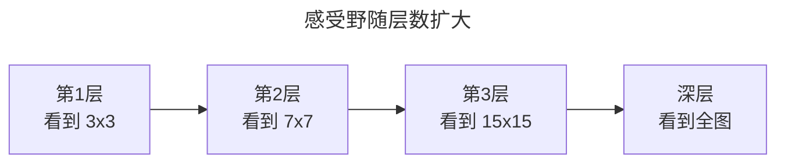
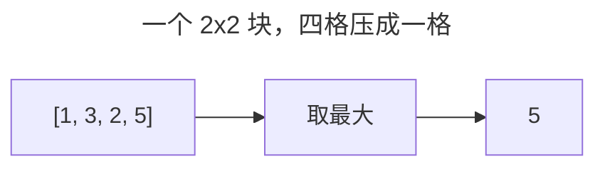
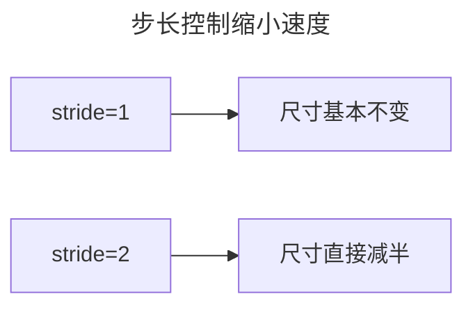
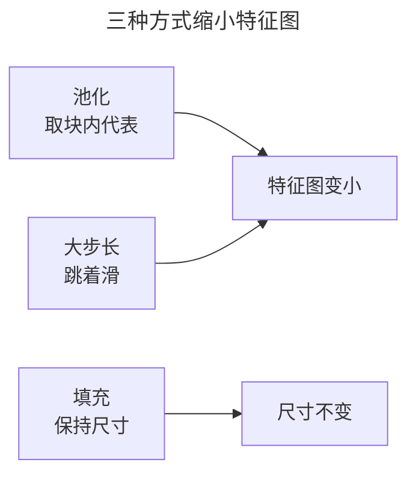
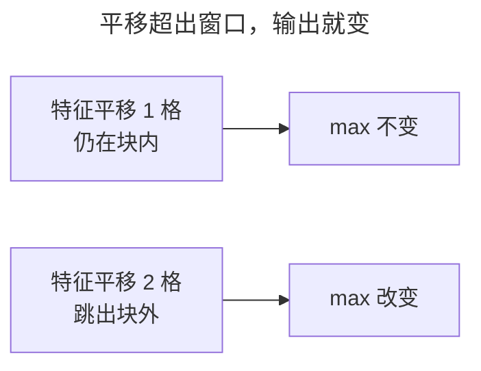
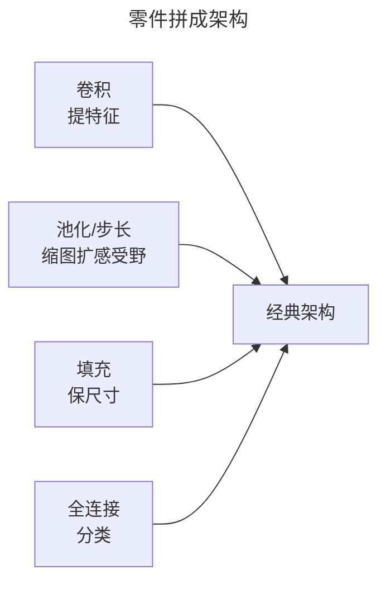

> 作者：轻松学AI
> 日期：2026-10-18
> 风格：通俗科普
> 状态：待发布

# 从零开始学深度学习 #11：池化、步长与感受野

上一篇讲了卷积——用小窗口在图上滑动提取特征。这一篇讲它身边的三样配套：池化、步长、感受野。

这三样回答了同一个问题：网络越往深走，怎么才能"既看细节，又看全貌"。

## 一、先说清楚：卷积之后为什么非"缩小"不可

卷积已经能提特征了，但光堆卷积，网络走不深。三个坑摆在这儿：

一是**算力和参数**。卷积核参数小（3×3 才 9 个数），但特征图每层不缩小，后面每层的计算量就跟着宽高平方涨。更要命的是最后接全连接：参数等于"特征图宽 × 高 × 通道 × 类别"。一张 28×28 的图，若特征图始终是 28×28、64 通道，光最后一层全连接就 28×28×64×10 ≈ 50 万个参数。宽高砍一半，这数直接降 4 倍。

二是**感受野涨得太慢**。每个 3×3 卷积只让感受野扩 2 格。不缩小、光堆卷积，堆 20 层感受野也才 41×41，连一张 224×224 的照片都盖不住。

三是**对位移太敏感**。特征在图上挪一个像素，卷积输出全跟着变，网络学不到"平移"这件事。

所以要一种主动下采样的手段，定期把特征图砍小：省算力、扩感受野、顺便抗位移。池化干的就是这个。



## 二、直觉：地图逐级缩小，取个代表

卷积之后通常接一个池化层。它做的事一句话：把特征图切成一块块，每块只留一个"代表值"。


就像看地图：看全国时你在意省和省的关系，不会去盯某条小街。最大池化取块里的最大值，平均池化取块里的平均值——一个要"这块最强的信号"，一个要"这块的平均水平"。哪种好、为什么，下一节拆。

## 三、机制：max 为什么能又缩图又抗位移

最大池化的输出是 `out = max(块里 4 个数)`。它问的是："这个 2×2 区域里，最强的一次响应有多强？"至于精确在第几行第几列，max 根本不关心。

卷积提的是"有没有某个模式"——比如一条竖边。max 池化保留的是"这一块里，这个模式最明显的那一下"。只要竖边出现在这块里，靠左靠右都无所谓，max 都抓得住。这就是它又缩图、又不丢"有没有"这个最关键信息的原因。

**平移不变性的数学**：max 这个函数对输入顺序天生不敏感，四个数怎么排，max 都一样。所以特征在窗口内挪动不超过窗口大小（2 像素）时，强激活还留在窗口里，输出纹丝不动。这就是"平移不变性"的数学来源，没什么玄乎的。注意它是局部的——挪超过窗口，强激活跳进隔壁块，输出才变。这个边界第七节专门讲。

**为什么常用 max 而不是 average**：average 会稀释。一块里一条强边缘 + 三个背景，平均完边缘强度只剩四分之一，特征被抹淡了；max 只留最强那一下，背景噪声直接无视。分类任务要的是"这个特征有没有"，不要"平均有多强"，所以 max 从 AlexNet 之后一直是默认。



顺手把两个配套旋钮的机制讲清。**步长（stride）**：池化是"先算完整个特征图，再取代表"，步长是"干脆跳过某些位置不滑"，跳过的位置连卷积都不算，更省，但它没有 max 那个"选最强"的非线性，是纯几何缩小。**填充（padding）**：卷积天生让图缩小、边缘滑得少，填一圈 0，边缘也能被完整滑到、尺寸还能保住，代价是引入了假的黑边，第六节细说。

这三样合起来，让**感受野**——某个神经元在原图上"看到"的范围——指数级扩大。每过一遍"3×3 卷积 + 2×2 池化"，感受野大致翻倍再加一圈：



浅层神经元只看 3×3 一小块，管边缘、纹理；深层神经元看到整张图，管"这是个猫还是狗"。这就是 CNN"既看细节又看全貌"的机制来源。

## 四、手写一个最大池化，逐行拆开

最大池化和卷积一样是双重循环，但比卷积简单，因为它**没有可学习的参数**：

```python
def maxpool2d_naive(x, k=2, stride=2):
    for i in range(outH):
        for j in range(outW):
            out[i, j] = x[i*2:i*2+2, j*2:j*2+2].max()   # 2x2 块取最大
```

为什么这么写：外层两重循环遍历输出图的每个位置 (i, j)；`i*2` 和 `j*2` 是步长 2 时，输出位置对应回原图的起始坐标；切片 `i*2:i*2+2` 取出的正是那个 2×2 小块；`.max()` 一步把块里四个数压成一个。



注意那个"没有"：这段代码里没有权重、没有梯度要更新。池化层不学习，这是它和卷积最本质的区别，这个"没有"在第七节误解里还会派上用场。

## 五、实验：2×2 池化，当场丢掉 75%

光说缩图不够，算笔账。一个 2×2 的池化，把特征图长宽各砍一半。16×16 变成 8×8，再池化一次变 4×4：


数字摆出来：16×16=256 个像素，第一次池化后剩 8×8=64 个，第二次剩 4×4=16 个。每池化一次只留四分之一，**丢掉四分之三**——也就是 75% 的值当场扔掉。两次下来 256 → 16，只剩十六分之一。

换来的是：后面每层卷积的计算量降 4 倍，最后接全连接时的参数也降 4 倍。用"扔掉 75% 的中间激活"换"计算和参数的大幅下降"，这就是池化这笔买卖的核心账。

## 六、池化不是免费的：代价与边界

那 75% 不是白丢的，代价是**信息损失**——尤其是位置信息。

max 只告诉你"这块里有过强特征"，不告诉你它精确在哪个像素。对"整张图是猫还是狗"这种分类，位置不重要；但对"肿瘤边界在哪""人脸关键点坐标是多少"这种要精确定位的任务，池化把位置抹掉，就是减分项。所以语义分割、关键点检测要么少用池化，要么靠跳连（U-Net 那种）把位置从浅层再捡回来。

池化也不是唯一的下采样手段，**步长**就能替代它：



区别在"要不要计算跳过的位置"：步长是跳着滑、不计算，池化是全算完再取代表。步长卷积能省更多算力，而且卷积核可学习——它自己学"怎么缩最好"，而不是固定取 max。所以 ResNet 之后的架构越来越多用步长 2 的卷积替代池化，GAN 里更是基本见不到池化。

**填充**也有代价：



补的是假 0，网络学到的是"图外有黑边"。深层、大 padding 时会带出边框伪影——模型误把填充的 0 当成真实特征。所以填充能保尺寸，但不是白拿。

一句话记牢：`padding` 决定"要不要保住尺寸"，`stride` 和池化决定"缩多快"。池化、步长、填充都是"用信息换结构"的工具，用得对是利器，用错地方是减分项。

## 七、一个常见误解：池化的"平移不变"被高估了

很多人以为池化让网络"随便平移都认得出来"。真不是。



前面说过，max 只在**窗口内**对位移不敏感。2×2 的池化，特征挪 1 个像素可能还在块里；挪 2、3 个像素，强激活就跳进隔壁块，输出照样变。池化给的是局部平移容错，不是全局平移不变。真正要全局平移不变，得靠数据增强（把图多平移几次喂进去）加上深层感受野覆盖，池化只贡献了一小部分。

还有个连带陷阱：max 的反向传播只把梯度传给"最大那个位置"，块里其他三个位置的梯度是 0。这说的是那些没被选中的位置这一轮梯度为零——和 ReLU 的死神经元同一个味道。以为池化"没有参数、不会出问题"是错的，它有自己的一类坑。

## 八、往后看：感受野才是这一切的目的

回头看，池化、步长、填充这三样，服务的其实是同一个东西——**感受野**。



浅层感受野小，管边缘、纹理这些局部细节；越深感受野越大，管"整体是什么"。池化、步长是"往大扩感受野"的加速器，填充是"别让边缘掉队"的补丁。感受野从小到大、层次分明，这才是 CNN 能"既看细节又看全貌"的根。

到这儿，CNN 的零件讲齐了：卷积提特征、池化降维、步长和填充控尺寸、感受野决定视野。把这些零件拼起来，就得到一个个具体架构——LeNet 用卷积+池化交替，VGG 一路 3×3 卷积小步快跑，再到 ResNet 用步长卷积替代池化。下一篇就把这些零件拼成第一代经典 CNN，看它们怎么一步步堆出来的。

- [《动手学深度学习》6.3 填充和步幅](https://zh.d2l.ai/chapter_convolutional-neural-networks/padding-and-strides.html)
- [《动手学深度学习》6.5 汇聚层](https://zh.d2l.ai/chapter_convolutional-neural-networks/pooling.html)
- [配套仓库 dl-from-scratch（cnn/pooling.py）](https://github.com/Joneyao/dl-from-scratch)
