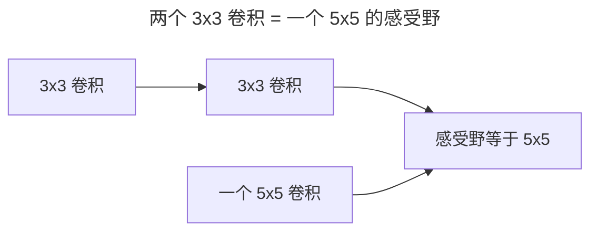
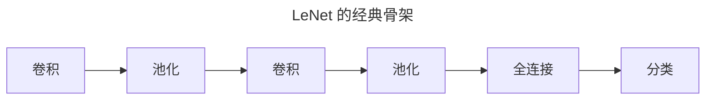
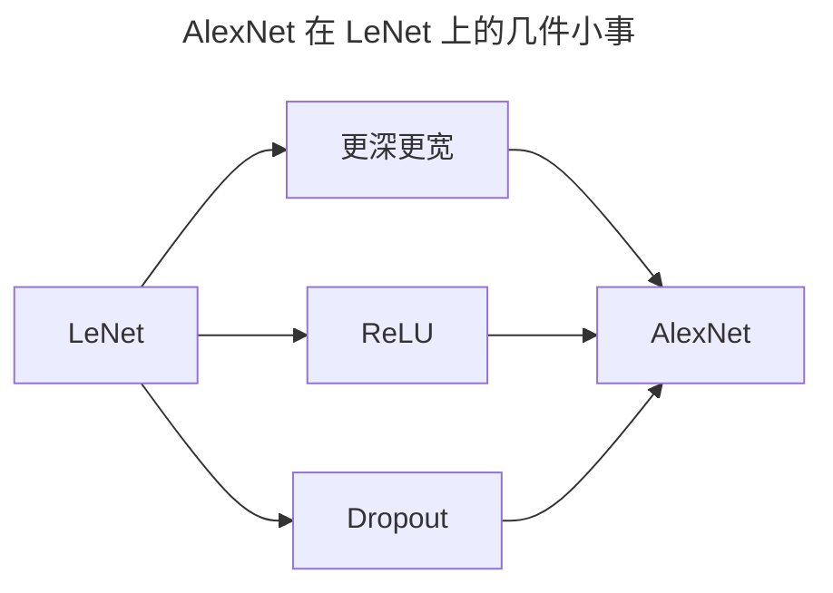
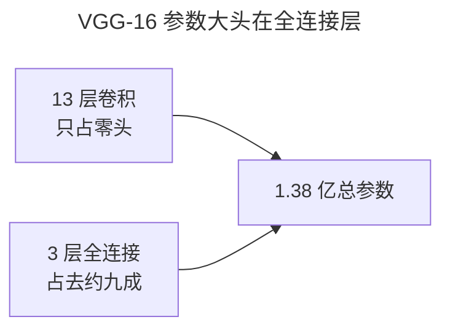
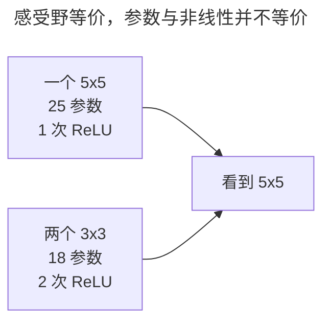
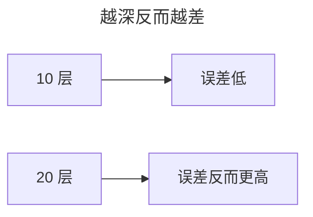

> 作者：轻松学AI
> 日期：2026-10-18
> 风格：通俗科普
> 状态：待发布

# 从零开始学深度学习 #12：经典 CNN 架构——从 LeNet 到 VGG

零件备齐了，这一篇把它们拼成完整网络，走一遍 CNN 架构的演进前半程：LeNet、AlexNet、VGG。

这条演进线的主旋律只有一个字：**深**。人们一路在想办法把网络堆得越来越深，因为越深，能力越强。

## 一、问题由来：从手写数字到真实照片，中间隔了什么

1998 年 LeNet 问世，任务是认手写数字，几个卷积池化加全连接，就把 MNIST 做到 99% 以上。这个成绩让不少人以为图像识别已经解决了。

顺便说一句，当年图像识别的主流根本不是卷积网络。2012 年之前，标准做法是手工设计特征——SIFT、HOG 这些——再丢给 SVM 分类。特征靠人一行行调，换一种物体就得换一套，天花板一眼望得到头。

但 LeNet 一碰到真实照片就露馅：手写数字是黑底白字、居中、就 10 个类别；真实世界是彩色、有遮挡、光照乱、几千个类别。把 LeNet 原样放大去认 ImageNet，正确率惨不忍睹。问题不在"卷积这个想法错了"，而在**当时的网络太浅、太小，手上也没有足够的数据和算力把它训起来**。

于是卷积网络沉寂了十几年。真正的转折是 2012 年的 AlexNet——它证明了一件事：只要网络堆得够深、数据喂得够多、用 GPU 训得动，卷积这条路就通。从这以后，所有人的问题从"要不要用卷积"变成了"**该把网络做成什么样、往深里怎么堆**"。


## 二、核心直觉：搭积木，堆得越高越能打

深度学习最朴素的一条直觉：**网络越深，能表达的函数越复杂，能力越强**。浅网络像几块积木，只能拼出简单形状；深网络把几十块积木一层层摞上去，能搭出精细得多的高楼。


CNN 尤其如此。卷积层一层层叠起来，前面的层看边缘、中间看纹理、后面的层看"猫脸"这种整体，每加一层就抽象一档。这条"深 = 强"的直觉，是后面所有架构演进的地基。

## 三、机制：3×3 到底赢在哪，算给你看

AlexNet 虽然把网络堆深了，第一层却还是个 11×11 的大卷积核，中间也混着 5×5。VGG 问了个更狠的问题：这些大卷积核，真的有必要吗？它的回答朴素到极点——别搞花活，就用 3×3，不停加深。这话听着像废话，背后其实是一道简单的算术题。

先说感受野。一个 3×3 卷积只能看到 3×3 的范围；但两层 3×3 叠起来，第二层每个点看的是第一层的 3×3，而第一层每个点又对应原图的 3×3——能看到的范围就扩成了 5×5。三层叠起来，就是 7×7。



所以"两个 3×3"和"一个 5×5"**看到的东西一样大**。那为什么还要叠两个小的？算参数：

- 一个 5×5 卷积核：25 个参数。
- 两个 3×3 卷积核：9 + 9 = 18 个参数。

同样 5×5 的感受野，参数省了 28%。三层 3×3 等于一个 7×7，参数是 27 对 49，省了将近一半。把规律推到底：堆 n 层 3×3，感受野是 (2n+1)×(2n+1)，参数是 9n；想一步到位拿到同样感受野，得用一个 (2n+1)×(2n+1) 的大核，参数是 (2n+1)²。n 越大，两条线的差距拉得越开。

省参数还不是重点。真正的杀招是**非线性**：一个 5×5 卷积后面只能接一次 ReLU；两个 3×3 之间能塞一次 ReLU，叠三层就能塞三次。每多一次非线性，网络能表达的函数就复杂一档。同样的视野，更少的参数、更多的非线性——这就是"小卷积核一味加深"能赢的数学原因。

## 四、手写核心：LeNet 那几行代码，逐行拆

用 PyTorch 搭一个 LeNet，几行就出来：

```python
model = nn.Sequential(
    nn.Conv2d(1, 6, 5, padding=2), nn.Tanh(), nn.MaxPool2d(2),
    nn.Conv2d(6, 16, 5), nn.Tanh(), nn.MaxPool2d(2),
    nn.Flatten(),
    nn.Linear(16*5*5, 120), nn.Tanh(),
    nn.Linear(120, 84), nn.Tanh(),
    nn.Linear(84, 10),
)
```

这 6 行正好对应那个沿用至今的骨架：



每一行在干嘛：

- `Conv2d(1, 6, 5)`：输入 1 个通道（灰度图），用 6 个 5×5 卷积核提 6 张特征图。
- `MaxPool2d(2)`：把特征图长宽各砍一半，既降参数，又给一点平移容忍。
- `Linear(16*5*5, 120)`：池化到 5×5、16 个通道后拉平，接全连接做决策。

"卷积提特征、全连接做决策"的分工，从这几行里看得一清二楚。后面的 AlexNet、VGG 全是在这个骨架上做手脚。

## 五、实验：数字摆在桌面上

AlexNet 的贡献，用 #02 里那个数字就够了：它在 ImageNet 上把 top-5 错误率从 25.8% 砍到 16.4%，一次砍掉近 10 个百分点，直接终结了"手工设计特征 + 浅模型"这条路线。



它和 LeNet 结构几乎一样，只做了几件"小事"：更深更宽、用 ReLU 替代 Sigmoid、加 Dropout 防过拟合、上 GPU 训练。就这么几件事，加上海量数据和 GPU，让沉寂十几年的卷积网络重新成为图像识别的主流方案。

VGG 这边，参数量的对比更有冲击力：


LeNet 约 6 万参数，VGG-16 约 1.38 亿——差了三个数量级，其中绝大多数来自末尾的全连接层。2014 年 VGG 用这套"只有 3×3、一味加深"的设计在 ILSVRC 拿了亚军，只输给结构更精巧的 GoogLeNet。训练又贵又慢，但性能的大幅提升让这些代价值得付出。

## 六、边界与代价：1.38 亿参数的账单

VGG 的"一味加深"不是免费的。那 1.38 亿参数里，绝大多数堆在末尾的三层全连接：第一层把 7×7×512 的特征图连到 4096 个神经元，光这一层就 1 亿多个权重，第二层又是 4096×4096。这些参数对分类有用，但也让模型又大又慢：权重文件存下来要 500 多 MB，推理一次要跑过全部 13 层卷积加 3 层巨无霸全连接。



更深一层的问题：3×3 叠得再多，感受野增长是线性的——堆 n 层才看到 (2n+1)×(2n+1) 的范围。想看全整张图的全局信息，就得堆很深，成本陡增。所以 VGG 之后，大家反过来想：能不能既加深、又别让参数和计算一起爆炸？这才有了用 1×1 降维、用全局池化替换全连接的 GoogLeNet，以及后面"跳过连接"的 ResNet。

## 七、一个常见误解：叠 3×3，不是"白捡"一个 5×5

很多人把"两个 3×3 感受野等于一个 5×5"理解成"它们俩就是同一个东西"。不是。

等价的是**看到的范围**，不是**学到的东西**。一个 5×5 卷积是 25 个参数、做一次线性变换、接一次 ReLU；两个 3×3 是 18 个参数、做两次线性变换、塞两次 ReLU。后者参数更少、非线性更多，表达力更强——这才是"等价"背后的真正价值。



所以别把结论记成"小卷积核 = 大卷积核"，要记成"**同样的视野，小卷积核更省参数、能塞更多非线性**"。

## 八、延伸：更深之后，卡住了

VGG 把网络堆到 16、19 层，还想再深吗？想，但堆不动了。



因为人们发现，网络深到一定程度，性能不但不涨，反而**退化**——不是过拟合，是更深反而更差。这个"越深越差"的诡异现象，卡住了所有人，直到 2016 年 ResNet 用一个"跳过连接"把它解决。

下一篇就讲这个——残差连接，以及它如何让网络第一次可以无上限地堆深。

- [《动手学深度学习》7.1 深度卷积神经网络（AlexNet）](https://zh.d2l.ai/chapter_convolutional-modern/alexnet.html)
- [《动手学深度学习》7.2 使用块的网络（VGG）](https://zh.d2l.ai/chapter_convolutional-modern/vgg.html)
- [VGG 论文：Very Deep Convolutional Networks](https://arxiv.org/abs/1409.1556)
- [配套仓库 dl-from-scratch（cnn/architectures.py）](https://github.com/Joneyao/dl-from-scratch)
