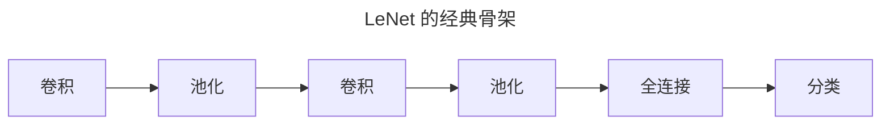
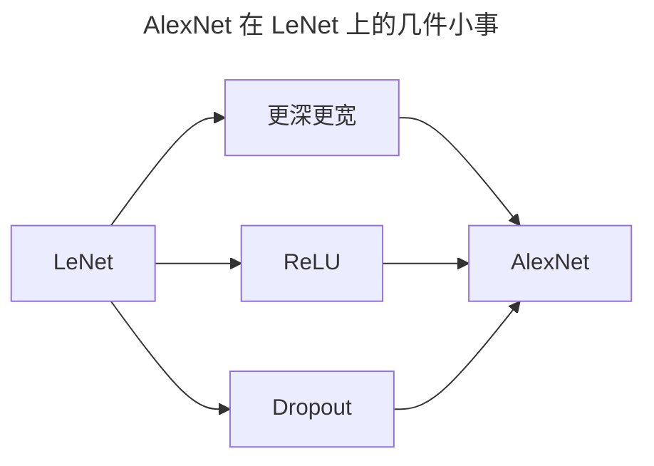
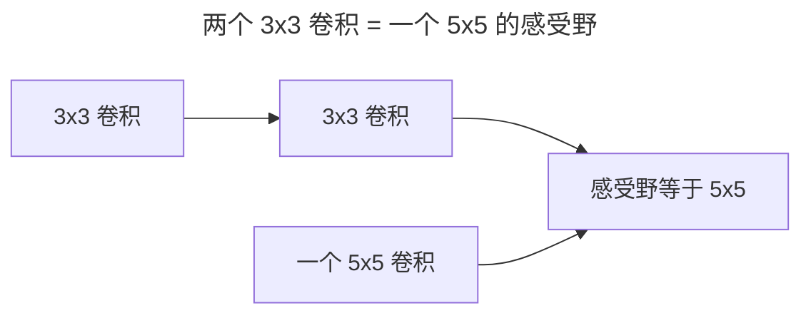
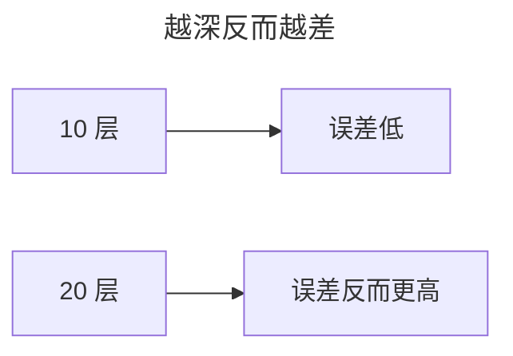

> 作者：轻松学AI
> 日期：2026-10-18
> 风格：通俗科普
> 状态：待发布

# 从零开始学深度学习 #12：经典 CNN 架构——从 LeNet 到 VGG

零件备齐了，这一篇把它们拼成完整网络，走一遍 CNN 架构的演进前半程：LeNet、AlexNet、VGG。

这条演进线的主旋律只有一个字：**深**。人们一路在想办法把网络堆得越来越深，因为越深，能力越强。

## 一、LeNet：卷积网络的鼻祖

第一个真正用起来的卷积网络，是 1998 年的 LeNet，用来识别手写数字。它奠定了 CNN 的基本骨架，直到今天绝大多数 CNN 仍沿用这个骨架：



交替的"卷积 + 池化"负责提特征，最后接全连接层负责分类。这个"卷积提特征、全连接做决策"的分工，一直沿用到今天。

用 PyTorch 搭 LeNet，几行就出来：

```python
model = nn.Sequential(
    nn.Conv2d(1, 6, 5, padding=2), nn.Tanh(), nn.MaxPool2d(2),
    nn.Conv2d(6, 16, 5), nn.Tanh(), nn.MaxPool2d(2),
    nn.Flatten(),
    nn.Linear(16*5*5, 120), nn.Tanh(),
    nn.Linear(120, 84), nn.Tanh(),
    nn.Linear(84, 10),
)
```

LeNet 只有几万个参数，当年就能把 MNIST 手写数字识别到 99% 以上。但它的能力天花板，在更复杂的真实图像上很快就到了。

## 二、AlexNet：让深度学习出圈的那个网络

LeNet 之后，CNN 沉寂了十几年，直到 2012 年的 AlexNet——就是 #02 里那个把 ImageNet 错误率从 25.8% 砍到 16.4% 的主角。

AlexNet 和 LeNet 结构几乎一样，只做了几件"小事"：


网络更深更宽、用了 ReLU 而不是 Sigmoid、加了 Dropout 防过拟合、用 GPU 训练。就这么几件小事，加上海量数据和 GPU，让沉寂十几年的卷积网络重新成为图像识别的主流方案。

## 三、VGG：一次"朴素到极致"的实验

AlexNet 火了之后，大家开始追问：到底什么因素最管用？2014 年的 VGG 网络，用一个朴素到极点的设计回答了这个问题。

VGG 的答案是：**别搞花活，就用 3×3 的小卷积核，不停加深**。

它的逻辑很妙。两个 3×3 卷积叠起来，感受野等于一个 5×5 卷积；三个叠起来，等于一个 7×7。但参数更少、非线性更多。所以与其用一个大的 7×7 卷积核，不如叠三个 3×3——同样"看到"那么大范围，表达力却强得多。



于是 VGG 把"全是 3×3、只是加深"这条路走到了极致，一路堆到 16 层、19 层。


它第一次用可控实验说明：当设计被压到只剩 3×3 卷积这一招时，加深网络带来的收益稳定超过了堆技巧。


代价也直观地摆在这张图里：LeNet 约 6 万参数，VGG-16 约 1.38 亿——差了三个数量级，其中绝大多数来自末尾的全连接层。训练又贵又慢，但性能的大幅提升让这些代价值得付出。

## 四、更深之后，遇到了新问题

VGG 把网络堆到了 19 层，还想再深吗？想，但堆不动了。

因为人们发现，网络深到一定程度，性能不但不涨，反而**退化**——不是过拟合，是更深反而更差。


这个"越深越差"的诡异现象，卡住了所有人，直到 2016 年 ResNet 用一个"跳过连接"把它解决。

下一篇就讲这个——残差连接，以及它如何让网络第一次可以无上限地堆深。

- [《动手学深度学习》7.1 深度卷积神经网络（AlexNet）](https://zh.d2l.ai/chapter_convolutional-modern/alexnet.html)
- [《动手学深度学习》7.2 使用块的网络（VGG）](https://zh.d2l.ai/chapter_convolutional-modern/vgg.html)
- [VGG 论文：Very Deep Convolutional Networks](https://arxiv.org/abs/1409.1556)
- [配套仓库 dl-from-scratch（cnn/architectures.py）](https://github.com/Joneyao/dl-from-scratch)
