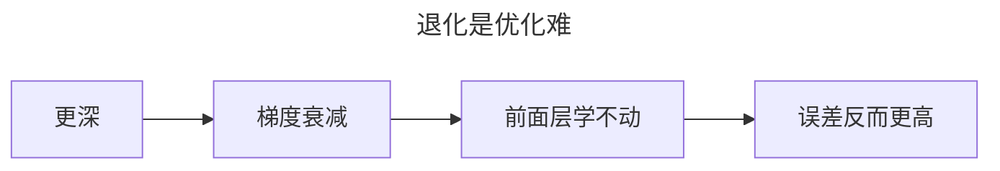
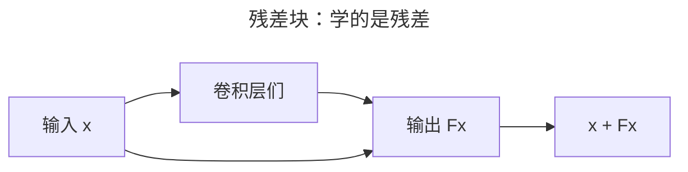
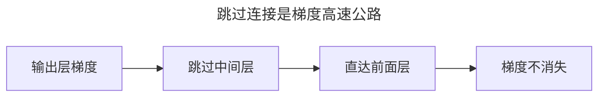
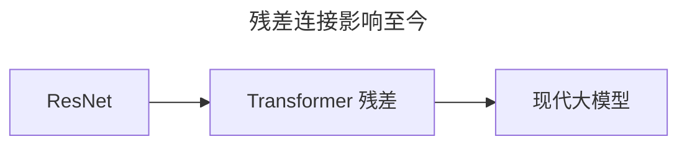

> 作者：轻松学AI
> 日期：2026-10-18
> 风格：通俗科普
> 状态：待发布

# 从零开始学深度学习 #13：残差连接——ResNet 为什么能无限加深

上一篇结尾留了个难题：网络深到一定程度，性能不但不涨，反而退化。不是过拟合，是更深了反而更差。

这个问题卡了整个领域好几年，直到 2016 年 ResNet 用一个出人意料的简单招数——跳过连接——把它解决。这一篇讲清楚这个"深度的破局"。

## 一、退化问题：越深为什么反而越差

先把这个诡异的现象说清楚。

按直觉，网络加深，表达能力只增不减——大不了多出来的层"什么都不干"，原样传过去，也不该变差才对。但实验事实是：一个 20 层的网络，训练误差和测试误差，都比 10 层的网络**更高**。

问题出在优化上。深层网络更难训练，梯度在前面几层已经衰减得不成样子


（#04 的梯度消失），优化器没法把那么深的网络"调好"。多出来的层不是"闲着"，而是"帮倒忙"——它们学坏了。

## 二、残差：让网络学"差多少"，而不是"直接学"

ResNet 的洞察一句话就能说清：与其让一层网络去学"完整的输出"，不如让它学"输出和输入差多少"。




看这个结构。普通网络里，一堆卷积层要从 `x` 直接学出一个目标 `H(x)`。残差块不这么干——它让卷积层去学 `F(x) = H(x) - x`（也就是"差多少"），最后再把输入 `x` 原样加回来，得到 `H(x) = F(x) + x`。

那条把 `x` 直接连到输出的线，就是**跳过连接**。

## 三、为什么"学残差"更简单

这个看似绕弯的设计，好处巨大。

关键在那条跳过连接：它给梯度开了条"高速公路"。


反向传播时，梯度可以绕过那些卷积层，直接、无损地传到前面的层。于是哪怕网络堆到上百层，前面的层也照样收得到梯度——#04 的梯度消失，被这条短路给化解了。

更妙的是那个"最坏情况"。如果某一层完全没学会（F(x) 趋近 0），残差块就退化成 `x + 0 = x`——等于原样传过去。也就是说，加深网络最坏也只是"白加了一层"，绝不会比浅网络更差。

```python
class BasicBlock(nn.Module):
    def forward(self, x):
        identity = x                      # 记住输入
        out = self.conv2(self.conv1(x))   # 学残差 F(x)
        out += identity                   # 关键：加上跳过来的输入
        return self.relu(out)
```

这五行代码，就是 ResNet 的核心。`out += identity` 那一行，是整篇的灵魂。

## 四、实验：同样深度，残差更顺

光说不练假把式。搭一个 6 层的普通卷积网络，和一个 6 层的残差网络，同样数据、同样训练，看损失。


结果很直接：普通网络损失降得又慢又抖，残差网络一路顺畅往下。同样的深度，就因为多了几条跳过连接，训练难度天差地别。

正是这个改动，让 ResNet 敢于把网络堆到 152 层，在 2015 年把 ImageNet 错误率干到 3.57%，超过了人类。从那以后，"网络有多深"不再是个问题，残差连接也成了几乎所有现代深度网络的标配。

## 五、一个影响至今的设计

残差连接的意义远不止 ResNet 本身。

它确立了一条原则：**网络里该有"捷径"，让信号和梯度能绕开中间层直达**。


后来 Transformer 里的残差连接、现代大模型里的各种"短路"设计，都源自这同一个想法。

到这儿，CNN 的演进主线我们走完了。下一篇是这一批的收官——CNN 实战，把前面学的东西全部用上，真正训一个图像分类模型出来。

- [ResNet 论文：Deep Residual Learning for Image Recognition](https://arxiv.org/abs/1512.03385)
- [《动手学深度学习》7.6 残差网络（ResNet）](https://zh.d2l.ai/chapter_convolutional-modern/resnet.html)
- [配套仓库 dl-from-scratch（cnn/resnet.py）](https://github.com/Joneyao/dl-from-scratch)
