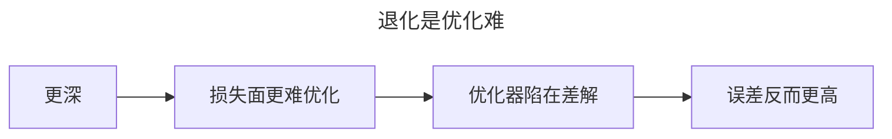
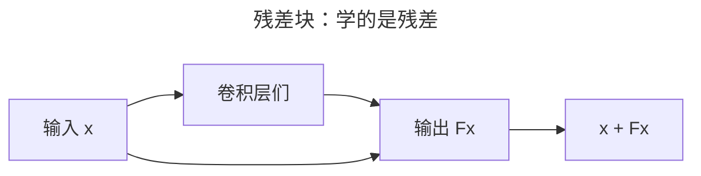
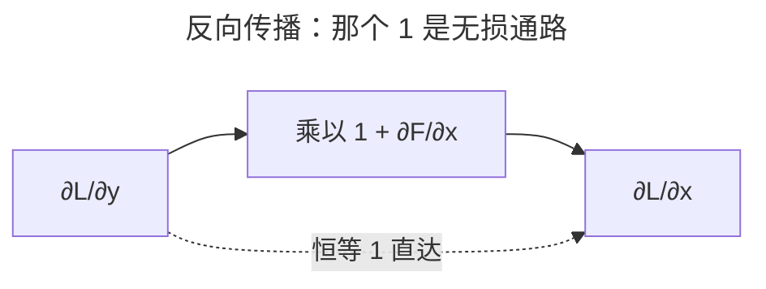
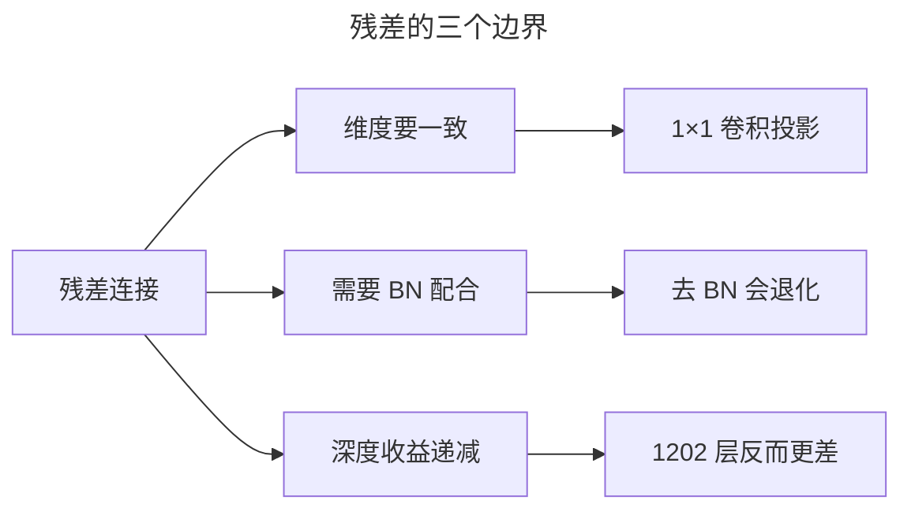
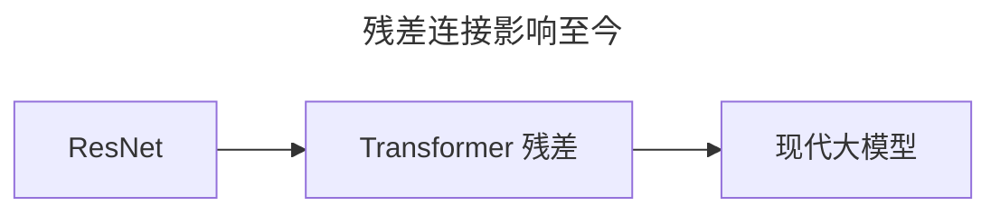

> 作者：轻松学AI
> 日期：2026-10-18
> 风格：通俗科普
> 状态：待发布

# 从零开始学深度学习 #13：残差连接——ResNet 为什么能无限加深

上一篇结尾留了个难题：网络深到一定程度，性能不但不涨，反而退化。不是过拟合，是更深了反而更差。

这个问题卡了整个领域好几年，直到 2015 年底 ResNet 用一个出人意料的简单招数——跳过连接——把它解决。

## 一、退化问题：越深为什么反而越差

先把这个诡异的现象说清楚。

按直觉，网络加深，表达能力只增不减——大不了多出来的层"什么都不干"，原样传过去，也不该变差才对。但实验事实（ResNet 论文的退化演示）是：一个 56 层的网络，训练误差和测试误差，都比 20 层的网络**更高**。

注意，这不是过拟合。过拟合是训练误差低、测试误差高；退化是训练误差本身就更高——网络连训练集都拟合得更差。问题出在**优化**：深层网络的损失面比浅层更难走，优化器陷在差解里出不来。



多出来的层不是"闲着"，而是"帮倒忙"——它们学坏了。

## 二、核心直觉：一条不设闸的高速公路

ResNet 的洞察一句话就能说清：与其让一层网络去学"完整的输出"，不如让它学"输出和输入差多少"。

这个"抄近路"的主意，打个比方就是修一条高速公路——普通网络是普通公路，信号每过一个路口就被损耗一次；残差连接等于在旁边并一条**不设闸的匝道**，让信号和梯度全程不减速地直达。


这个类比好记，但它只讲了"结构像什么"，真正"为什么有效"得下一节拆数学。

## 三、机制：那个"加号"为什么救活了梯度

先说结构。普通网络里，一堆卷积层要从 `x` 直接学出目标 `H(x)`。残差块不这么干——它让卷积层去学 `F(x) = H(x) - x`，也就是"差多少"，最后再把输入 `x` 原样加回来，得到 `H(x) = F(x) + x`。那条把 `x` 直连输出的线，就是跳过连接。



但"学残差"这三个字只是复述结构，真正让它起死回生的，是那个加号在求导时干了什么。

残差块的前向是 `y = x + F(x)`。对它求导，链式法则一展开：

:::formula 残差块的反向梯度
∂L/∂x = ∂L/∂y · (1 + ∂F/∂x)
∂L/∂x：损失对输入的梯度 ｜ 1：恒等分支 x 的导数 ｜ ∂F/∂x：残差分支的导数
:::

关键在括号里那个 **1**。它是恒等分支 `x` 的导数，恒等于 1，跟网络学得怎么样半毛钱关系没有。

对比普通网络：那里 `y = F(x)`，求导只剩 `∂L/∂y · ∂F/∂x`，每一项都可能小于 1。几十层连乘下来，梯度指数衰减——这正是 #04 讲的梯度消失。

残差块多出的这个 "+1"，意味着就算残差分支 `∂F/∂x` 学得很烂、趋近 0，梯度也至少保留 "1 × ∂L/∂y" 那份**无损地**往回传。把一堆残差块串起来，逐层求导后每一项都是 (1 + ∂F/∂x) 的样子，这些 1 连成一条从输出直达任何一层的通路。所以哪怕堆到一百多层，最前面那层收到的梯度里，始终有一份是从输出直接抄近路过来的、不经过任何衰减——"梯度高速公路"不是比喻，是一个恒等于 1 的加法。



再看兜底。如果某一层完全没学会，`F(x)` 趋近 0，残差块就退化成 `x + 0 = x`，原样传过去。也就是说，加深网络最坏也只是白加一层，绝不会比浅网络更差。这个下限是数学写死的，恰恰是退化问题最想要、普通网络给不了的那份保证。

## 四、手写核心：四行代码逐行拆

这四行就是残差块的全部，逐行拆一下为什么这么写：

```python
class BasicBlock(nn.Module):
    def forward(self, x):
        identity = x                      # 记住输入
        out = self.conv2(self.conv1(x))   # 学残差 F(x)
        out += identity                   # 关键：加上跳过来的输入
        return self.relu(out)
```

- `identity = x`：先把输入存下来。这是"原样传过去"的那份，后面要靠它实现 `x + F(x)` 里那个 `x`。
- `self.conv2(self.conv1(x))`：两个卷积层负责学残差 `F(x)`。注意它们学的是"差多少"，不是"完整输出"——目标变了，这是和普通网络最根本的区别。
- `out += identity`：核心一行。PyTorch 的 `+=` 是原地加，反向传播时梯度会顺着这个加法多出一条不衰减的通道，对应上一节那个 "+1"。
- `return self.relu(out)`：激活放在相加之后。


`identity = x` 和 `out += identity` 这两行合起来，就是那条跳过连接。少了任何一行，梯度就失去 "+1" 通路，残差块退化成普通的两层卷积，前面的机制全部失效。

## 五、实验：同样深度，残差更顺

搭一个 6 层普通卷积网络和一个 6 层残差网络，同样数据、同样训练，看损失。


配套仓库实测跑出来的数字很直白：同样 2 个 epoch，普通 6 层网络损失只从 2.23 降到 1.99，基本卡在原地；残差网络从 0.86 一路降到 0.72。同样的深度、同样的数据，就多了几条跳过连接，训练难度天差地别——普通网络学不动，残差网络往下走。

正是这个改动，让 ResNet 敢把网络堆到 152 层，在 2015 年把 ImageNet top-5 错误率干到 3.57%，首次低于人类水平（论文里人类 top-5 错误率约 5.1%）。从那以后，"网络有多深"不再是个问题，残差连接成了几乎所有现代深度网络的标配。

## 六、边界与代价：为什么"无限加深"是夸张

残差不是没代价，也不是无条件能用。三个边界得说清楚。

第一，**维度要对齐**。跳过连接要把 `x` 原样加回去，两边的形状必须一致；不一致就得用 1×1 卷积把 `x` 投影成同样形状再加——bottleneck 结构里那个 1×1 卷积就是干这个的。投影层不是免费的，它带来额外参数和计算。

第二，**离不开 BatchNorm**。原版 ResNet 如果把 BN 去掉，一样会退化。残差的 "+1" 只保证梯度有一条无损通路，但信号在前向里还是会逐层漂移；BN 负责把激活值拉回稳定分布，两个一起才成立。

第三，**深度收益会递减**。"无限加深"是夸张。ResNet 论文里的 1202 层在 CIFAR 上反而比 110 层更差——退化问题换了个形式又回来了。当深度远超任务需要，多出来的层带来的收益，会被优化难度和过拟合吃掉。



## 七、一个常见误解：功劳不在"深"，在"可训"

很多人读完，把 ResNet 的功劳记在"网络更深"上——"ResNet 靠 152 层打赢了"。

恰恰相反。深是结果，不是原因。ResNet 真正的贡献，是让一个深网络变得可以被训练：在残差之前，深网络不是"不够强"，而是"训不动"。那条跳过连接解决的是优化问题，不是信息保留问题。你只记住"信号抄近路"，就只懂了类比，没懂那个 "+1"。


## 八、延伸：一条影响至今的设计原则

残差连接留下的真正遗产，是一条设计原则——**让信号和梯度有捷径可走**。



后来 Transformer 里的残差连接、现代大模型里各种"短路"设计，都源自这同一个想法。Transformer 每个 block 里那句 `x = x + SelfAttention(x)` 和 `x = x + FFN(x)`，几乎就是 ResNet 残差块的复刻。理解透这一篇，下一篇去看 Transformer 会顺很多。

到这儿，CNN 的演进主线我们走完了。下一篇是这一批的收官——CNN 实战，把前面学的东西全部用上，真正训一个图像分类模型出来。

- [ResNet 论文：Deep Residual Learning for Image Recognition](https://arxiv.org/abs/1512.03385)
- [Batch Normalization 论文](https://arxiv.org/abs/1502.03167)
- [《动手学深度学习》7.6 残差网络（ResNet）](https://zh.d2l.ai/chapter_convolutional-modern/resnet.html)
- [配套仓库 dl-from-scratch（cnn/resnet.py）](https://github.com/Joneyao/dl-from-scratch)
