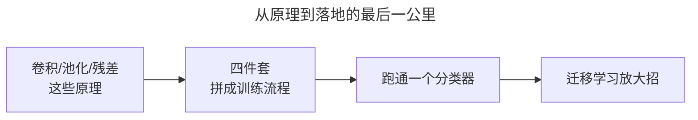
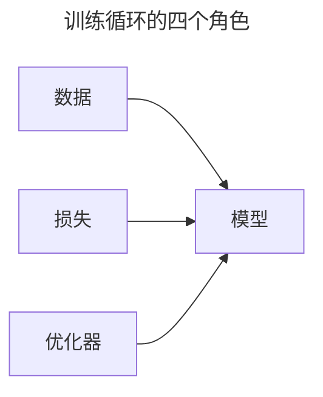
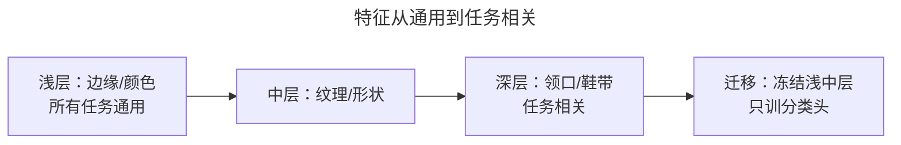
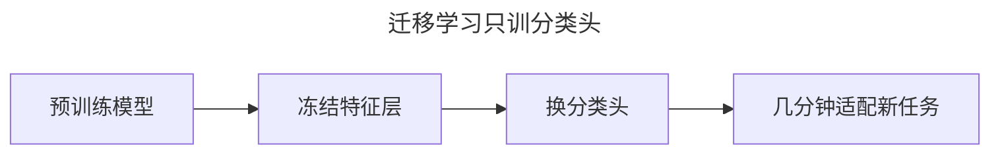
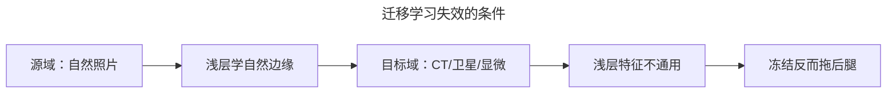
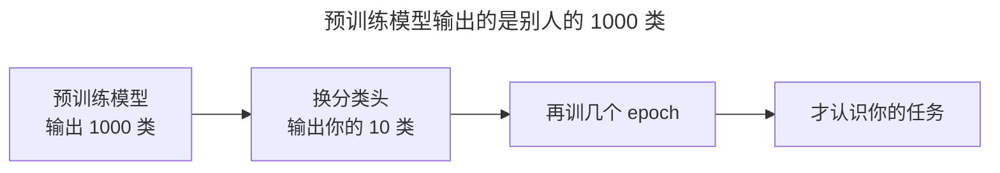
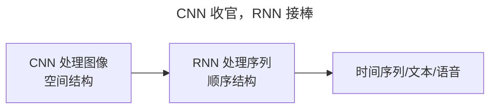

> 作者：轻松学AI
> 日期：2026-10-18
> 风格：通俗科普
> 状态：待发布

# 从零开始学深度学习 #14：CNN 实战——训一个图像分类器

这是 CNN 这一批的收官。前面讲了卷积、池化、经典架构、残差，这一篇把它们全部用上，真正训一个图像分类模型出来。

数据集用 Fashion-MNIST——10 类衣服鞋帽的 28×28 灰度图，是手写数字 MNIST 的"时尚版"，比它更难一点。

## 一、问题由来：为什么收官要真训一次

前面 #10 到 #13，卷积、池化、经典架构、残差，一路都在讲"怎么搭网络"。但搭网络离"训出一个能用的模型"还隔着一条沟：真训起来，光有网络结构远远不够——数据怎么打包、损失用什么、参数怎么更新，这些散件不拼起来，代码就是死的。

更现实的痛点藏在后面：从头训一个像样的 CNN，要几小时 GPU 和海量标注数据。很多人学到这卡住了——原理都懂，落地不会。这一篇就拿 Fashion-MNIST 练手：6 万张训练图、1 万张测试图，10 类衣服鞋帽，28×28 灰度图，比手写数字难一点，又不用租 GPU，正好把整套流程跑通一遍。

加载它，PyTorch 一行搞定，数据会自动下载：

```python
import torchvision
dataset = torchvision.datasets.FashionMNIST(
    root="cnn/data", train=True, download=True, transform=torchvision.transforms.ToTensor())
```

`transform` 这步很关键：它把图片转成张量，还能顺便做数据增强。



## 二、核心直觉：训练就是凑齐"四件套"

真训一个模型，其实就四样东西，缺一不可：



- **DataLoader**：把数据按批（batch）打包，训练时一批一批喂，还支持打乱顺序。
- **损失函数**：分类任务用交叉熵（CrossEntropyLoss）。
- **优化器**：#08 讲的 Adam。
- **训练循环**：#03 搭的那个四步循环，这里换成完整的版本。

记住这个骨架，后面所有代码都是围着它转：损失函数负责"告诉模型你错多少"，优化器负责"朝对的方向改参数"，训练循环负责把这两件事反复做几千次。

## 三、机制：迁移学习凭什么有效

这一篇真正的增量是下面那招迁移学习，先把原理讲透，不然你只会抄代码。

CNN 的层是有分工的。浅层学的是低级特征——边缘、角、颜色过渡；中层学纹理、形状；越到深层，学的东西越"任务相关"，比如衣服的领口、鞋的鞋带。这个分工藏着一个关键性质：**低级特征是通用的**。不管认猫还是认鞋，第一件事都是认边缘、认轮廓，这一步和具体任务没关系。

这恰恰是迁移学习成立的因果。在 ImageNet（1000 类、上百万张自然照片）上训练过的模型，它的浅中层滤波器已经被海量图像磨到了近乎最优——而这些低级特征在新任务上依然接近最优，因为自然图像的统计规律（边缘怎么分布、纹理怎么过渡）是任务无关的。所以把浅中层冻结、只重训最后的分类头，几乎不损失精度，却省下了从头训练所需的几小时 GPU 和上百万标注样本。用数学说，微调时只有分类头的参数在被更新：

:::formula 微调只动最后一小段
θ = θ_frozen ∪ θ_head
冻结：∂L/∂θ_frozen 不参与更新
微调只做：θ_head ← θ_head − η · ∂L/∂θ_head
θ：模型参数 ｜ frozen：冻结的特征层 ｜ head：要重训的分类头 ｜ η：学习率
:::

反向传播在冻结层就被截断了，前面几百层的前向、反向都省了——这就是"几分钟适配"的账。


这就是"站在巨人肩膀上"：通用特征别人帮你训好了，你只训自己任务特有的那一小部分。

数据增强也得讲一句"为什么"。翻转、裁剪为什么能防过拟合？因为它逼模型学**几何不变性**：同一只鞋，左右翻转后还是那只鞋，模型如果只背下了"鞋头朝左"这种偶然细节，翻转样本就让它露馅。于是模型被逼着去抓"鞋的本质特征"，而不是背某张特定图。



## 四、手写核心：代码逐行看

第一段，数据增强。上一篇 #09 讲过，图像上尤其管用——同一张鞋的图，左右翻转一下、随机裁一角，对模型来说就是全新的样本。

```python
transform = transforms.Compose([
    transforms.RandomHorizontalFlip(),      # 随机左右翻转
    transforms.RandomCrop(28, padding=4),   # 随机裁切
    transforms.ToTensor(),
])
```

第二段，训练循环，这是最核心的四步。

```python
loader = DataLoader(dataset, batch_size=64, shuffle=True)
loss_fn = nn.CrossEntropyLoss()
optimizer = torch.optim.Adam(model.parameters(), lr=0.01)

for X, y in loader:                    # 一批一批
    optimizer.zero_grad()
    loss = loss_fn(model(X), y)        # 前向 + 算损失
    loss.backward()                    # 反向
    optimizer.step()                   # 更新参数
```

每一行都有讲究：`zero_grad()` 必须先清空上一批的梯度，否则梯度会越叠越多；`backward()` 算的是当前这批样本对参数的梯度；`step()` 才真正按 Adam 的规则更新参数。跑几个 epoch（把整个数据集过一遍叫一个 epoch），模型就开始"学会"认衣服了。

第三段，迁移学习。从头训要几小时 GPU，但大多数时候根本不用——直接拿 ImageNet 预训练好的模型，只换最后的分类头：

```python
from torchvision import models
model = models.resnet18(weights="IMAGENET1K_V1")   # 预训练权重
for param in model.parameters():
    param.requires_grad = False                     # 冻结特征层
model.fc = nn.Linear(model.fc.in_features, 10)      # 只换最后的分类头
```

`requires_grad = False` 是这段的灵魂：它让 autograd 直接跳过特征层的梯度计算，只留最后的 `fc`（从 1000 类换成 10 类）能被优化器更新。



这也是为什么深度学习工业应用能这么快铺开——直接复用开源预训练模型。

## 五、实验：跑起来看训练曲线

搭一个两层卷积的小 CNN，用数据增强，训 4 个 epoch，看训练和验证的表现。


左图是损失，右图是准确率。训练损失一路降、训练准确率一路涨——模型在"学"。验证准确率（红方块）也稳步上升，训练、验证两条曲线同步上升，模型没有只记住训练集。4 个 epoch，验证准确率就冲到了 85% 上下。

如果训练准确率很高、验证准确率停滞甚至下降，那就是过拟合的信号——这时候该回 #09 加正则、加数据增强了。

## 六、边界：跨域迁移什么时候会翻车

迁移学习回报高，但吃一个前提：**源域和目标域要长得像**。ImageNet 预训练模型是从自然照片里学出来的，把它搬到差异大的领域，浅层那些"通用特征"就不通用了。

几个典型失效场景：医学影像（X 光、CT 是灰度断层图，没有自然照片的颜色和纹理分布）、遥感卫星图（俯视视角、多光谱波段）、显微镜细胞图。这些图里"边缘"的统计规律和自然照片差太远，冻结 ImageNet 的浅中层不但帮不上忙，反而把模型锁死在错误的低级特征上，效果常常不如从零训练。

代价还有两点：预训练权重不小，ResNet-18 一个权重文件就 40 多 MB，更大的模型上 GB，部署时内存账要算清；你继承的不只是"知识"，还有原模型的偏置——它在 ImageNet 上见过的类、它的数据分布，都会漏进你的任务里。跨域时与其硬套，不如只用前几层，或者干脆放弃预训练、从零训。



## 七、一个常见误解：预训练模型 ≠ 拿来即用

很多人以为，下载一个预训练模型，直接喂自己的图就能出结果。

不是的。预训练模型学的是"通用特征"，它不知道怎么把你那 10 类分出来——最后那层分类头输出的是 ImageNet 的 1000 类。你必须把分类头换成自己任务的样子，再训上几个 epoch，让模型把通用特征"翻译"成你的标签。所谓"几分钟适配"，指的是只训最后一小段，不是完全不训。



## 八、延伸：收官之后，换个赛道

到这里，CNN 这一批五篇（#10 到 #14）全部讲完。回顾这条线：卷积提特征、池化降维、架构堆深、残差破深度瓶颈、实战落地。这五篇，就是 CNN 的完整入门。

迁移学习你后面还会反复撞见——它其实是整个深度学习的通用思路，不止图像，文本、语音里同样靠预训练模型打底。下一批，我们换个赛道，去处理"有顺序"的数据——文本、语音、时间序列。那就是循环神经网络 RNN 的天下，而 RNN 训练时的梯度问题，正好接回 #04 埋下的伏笔。



- [PyTorch 官方教程：Transfer Learning for Computer Vision](https://pytorch.org/tutorials/beginner/transfer_learning_tutorial.html)
- [《动手学深度学习》13.2 微调](https://zh.d2l.ai/chapter_computer-vision/fine-tuning.html)
- [Fashion-MNIST 数据集](https://github.com/zalandoresearch/fashion-mnist)
- [配套仓库 dl-from-scratch（cnn/practice.py）](https://github.com/Joneyao/dl-from-scratch)
