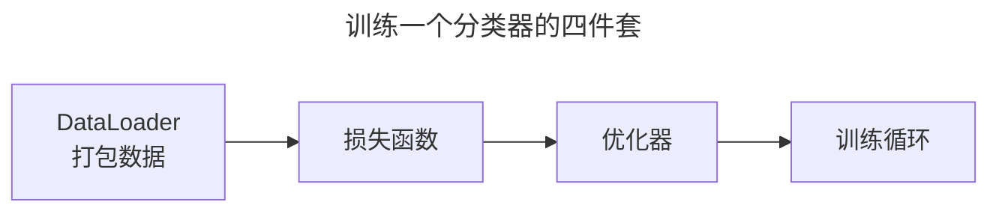
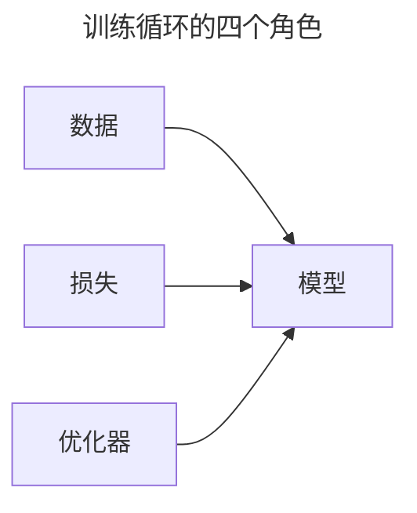
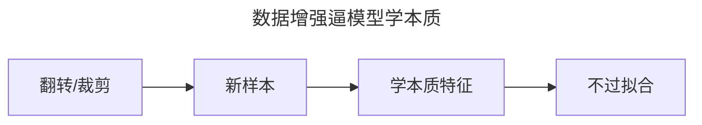
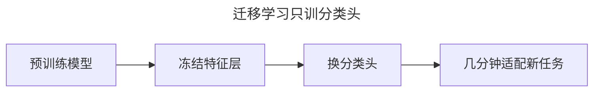

> 作者：轻松学AI
> 日期：2026-10-18
> 风格：通俗科普
> 状态：待发布

# 从零开始学深度学习 #14：CNN 实战——训一个图像分类器

这是 CNN 这一批的收官。前面讲了卷积、池化、经典架构、残差，这一篇把它们全部用上，真正训一个图像分类模型出来。

数据集用 Fashion-MNIST——10 类衣服鞋帽的 28×28 灰度图，是手写数字 MNIST 的"时尚版"，比它更难一点。

## 一、先看数据长什么样

Fashion-MNIST 有 6 万张训练图、1 万张测试图，分成 10 类：T恤、裤子、套头衫、裙子、外套、凉鞋、衬衫、运动鞋、包、靴子。




加载它，PyTorch 一行搞定，数据会自动下载：

```python
import torchvision
dataset = torchvision.datasets.FashionMNIST(
    root="cnn/data", train=True, download=True, transform=torchvision.transforms.ToTensor())
```

`transform` 这步很关键：它把图片转成张量，还能顺便做数据增强。

## 二、完整训练循环的四件套

真训一个模型，光有网络不够，还得凑齐四件套：




- **DataLoader**：把数据按批（batch）打包，训练时一批一批喂，还支持打乱顺序。
- **损失函数**：分类任务用交叉熵（CrossEntropyLoss）。
- **优化器**：#08 讲的 Adam。
- **训练循环**：#03 搭的那个四步循环，这里换成完整的版本。

```python
loader = DataLoader(dataset, batch_size=64, shuffle=True)
loss_fn = nn.CrossEntropyLoss()
optimizer = torch.optim.Adam(model.parameters(), lr=0.01)

for X, y in loader:                    # 一批一批
    optimizer.zero_grad()
    loss = loss_fn(model(X), y)        # 前向 + 算损失
    loss.backward()                    # 反向
    optimizer.step()                   # 更新参数
```

就这么一个循环，跑几个 epoch（把整个数据集过一遍叫一个 epoch），模型就开始"学会"认衣服了。

## 三、数据增强：让模型见多识广

上一篇 #09 讲过数据增强。在图像上它尤其管用——同一张鞋的图，左右翻转一下、随机裁一角，对模型来说就是全新的样本。

```python
transform = transforms.Compose([
    transforms.RandomHorizontalFlip(),      # 随机左右翻转
    transforms.RandomCrop(28, padding=4),   # 随机裁切
    transforms.ToTensor(),
])
```

这些"伪造"的样本，逼着模型去学"鞋的本质特征"，而不是背下某张特定图片。


数据量不变，但模型见过的"花样"翻了好几倍。

## 四、跑起来，看训练曲线

搭一个两层卷积的小 CNN，用数据增强，训 4 个 epoch，看训练和验证的表现。


左图是损失，右图是准确率。训练损失一路降、训练准确率一路涨——模型在"学"。验证准确率（红方块）也稳步上升，说明它不是在背答案，是真的学到了能泛化的东西。4 个 epoch，验证准确率就冲到了 85% 上下。

如果训练准确率很高、验证准确率停滞甚至下降，那就是过拟合的信号——这时候该回 #09 加正则、加数据增强了。

## 五、迁移学习：深度学习的正确打开方式

最后讲一个实战里最重要的思路：**迁移学习**。

从头训一个像样的 CNN，要几小时 GPU 和海量数据。但大多数时候你根本不用从头训——直接拿一个在 ImageNet 上预训练好的模型（它已经学会了"认边缘、认形状"这些通用特征），只重新训练最后几层分类头，几分钟就能适配你的新任务。


```python
from torchvision import models
model = models.resnet18(weights="IMAGENET1K_V1")   # 预训练权重
for param in model.parameters():
    param.requires_grad = False                     # 冻结特征层
model.fc = nn.Linear(model.fc.in_features, 10)      # 只换最后的分类头
```

这就是"站在巨人肩膀上"：通用特征别人帮你训好了，你只训自己任务特有的那一小部分。


这也是为什么深度学习工业应用能这么快铺开——不用人人从零造轮子。

**结语**

到这里，CNN 这一批五篇（#10 到 #14）全部讲完了。我们从卷积的原理出发，一路走到能训出一个真正的图像分类模型。

回顾这条线：卷积提特征、池化降维、架构堆深、残差破深度瓶颈、实战落地。这五篇，就是 CNN 的完整入门。

下一批，我们换个赛道，去处理"有顺序"的数据——文本、语音、时间序列。那就是循环神经网络 RNN 的天下。

- [PyTorch 官方教程：Transfer Learning for Computer Vision](https://pytorch.org/tutorials/beginner/transfer_learning_tutorial.html)
- [《动手学深度学习》13.2 微调](https://zh.d2l.ai/chapter_computer-vision/fine-tuning.html)
- [Fashion-MNIST 数据集](https://github.com/zalandoresearch/fashion-mnist)
- [配套仓库 dl-from-scratch（cnn/practice.py）](https://github.com/Joneyao/dl-from-scratch)
