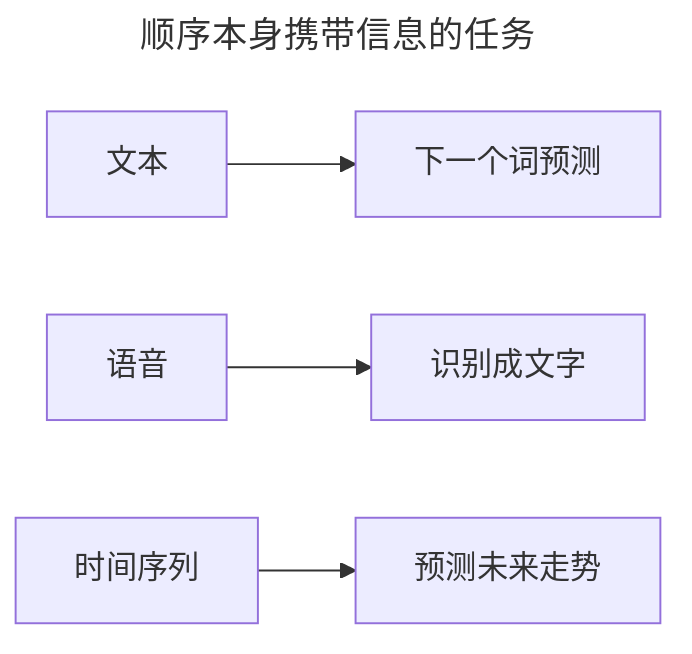
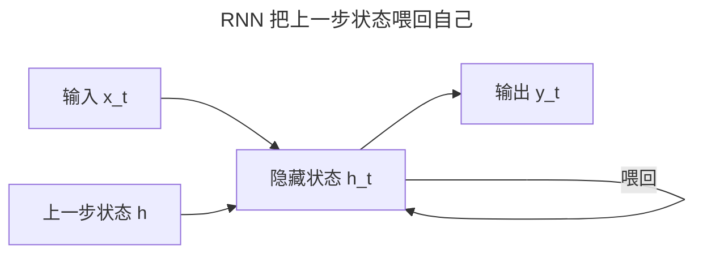
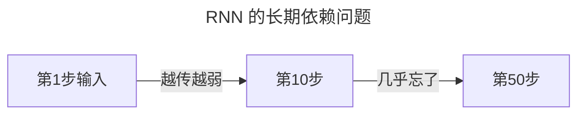

> 作者：轻松学AI
> 日期：2026-10-18
> 风格：通俗科普
> 状态：待发布

# 从零开始学深度学习 #15：RNN——网络怎么"记住"前面的话

前十四篇处理的数据，都有一个共同点：样本之间互相独立。一张图片、一行特征，喂给网络时，它跟前面那张图没有关系。

但很多数据不是这样的。一句话、一段语音、一条时间序列——顺序本身就是信息。"我打了电话"和"电话打了我"，同样的字，顺序不同意思相反。处理这种数据，需要网络有"记忆"。这就是循环神经网络 RNN 的由来。

## 一、序列数据：顺序本身就是信息

先看清 RNN 要解决的问题。下面这些任务，都不能把每个输入当独立样本来处理：



它们的共性：输入是一个序列，输出依赖于序列里"前面"的元素。前面那个普通的全连接网络，做不到这一点——它每看一个输入，就把上一个忘光了。

## 二、核心思想：把上一步的输出喂回自己

RNN 的思路非常直接。普通网络里，信息是"输入 → 输出"单向流。RNN 加了一条线：把上一步的隐藏状态，再喂回给下一步。



这个隐藏状态 `h`，就是网络的"记忆"。它既接收当前的输入，又接收上一步的 `h`，于是信息可以在时间上一步步传递下去。


用一个公式概括：

:::formula RNN 的单步
h_t = tanh( x_t·W_xh + h_{t-1}·W_hh + b )
h_t：当前隐藏状态 ｜ x_t：当前输入 ｜ h_{t-1}：上一步状态
:::

## 三、手写一个 RNN 前向

关键细节就一个：**所有时间步，用的是同一组权重** `W_xh`、`W_hh`。手写前向，就是拿这组权重，一步步滚下去：

```python
def rnn_forward(X, h0, W_xh, W_hh, b_h):
    h = h0
    outputs = []
    for t in range(X.shape[0]):          # 逐个时间步
        h = torch.tanh(X[t] @ W_xh + h @ W_hh + b_h)
        outputs.append(h)
    return torch.stack(outputs)
```

一个循环，一个 `tanh`。整个 RNN 的前向，就这么简单。

顺带说一句"记忆"是怎么学出来的：训练时，损失沿时间轴一步步反向回传（BPTT），同一组权重 `W_xh`、`W_hh` 在每个时间步都被用了一次，所以梯度要沿时间累加。前向的循环给了它"记忆"的形态，反向的时间轴传播才让这份记忆真正被训练出来。

我们跑一个字符级的小实验，训练它预测"下一个字符"，损失一路下降：


## 四、RNN 的软肋：记不住太远的

RNN 能"记住"前面的话，但记得不远。

原因还是 #04 的梯度消失——只不过这次是沿着时间轴。信息每过一个时间步，就要乘一次权重，几十步下来，最早的输入对当前的影响就衰减到几乎没有了。



一句话开头提到"张三"，50 个词之后再出现"他"，RNN 早就忘了"张三"是谁。这个"长期依赖"问题，正是下一篇 LSTM 要解决的。

- [《动手学深度学习》8.4 循环神经网络](https://zh.d2l.ai/chapter_recurrent-neural-networks/rnn.html)
- [《深度学习》花书 第 10 章：序列建模](https://www.deeplearningbook.org/contents/rnn.html)
- [配套仓库 dl-from-scratch（rnn/rnn.py）](https://github.com/Joneyao/dl-from-scratch)
