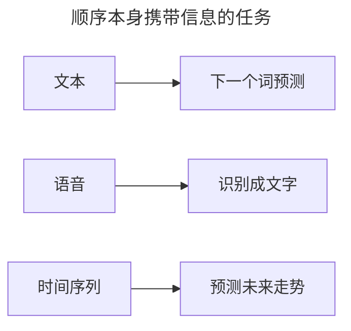
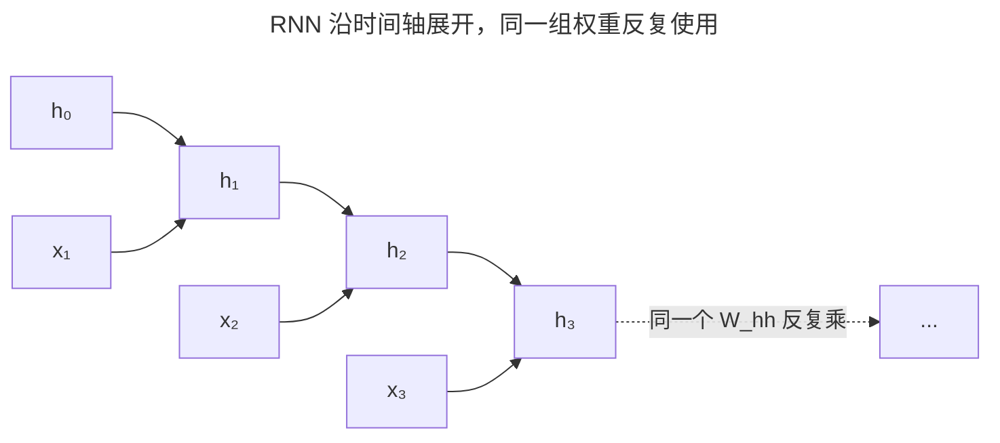
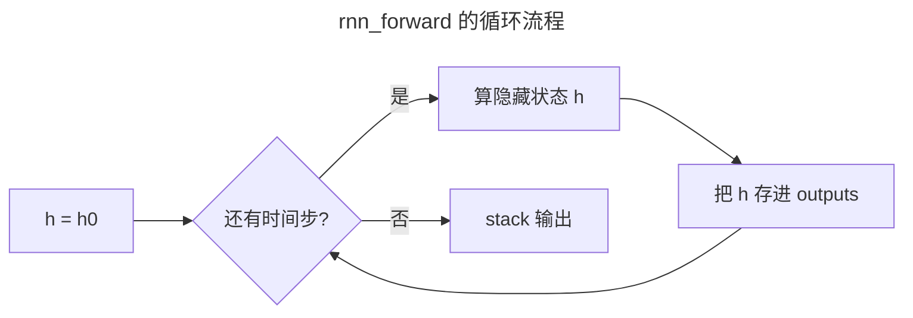
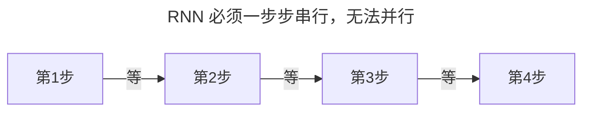
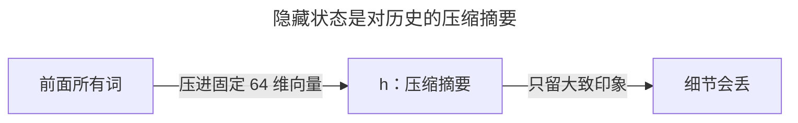
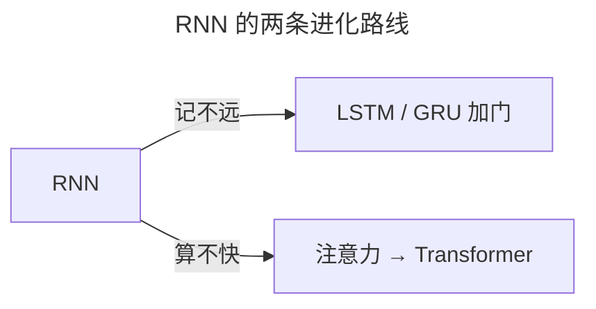

> 作者：轻松学AI
> 日期：2026-10-18
> 风格：通俗科普
> 状态：待发布

# 从零开始学深度学习 #15：RNN——网络怎么"记住"前面的话

前十四篇处理的数据，都有一个共同点：样本之间互相独立。一张图片、一行特征，喂给网络时，它跟前面那张图没有关系。

但很多数据不是这样的。一句话、一段语音、一条时间序列——顺序本身就是信息。"我打了电话"和"电话打了我"，同样的字，顺序不同意思相反。处理这种数据，需要网络有"记忆"。这就是循环神经网络 RNN 的由来。

## 一、问题由来：全连接网络在序列面前有三个死穴

顺序是信息，这话大家都懂。真正让旧工具卡住的，是三个更具体的死穴。

第一，输入长度不固定。图片能统一缩放到固定尺寸，全连接网络就能把输入维度写死；一句话却可长可短，没法提前定死。

第二，位置天然丢失。全连接网络把输入当一包无序的数，谁在前谁在后对它没区别——但"张三打李四"和"李四打张三"是两件事。

第三，没有跨样本的记忆。它每看一个输入就从头算，看完第三个词，前两个词的线索一点不剩。



翻译、语音识别、走势预测，全卡在这三件事上：都要拿着前文理解后文。缺的，就是一个能随时间把状态传下去的结构。

## 二、核心直觉：把上一步的输出喂回自己

RNN 的思路直接得有点粗暴。普通网络里信息单向流，输入进、输出出，算完就散。RNN 加了一条回边：把上一步算出的隐藏状态，再喂回给下一步。

可以想成流水线上的工人，每人带一个记事本：接到新零件，既看零件本身，也翻一眼上个工人留的笔记，写完新笔记再传给下一个人。这个记事本就是隐藏状态 h，网络唯一的记忆。

接力赛是同一个意思：接棒的人带着前一棒的速度继续跑。


用一个公式概括：

:::formula RNN 的单步
h_t = tanh( x_t·W_xh + h_{t-1}·W_hh + b )
h_t：当前隐藏状态 ｜ x_t：当前输入 ｜ h_{t-1}：上一步状态
:::

## 三、机制：这份"记忆"为什么真的存在

光有回边还不够，得说清它为什么能记住，又是怎么学会记的。

先看前向。把公式里的 h_{t-1} 一直递归代入，h_t 会展开成从 x_1 到 x_t 全部历史的一个函数。也就是说，h_t 在数学上显式依赖前面每一个输入——这就是记忆的形态：当前状态是所有历史的产物，而不是只看当下。

再回答一个更关键的问题：为什么每个时间步要共用同一组权重 W_xh、W_hh？看着像偷懒，其实有讲究。序列里的规律跟位置无关："的"字后面跟名词，在第 3 个位置成立，在第 30 个位置也成立。共享权重让网络把这条规律只学一次、到处通用，参数量也不随句子长度涨。反过来，如果每个位置一套独立权重，"张三"出现在句首和句尾学到的就互不相通，训练样本还被切成一段段，数据利用效率低得多。

最后是训练怎么让它学会"该记什么"。前向的循环只给了 h 承载历史的形态，记什么、丢什么，要靠反向传播沿时间轴回传——BPTT。把循环按时间展开成一条链，就是个很深的网络，普通反向传播照用。因为同一组 W_hh 在 T 个时间步各被用了一次，链式法则要求把这 T 份贡献加起来：

:::formula BPTT：梯度沿时间累加
∂L/∂W_hh = Σ(t=1..T) ∂L_t/∂W_hh
每一项 ∂L_t/∂W_hh 里含一串连乘：tanh'(·)·W_hh，从第 t 步一直乘回第 1 步
:::



注意连乘里每一项都带一个 tanh'(·)，它最大不过 1。这就是下一篇 LSTM 要治的病灶。顺带回答一个常被跳过的问题：为什么偏要用 tanh？因为它把状态锁在 (-1,1) 里——不压的话，h 每步叠加自己，几十步就指数膨胀，和 #04 的梯度爆炸是同一个根子。眼下先记住一点：记忆的"形态"来自前向循环，"内容"来自 BPTT。

## 四、手写一个 RNN 前向

前向代码就一个循环。逐行看它在干嘛：

```python
def rnn_forward(X, h0, W_xh, W_hh, b_h):
    h = h0
    outputs = []
    for t in range(X.shape[0]):          # 逐个时间步
        h = torch.tanh(X[t] @ W_xh + h @ W_hh + b_h)
        outputs.append(h)
    return torch.stack(outputs)
```

- `h = h0`：第一句之前没有历史，初始状态通常填成全零。
- `for t in range(...)`：沿时间轴一步步滚，这就是"循环"的物理体现。
- 中间那行是全部核心：先算新输入 X[t] 和旧记忆 h 的线性组合，再过一次 tanh。等号右边用到的 h 还是上一步的旧值，算完才覆盖，不会自我污染。
- `outputs.append(h)`：每一步的 h 都留一份——既给下一步当记忆，也可能就是这一步的输出。
- `return torch.stack(outputs)`：把 T 步的 h 摞成一个张量。



这组权重在每一步重复使用，是参数共享在代码里的样子。配套仓库里拿它和 PyTorch 原生 `nn.RNN` 对照过，结果一致。

## 五、实验：让字符级模型学会"hello world"

配套仓库跑了个最小的字符级实验：语料是 `hello world ` 重复 4 遍，共 48 个字符、只有 8 种不同字符（h、e、l、o、空格、w、r、d）。模型是原生 `nn.RNN`，隐藏维度 64，每次喂 10 个字符去预测下一个，用 Adam、学习率 0.01，训 200 轮。

初始损失在 ln(8)≈2.08 附近——这是"8 选 1 乱猜"的交叉熵起点。训练后损失一路往下掉：


模型真的学会了"hello world"这个循环规律：看到 "hell"，就知道下一个多半是 "o"。一个循环、一个 tanh，就够抓住顺序里的规律。

## 六、边界与代价：记不远，还串行算不快

RNN 有两个硬伤，一个是能力问题，一个是成本问题。

能力问题是长期依赖，也就是 #04 的梯度消失沿时间轴重演。信息每过一个时间步就乘一次 tanh'·W_hh，几十步连乘下来，最早的输入衰减得几乎没了。


一句话开头说"张三"，50 个词后再出现"他"，RNN 早忘了"张三"是谁。

成本问题是串行。第 t 步必须等第 t-1 步的 h 算出来，GPU 的并行算力派不上用场；句子越长，前向反向越慢、显存越高——因为每一步的中间状态都得存着。



工程上对付长序列，常用截断式 BPTT：只回传最近几十步，把显存和速度救回来，代价是更远处的依赖干脆不学了——又绕回"记不远"这条线。

所以 RNN 不是万能的：如果数据本来就没有顺序（表格、图像分类），套 RNN 只会更慢。这两条硬伤，分别引出了后面两条进化路线。

## 七、一个常见误解：h 不是"存档"，是"摘要"

很多人以为 RNN 的隐藏状态像个小抄，把前面的话原样存进去了。

其实 h 只是个固定维度的向量——上面实验里只有 64 维。它装不下原文，是一份有损压缩的摘要：每一步旧信息和新输入都被 tanh 压回 (-1,1) 后搅在一起重算，想留的留不住，想丢的也丢不干净。



所谓"记忆"，是对历史的概括，不是对历史的存档。

## 八、延伸：这条线通往 LSTM 和 Transformer

RNN 是序列建模的开端，它的两个硬伤直接催生了后面两条路。

记不远 → LSTM 和 GRU（#16、#17）：加门和细胞状态，让重要信息能跳过几十步不被稀释。算不快 → 注意力机制和 Transformer（#18 到 #20）：干脆不要循环，一步看到全局。



下一篇 LSTM，就看它怎么用三条门，把"该记的记牢、该忘的忘掉"显式做成可训练的参数。

- [《动手学深度学习》8.4 循环神经网络](https://zh.d2l.ai/chapter_recurrent-neural-networks/rnn.html)
- [《深度学习》花书 第 10 章：序列建模](https://www.deeplearningbook.org/contents/rnn.html)
- [colah：Understanding LSTM Networks](https://colah.github.io/posts/2015-08-Understanding-LSTMs/)
- [配套仓库 dl-from-scratch（rnn/rnn.py）](https://github.com/Joneyao/dl-from-scratch)
