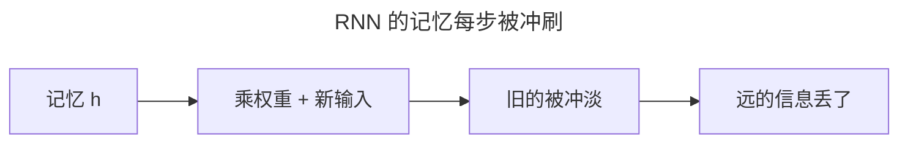
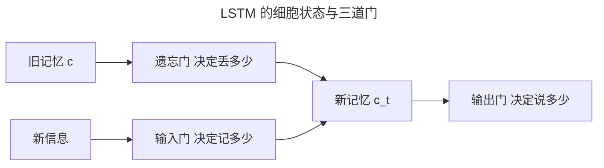
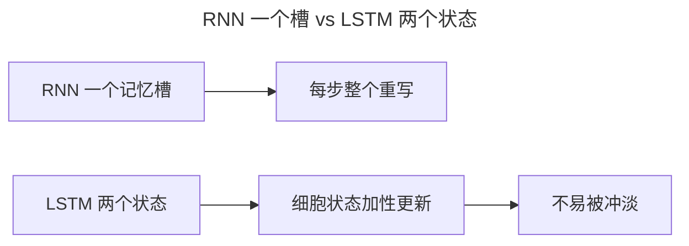

> 作者：轻松学AI
> 日期：2026-10-18
> 风格：通俗科普
> 状态：待发布

# 从零开始学深度学习 #16：LSTM——三条门与细胞状态

上一篇结尾留了个问题：RNN 记不住太远的信息，一句话开头的"张三"，到 50 个词之后就被忘了。

这一篇讲的 LSTM，就是为了解决这个问题设计的。它的做法是给网络配一个"记忆筛选器"，什么该忘、什么该记，都由网络自己学着决定。

## 一、RNN 记不住长依赖，卡在哪

先想清楚 RNN 为什么记不远。它的记忆就是那个隐藏状态 `h`，每一步都被新的输入"冲刷"一遍：



每一步，`h` 都被 `tanh` 压一次、被新输入混一次。几十步下来，最初的信息早就面目全非。要记住"张三"到第 50 个词，普通 RNN 力不从心。

## 二、LSTM：给记忆装三道门

LSTM 的关键改动，是引入一个独立的"细胞状态" `c`，专门负责长期记忆，再给它装三道门：

- **遗忘门**：决定丢掉哪些旧记忆。
- **输入门**：决定记住哪些新信息。
- **输出门**：决定当前输出多少。



三道门的本质，都是 `sigmoid` 输出 0 到 1 之间的数，用来"开合"信息的流动。

一个实践细节：遗忘门的偏置常被初始化为 1，让网络起步时就偏向"不遗忘"——先把信息留住，学不学遗忘以后再说。


0 表示全关（彻底忘/不记/不说），1 表示全开。


## 三、手写 LSTM 的核心

手写 LSTM 的单步，就是把这三道门算出来。关键代码：

```python
gates = x @ W_ih.T + b_ih + h_prev @ W_hh.T + b_hh
f, i, g, o = gates.chunk(4, dim=-1)      # 切出四块
f = torch.sigmoid(f)                     # 遗忘门
i = torch.sigmoid(i)                     # 输入门
g = torch.tanh(g)                        # 候选新值
o = torch.sigmoid(o)                     # 输出门
c = f * c_prev + i * g                   # 细胞状态：忘旧的 + 记新的
h = o * torch.tanh(c)                    # 输出：门控决定说多少
```

注意最后两行：细胞状态 `c` 的更新是"遗忘门乘旧记忆 + 输入门乘新信息"。这个结构让 LSTM 可以做到——某条重要信息，只要"遗忘门"一直开着、"输入门"不打扰，就能原样一路传下去，几十步都不衰减。


这张图是 LSTM 细胞状态在 10 个时间步里的变化。注意那些基本走平、甚至微微上升的曲线——信息被"保持"住了，而不是像 RNN 那样每步被冲刷。

## 四、LSTM 和 RNN 的本质区别

RNN 只有一个"记忆槽"，每步都整个重写；LSTM 有两个状态，其中细胞状态 `c` 走的是"加性"更新，不容易被冲淡。

为什么"加性"能救梯度？反向传播时，RNN 的梯度要穿过几十个连乘的权重矩阵，每步乘一个小于 1 的因子，几十次方后就趋近 0；LSTM 的细胞状态走的是加法路径，梯度沿这条路径近似无损地流回前面——这正是它"记得住"的原因。



这也解释了为什么 LSTM 能连续多年占据机器翻译、语音识别的 SOTA——它终于让网络能记住"几十步之前的关键信息"。

LSTM 的代价也不小：参数是普通 RNN 的 4 倍，训练更慢；而且它仍然是串行结构，无法像 Transformer 那样并行。对几百步以上的超长依赖，LSTM 也照样会遗忘——这些局限，正是 2017 年之后它被 Transformer 逐步取代的原因。

下一篇看 LSTM 的简化版 GRU，以及用字符级 RNN 做一个真正的"文本生成"小实验。

- [colah 博客：Understanding LSTM Networks](https://colah.github.io/posts/2015-08-Understanding-LSTMs/)
- [《动手学深度学习》9.2 长短期记忆网络（LSTM）](https://zh.d2l.ai/chapter_recurrent-modern/lstm.html)
- [《深度学习》花书 第 10 章](https://www.deeplearningbook.org/contents/rnn.html)
- [配套仓库 dl-from-scratch（rnn/lstm.py）](https://github.com/Joneyao/dl-from-scratch)
