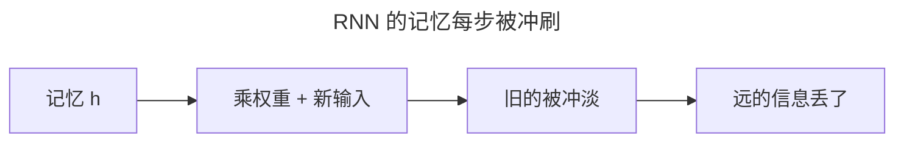
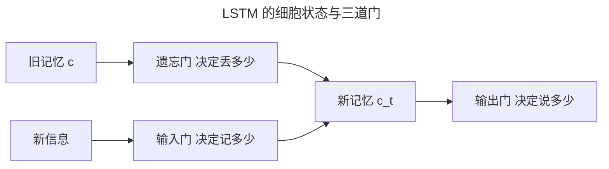
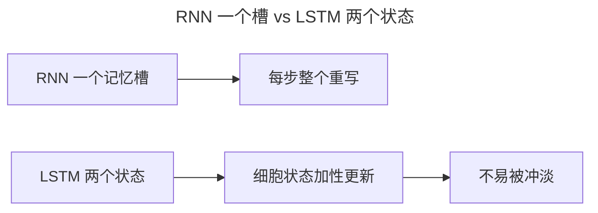
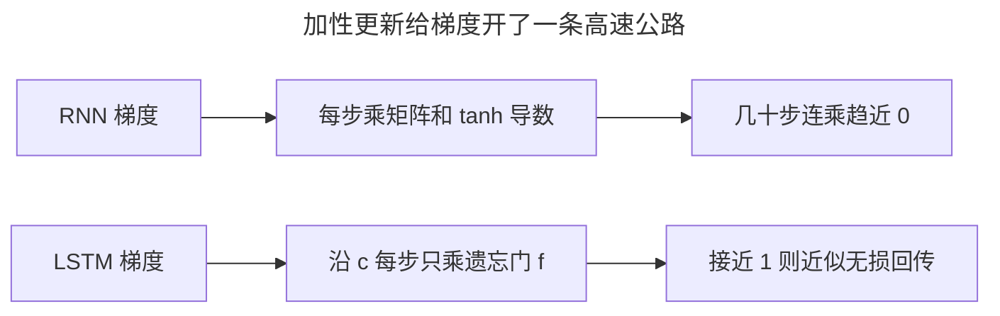
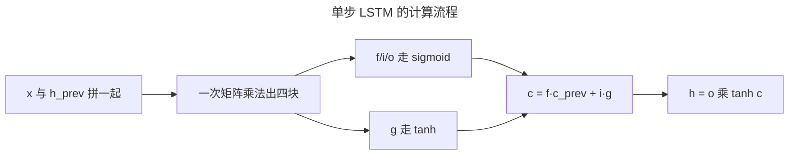
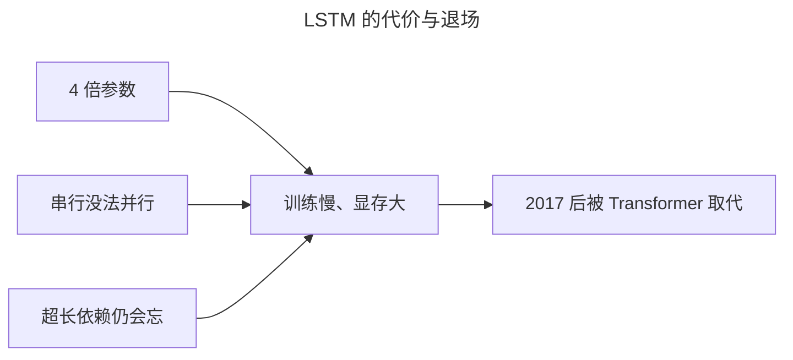
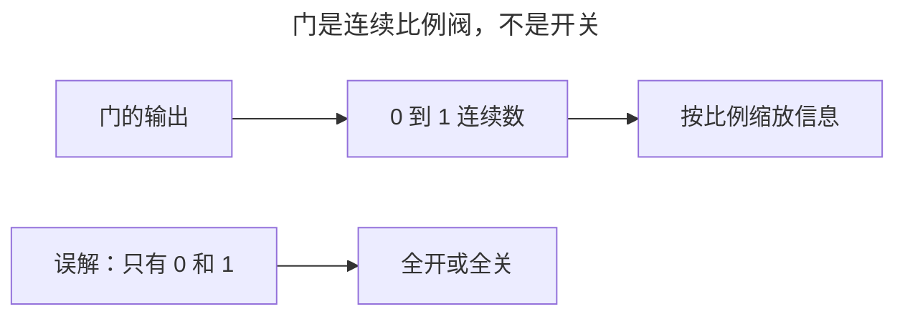
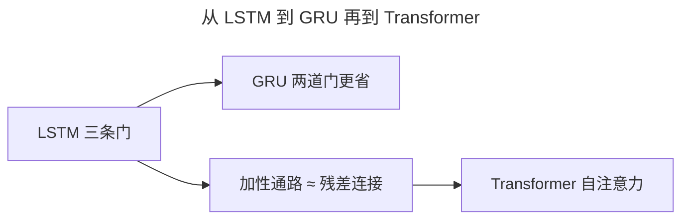

> 作者：轻松学AI
> 日期：2026-10-18
> 风格：通俗科普
> 状态：待发布

# 从零开始学深度学习 #16：LSTM——三条门与细胞状态

上一篇结尾留了个问题：RNN 记不住太远的信息，一句话开头的"张三"，到 50 个词之后就被忘了。

这一篇讲的 LSTM，就是为了解决这个问题设计的。它的做法是给网络配一个"记忆筛选器"——什么该忘、什么该记，都由网络自己学着决定。要说清楚它为什么能成，得先看 RNN 到底卡在哪。

## 一、问题由来：RNN 记不住长依赖，卡在哪

先想清楚 RNN 为什么记不远。它的记忆就是那个隐藏状态 `h`，每一步都被新的输入"冲刷"一遍：



每一步，`h` 都被 `tanh` 压一次、被新输入混一次。几十步下来，最初的信息早就面目全非，要记住"张三"到第 50 个词，普通 RNN 力不从心。

再往深一层说，这其实是上一篇梯度消失问题在"时间维度"上的翻版：反向传播时，梯度要穿过几十个连乘的权重矩阵，每步乘一个小于 1 的因子，几十次方后就趋近 0。梯度都没了，网络自然学不会"记住 50 步之前那个张三"这件事。

所以痛点不在 RNN 笨不笨，问题出在它的记忆机制先天带病：只有一个槽、每步整个重写、连乘衰减。要治，就得从记忆结构上动手。

## 二、核心直觉：给记忆装三道筛子

LSTM 的关键改动，是引入一个独立的"细胞状态" `c`，专门负责长期记忆，再给它装三道门：




可以把 `c` 想成一条传送带，上面放着长期记忆；三道门就是三面筛子——**遗忘门**决定旧记忆里哪些漏下去，**输入门**决定新信息哪些放进来，**输出门**决定此刻对外讲多少。0 表示全关（彻底忘/不记/不说），1 表示全开。

但类比只是帮你"看得见"，真正让它 work 的，是那套数学——尤其那个"加性更新"。

## 三、机制：为什么"加性更新"能救梯度

这是整篇最该讲透的地方。RNN 和 LSTM 的差别，表面看是"多了几道门"，根子上是一条梯度回传路径的差别。



RNN 的隐藏状态是这么更新的：

`h_t = tanh(W_hh · h_{t-1} + W_ih · x_t)`

注意那个 `W_hh`：每一步，旧状态都要被同一个权重矩阵"整容"一次，再过一道 tanh。反向传播要穿过 t 步，就得连乘 t 次 `W_hh 的转置 × tanh 的导数`。矩阵的特征值只要稍微偏离 1，t 次方下去就是指数衰减或爆炸——这正是上篇连乘公式在时间维度上的翻版。

LSTM 把记忆搬进细胞状态 `c`，更新公式变成：

`c_t = f_t ⊙ c_{t-1} + i_t ⊙ g_t`

关键在那个"加"和逐元素的"乘"。往回求导，`c_t` 对 `c_{t-1}` 的导数就是 `f_t`——一个 0 到 1 之间的数，而且是逐元素的数，不是矩阵。梯度沿细胞状态这条路回传，每一步只乘一个 `f_t`，没有权重矩阵反复乘，没有 tanh 反复压。

只要遗忘门 `f` 学得接近 1，这条路就近似无损：每步乘 0.99，传 50 步还剩 0.99⁵⁰ ≈ 0.6，而不是趋近 0。这就是"加性更新救梯度"的全部真相——它给梯度开了一条没有重重折扣的高速公路。

顺带把门控讲透。为什么三道门都用 sigmoid？因为它输出 0 到 1，天然就是"开合度"。为什么候选值 `g` 用 tanh 而不用 sigmoid？因为往 `c` 里"加"的值得可正可负——记忆既要有"记住 X"，也要有"减掉 Y"——tanh 输出 -1 到 1 正好。最后 `h = o ⊙ tanh(c)`，外层 tanh 把 `c` 压回 -1 到 1，防止数值一路涨爆。




还有一个实践细节：遗忘门的偏置常被初始化为 1，让网络起步时就偏向"不遗忘"——先把信息留住，学不学遗忘以后再说。

## 四、手写核心：十行代码，逐行干什么

手写 LSTM 的单步，就是把四块（三道门加一个候选值）一次算出来：

```python
gates = x @ W_ih.T + b_ih + h_prev @ W_hh.T + b_hh
f, i, g, o = gates.chunk(4, dim=-1)      # 切出四块
f = torch.sigmoid(f)                     # 遗忘门
i = torch.sigmoid(i)                     # 输入门
g = torch.tanh(g)                        # 候选新值
o = torch.sigmoid(o)                     # 输出门
c = f * c_prev + i * g                   # 细胞状态：忘旧的 + 记新的
h = o * torch.tanh(c)                    # 输出：门控决定说多少
```

第一行是"为什么这么写"的精华：四块的计算合并成一次矩阵乘法，`W_ih` 的维度是 `(4×hidden, input)`、`W_hh` 是 `(4×hidden, hidden)`，一次算完再 `chunk` 切四块，比分开算四次快，这也是 PyTorch 官方 LSTM 的实现方式。`f`、`i`、`o` 都过 sigmoid，因为它们是"开合度"；只有 `g` 过 tanh，因为它是往记忆里"加"的值，得可正可负。

最后两行就是上一节公式的直译：`c` 是"遗忘门筛过后的旧记忆 + 输入门筛过后的新信息"，`h` 是"输出门决定把 c 的多少说出去"。注意 `c` 和 `h` 分工不同——`c` 是不加约束的原始记忆，`h` 是经过 tanh 压缩、用来对接下一步和输出的"对外接口"。



## 五、实验：看细胞状态怎么"保持住"

光讲机制不够直观，配套仓库里跑了字符级 LSTM，把细胞状态 `c` 随时间的演变画了出来：


这张图是 10 个时间步里 `c` 的变化。注意那些基本走平、甚至微微上升的曲线——信息被"保持"住了，而不是像 RNN 那样每步被冲刷。对比上篇那张梯度逐层衰减到 1.7×10⁻¹⁸ 的图，就能直观看到：LSTM 把"每步打折扣"换成了"每步轻轻扣一点点"。

这里没有故弄玄虚的大数字，因为 LSTM 的强是结构性的——它不保证 100 步不忘，但"几十步"这个量级确实拿住了。它后来能连续多年占据机器翻译、语音识别的 SOTA，根子就在这条加性记忆通路上。

## 六、边界与代价：4 倍参数，还被 Transformer 取代

LSTM 不是白拿的，代价至少有三条。

第一是参数。四个门的权重块是独立的，输入到隐藏、隐藏到隐藏的矩阵都变成 4 倍大小，所以总参数量约为同尺寸 RNN 的 4 倍，每步的计算量和显存也跟着翻倍。

第二更致命：它还是串行的。第 t 步必须等第 t-1 步的 `h` 算完，整条序列没法并行，序列一长训练时间线性往上爬。

第三，它只是"缓解"了长依赖，没根治。超过几百步，遗忘门每步扣一点，累积起来照样忘。它把能记的距离从几十步拉到了几百步，但没到无限。

这三条叠加，就是 2017 年之后它被 Transformer 逐步取代的原因。Transformer 用自注意力让任意两个位置直接"连线"，信息不用一步步传，训练时所有位置还能并行。2017 年那篇《Attention Is All You Need》之后，机器翻译、语言模型的主干迅速换血，LSTM 从主角退成配角——现在更多出现在小模型、流式语音、时序信号这类"序列短、要省算力"的场景。



## 七、一个常见误解：门是"比例阀"，不是开关

最容易搞错的一点，是把三道门当成三个 0/1 开关：遗忘门打开就全记住、关上就全忘光。

真相是，sigmoid 输出的是 0 到 1 之间的连续数，门按比例开合。遗忘门输出 0.7，意思是这条记忆保留 70%、丢掉 30%。而且门是每个时间步、每条通道现算出来的，开合度各不相同。它做的是连续缩放，不是二选一地做决定。搞混这一点，就会误以为 LSTM 真"懂"该忘什么，其实它只是给出连续权重，效果是训练逼出来的。



## 八、延伸：GRU 精简版，以及通向 Transformer

LSTM 之后有个"精简款"叫 GRU：把遗忘门和输入门合并成一个"更新门"，细胞状态 `c` 和输出 `h` 也合二为一。参数量降到 LSTM 的约 3/4，效果在大多数任务上打平，短序列场景直接上 GRU 更省事。

再往后看，LSTM 的"加性记忆通路"和后来 ResNet 的"残差连接"是同一个思路的两次独立发明——都是给梯度留一条不打折扣的高速公路，这条线索会一路串到 Transformer。

下一篇就讲 GRU，然后用字符级 RNN 真刀真枪做一个"文本生成"小实验，把这几篇攒下的东西跑起来。



## 参考

- [colah 博客：Understanding LSTM Networks](https://colah.github.io/posts/2015-08-Understanding-LSTMs/)
- [《动手学深度学习》9.2 长短期记忆网络（LSTM）](https://zh.d2l.ai/chapter_recurrent-modern/lstm.html)
- [《深度学习》花书 第 10 章](https://www.deeplearningbook.org/contents/rnn.html)
- [Attention Is All You Need（Transformer 原始论文）](https://arxiv.org/abs/1706.03762)
- [配套仓库 dl-from-scratch（rnn/lstm.py）](https://github.com/Joneyao/dl-from-scratch)
