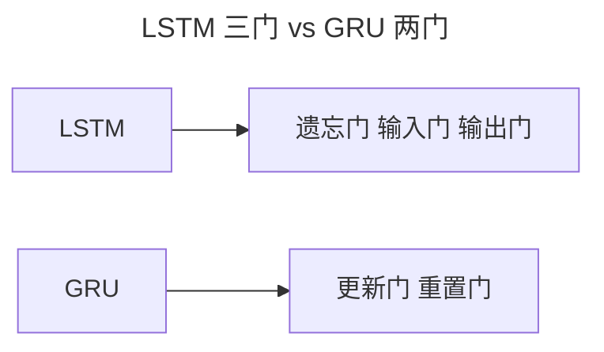
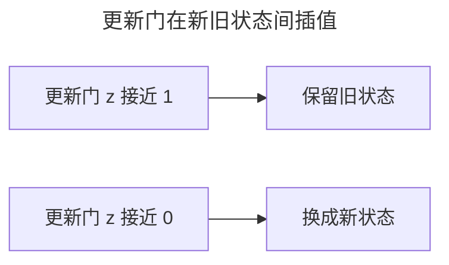
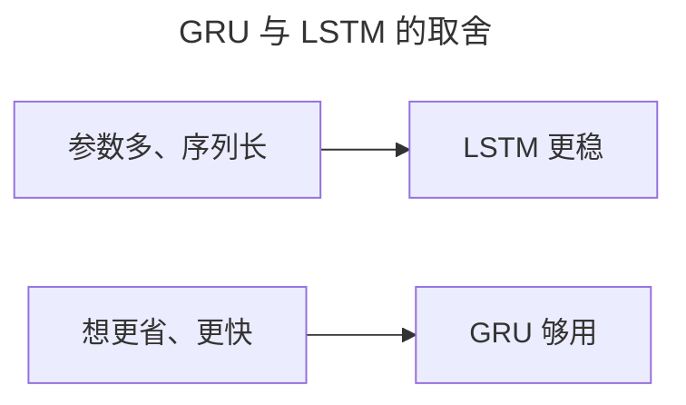

> 作者：轻松学AI
> 日期：2026-10-18
> 风格：通俗科普
> 状态：待发布

# 从零开始学深度学习 #17：GRU 与序列生成实战

上一篇讲了 LSTM 的三道门。这一篇先看它的简化版 GRU，再训练一个字符级 RNN，让它自己"续写"文本。

## 一、GRU：三道门砍成两道

LSTM 好用，但有点重——三道门 + 一个独立的细胞状态，参数多、算得慢。GRU 的答案是能：把遗忘门和输入门合并成一个更新门，再加一个重置门，去掉独立的细胞状态。GRU 把 LSTM 的"遗忘门 + 输入门"合并成一个"更新门"，再加上一个"重置门"，总共只有两道门，还去掉了独立的细胞状态。



两道门的职责：**更新门**决定"新状态替换多少旧状态"（管记忆），**重置门**决定"旧记忆有多少参与当前计算"（管当前）。少了三分之一的门，效果却几乎不差，计算更快。

## 二、手写 GRU 核心

GRU 的单步更新，核心是"新旧状态的插值"：

```python
z = sigmoid(x @ W_iz.T + h_prev @ W_hz.T + b)   # 更新门
r = sigmoid(x @ W_ir.T + h_prev @ W_hr.T + b)   # 重置门
n = tanh(x @ W_in.T + r * (h_prev @ W_hn.T + b))  # 候选新状态
h = (1 - z) * n + z * h_prev                      # 新旧插值
```

最后一行是精髓：更新门 `z` 越接近 1，就越"保留旧状态"；越接近 0，就越"换成新状态"。这就是它管"记忆"的方式。



## 三、实战：让网络自己续写文本

下面训练一个字符级 RNN，喂它一段文本，让它学会给定前文预测下一个字符。我们训练一个字符级 RNN：喂它一段文本，让它学会"给定前面的字符，预测下一个字符"。训练好后，给它一个开头，它就能一个字一个字地续写下去。


```python
model, c2i, i2c, hist = train_char_rnn("hello world hello world ...", epochs=150)
generated = generate(model, c2i, i2c, "h", length=60)
print(generated)
```


训练损失一路下降，模型从"乱猜"到"慢慢摸到字符的规律"。有意思的是，哪怕只喂它一个简单的重复串（比如 `abcabcabc...`），它也能学着续写出 `abcabcabc...`——这说明它真的学会了"a 后面跟 b，b 后面跟 c"这种顺序规律。

这个续写循环和 GPT 的逐词预测，是同一套机制。它背后就是今天所有大语言模型做"生成"的基本逻辑：预测下一个词，然后把它接上去，再预测下一个……GPT 的续写能力，就是从这么个小循环长出来的。

## 四、GRU 和 LSTM 怎么选

实战里，两者常常都能用，效果相近。一个朴素的参考：



不过说句实话：如今处理序列的主流，早就不是 RNN 家族了，而是下一篇要讲的注意力机制和 Transformer。RNN/LSTM/GRU 的价值，在于帮我们理解"序列建模"这件事本身，以及后来为什么会被 Transformer 取代。

- [GRU 论文：Learning Phrase Representations using RNN Encoder-Decoder](https://arxiv.org/abs/1406.1078)
- [《动手学深度学习》9.1 门控循环单元（GRU）](https://zh.d2l.ai/chapter_recurrent-modern/gru.html)
- [配套仓库 dl-from-scratch（rnn/gru.py）](https://github.com/Joneyao/dl-from-scratch)
