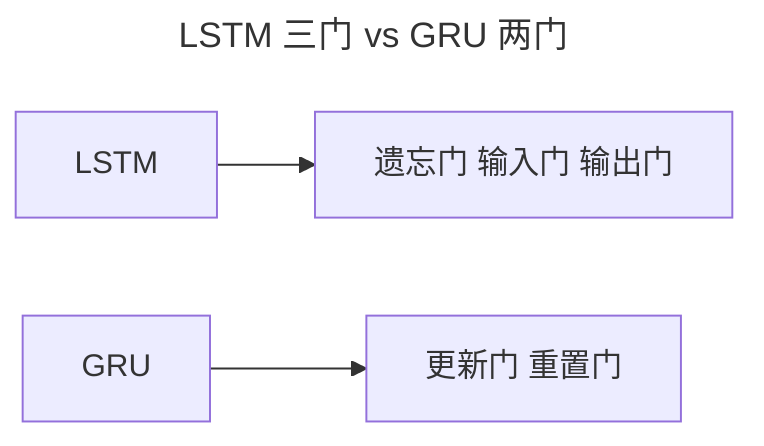
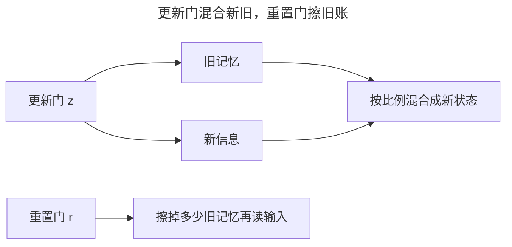
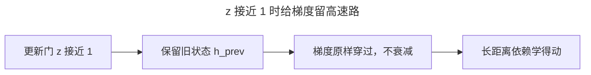
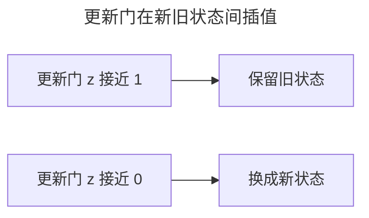
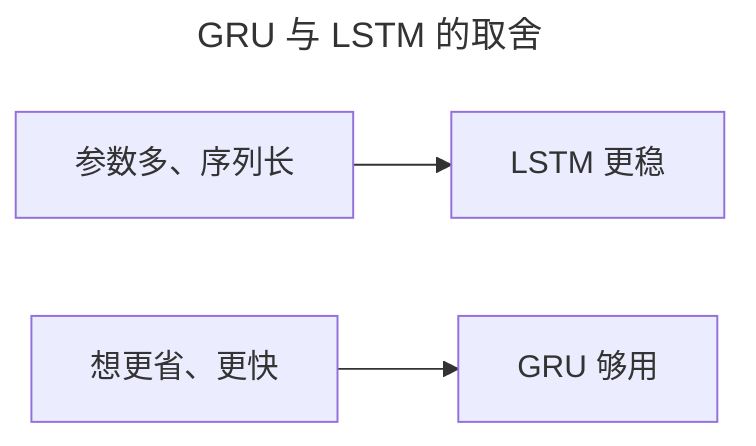
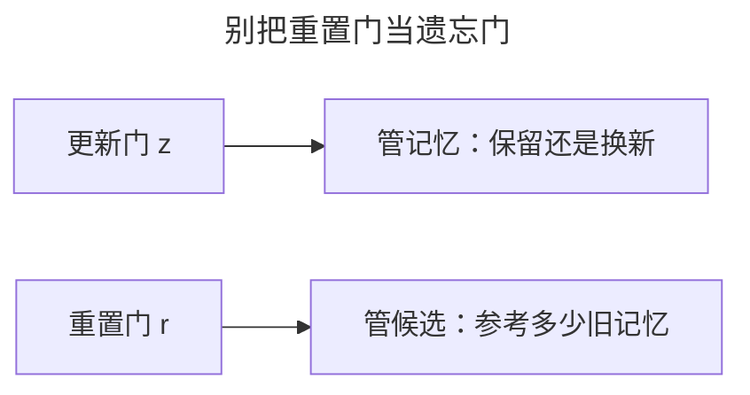
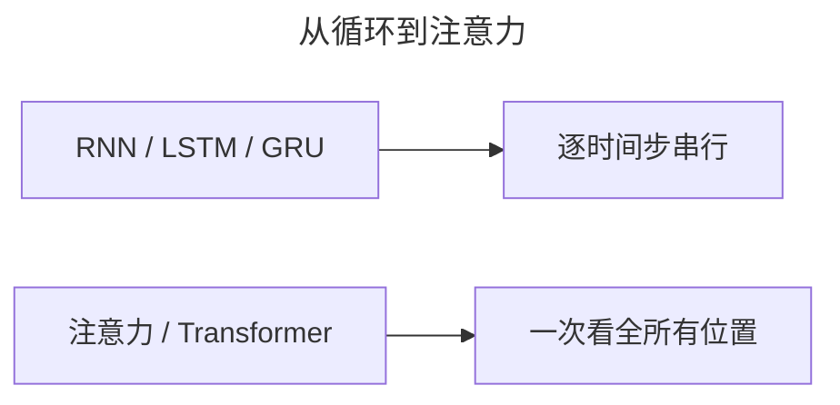

> 作者：轻松学AI
> 日期：2026-10-18
> 风格：通俗科普
> 状态：待发布

# 从零开始学深度学习 #17：GRU 与序列生成实战

上一篇讲了 LSTM 的三道门。这篇把镜头拉近它的简化版 GRU：门砍掉一道，独立的细胞状态也不要了，效果却几乎不差。最后再训一个字符级 RNN，让它自己"续写"文本，看看"预测下一个字"这个循环到底怎么转。

## 一、LSTM 有点重：GRU 为什么出现

LSTM 救回了被梯度消失掐死的循环网络，但它不便宜。它的记忆分两本账：隐藏状态 h 管"这一时刻往外输出什么"，细胞状态 c 管"长期记住什么"。两本账都得维护，再加遗忘门、输入门、输出门三道门，每道门各配一组权重矩阵。

这笔账算得出来。假设输入维度是 d、隐藏维度是 h，LSTM 一层要学 4 组权重（三个门加一个候选细胞状态），每组是 d×h + h×h + h 个参数；GRU 只要 3 组。所以同样一层，GRU 的参数量约为 LSTM 的四分之三，省下约 25%。



GRU 出自 2014 年 Cho 等人的论文，起点是机器翻译的 encoder-decoder：LSTM 又慢又吃显存，训不动。他们直接砍掉输出门和独立细胞状态，把"该忘多少、该写多少"合并成一个更新门，再留一个重置门。少了三分之一的门，翻译成绩没掉队，速度却上来了。它的目标很实：给 LSTM 找一个更省、更快的替代品。

## 二、直觉：一支推子，一块橡皮擦

把 GRU 的两道门想成两样东西：调音台和橡皮擦。

更新门像一支推子：往左推，输出更多旧记忆；往右推，输出更多新信息。它永远在两者之间"按比例混合"，所以状态不会突然翻车。重置门像块橡皮擦：读当前输入之前，先决定擦掉多少旧记忆——擦得越干净，就越像从头看这一个字，不带任何历史包袱。



这两扇门一配合，就顶上了 LSTM 三道门的事。凭什么是它俩？答案藏在一个式子里。

## 三、机制：为什么两道门就够

先看最要命的一行——新旧插值：

h = (1 − z) ⊙ n + z ⊙ h_prev

z 是更新门，经 sigmoid 压进 (0, 1)。z 接近 1 时，h 几乎等于 h_prev，状态原样保留；z 接近 0 时，h 几乎等于候选 n，状态整个换新。

这条式子为什么有效，根子在梯度。#04 讲过，梯度消失是因为误差回传时被每层连乘的衰减系数一路压缩。普通 RNN 里 h_t = tanh(W_h h_{t-1} + ...)，每过一个时间步都要过一次 tanh，导数要么掉进饱和区趋近 0，要么被反复压缩。而 GRU 的插值式给梯度留了一条高速路：当 z 接近 1 时，∂h_t / ∂h_{t-1} 约等于 1，误差可以原样穿过这个时间步，一点不衰减。那些"需要记住"的步子上，网络自动把 z 调大，等于告诉反向传播："这条链别打折，原样传回去。"

还有一层：z 和 (1 − z) 相加恒等于 1，所以 h 永远是 n 和 h_prev 的凸组合，数值被稳稳夹在两者之间，不会像普通 RNN 那样越滚越离谱。这就是"插值"比"直接叠加"稳的地方。



那砍掉输出门为什么没事？LSTM 里 h 和 c 分家，才需要一个输出门把 c 翻译成 h。GRU 让 h 兼任 c，输出就是 h 本身，这层转换直接省了。

最妙的是合并遗忘门和输入门。LSTM 里遗忘门 f 和输入门 i 是独立学的，网络得自己费劲保证它俩别打架（比如一边全忘一边全写）。GRU 用 z 和 (1 − z) 把它们捆死：你多记一分旧，就自动少写一分新，两者之和恒为 1。这个约束是结构里写死的，不用额外学，参数更少，小数据上也不容易过拟合。代价是它没法"全忘 + 全写"同时来——但实践里几乎没有任务真需要这种自由，这就是 GRU 敢砍门的底气。

## 四、手写核心：四行代码逐行拆

GRU 的单步更新，核心就是"新旧状态的插值"：

```python
z = sigmoid(x @ W_iz.T + h_prev @ W_hz.T + b)   # 更新门
r = sigmoid(x @ W_ir.T + h_prev @ W_hr.T + b)   # 重置门
n = tanh(x @ W_in.T + r * (h_prev @ W_hn.T + b))  # 候选新状态
h = (1 - z) * n + z * h_prev                      # 新旧插值
```

第一行算更新门 z：当前输入 x 和上一时刻 h_prev 各乘一组权重再相加，过 sigmoid 压到 (0, 1)。z 越大，越偏"保留旧状态"。

第二行算重置门 r，结构一模一样，管的是"旧记忆有多少参与计算候选状态"。

第三行算候选 n，注意 r 乘在 h_prev 那一项上——r 接近 0 时，这一项被整个抹掉，n 只看当前输入 x，等于从头开始。这是 GRU 和 LSTM 最大的不同之一：LSTM 的候选细胞状态不看门，永远带着完整旧记忆。

第四行是精髓：z 和 (1 − z) 相加为 1，h 是 n 和 h_prev 的凸组合，永远不超界。



## 五、实验：150 轮之后它学会了什么

光说不练没用。训一个字符级 RNN：喂它一段文本，让它学会"给定前面的字符，预测下一个字符"。

```python
model, c2i, i2c, hist = train_char_rnn("hello world hello world ...", epochs=150)
generated = generate(model, c2i, i2c, "h", length=60)
print(generated)
```


训练损失一路往下，模型从"乱猜"走到"慢慢摸到字符的规律"。配套仓库里还有个更极端的实验：只喂它 abcabcabc... 一个周期为 3 的重复串，训完从字母 a 续写，它吐出来的是 abcabcabc... 一路到底，一个字符都不错。这说明它摸清了"a 后面跟 b、b 后面跟 c"这条顺序依赖，而不是把整串硬背下来。

别小看这个玩具。这个"预测下一个字，接上去，再预测下一个"的循环，和 GPT 的逐词预测是同一套机制，今天所有大语言模型的"续写"，就是从这么个小循环里长出来的。

## 六、边界：GRU 省下的不是免费的

GRU 参数少 25%，训练更快，小模型、小数据下常常更稳——这是它相对 LSTM 的优势。但"少参数"是双刃剑。

需要极其精细、长期的记忆控制时，LSTM 那个独立的细胞状态 c 是一条专门的高速路：记忆和输出分家，遗忘、写入、输出可以各自独立调节。GRU 让 h 兼任 c，等于把"存"和"取"绑在同一个状态上，表达力收窄了一格。Greff 等人在 2015 年跑了 5400 组实验对比八种 LSTM 变体，结论是标准 LSTM 很难被超越、遗忘门最关键——门控本身值钱，但"更多的门"未必值钱。



还有一层代价别忽略：GRU 省掉的是参数，省不掉"串行"。它和 LSTM、普通 RNN 一样，得一个时间步一个时间步地算，长序列照样慢。所以它俩的比拼很多时候没有标准答案——同一任务上先跑 GRU，不够再上 LSTM，是常见的实用做法。

## 七、最容易搞错的一点：重置门不是遗忘门

很多人看一眼两道门的名字，就想当然：GRU 的"重置门"等于 LSTM 的"遗忘门"。错了。

GRU 里没有独立的遗忘门。"遗忘"这件事是更新门干的：z 接近 1 保留旧状态（不遗忘），z 接近 0 换成新状态（遗忘旧）。重置门管的是另一件事——读当前输入时，要参考多少旧记忆。它决定候选状态怎么算，跟"要不要记住过去"是两码事。



这个混淆的代价很实在：如果把重置门当成遗忘门去读代码，r * (h_prev @ W_hn + b) 这一行就整个读反了。

## 八、延伸：从这里到 Transformer

上一讲的 LSTM 三道门，这一讲的 GRU 两道门，都还在"循环"的框架里：记忆靠状态沿时间步一步步传。下一篇要讲的注意力机制和 Transformer 直接掀了这张桌子——丢掉"逐时间步串行"这个假设，把序列建模从一条链变成一张全连接的图，一次看全所有位置。



RNN、LSTM、GRU 的价值，在于逼你想清楚两件事：序列建模是什么，门控记忆为什么有用。想通了这两件，Transformer 的自注意力为什么能取代它们，你才看得懂。

- [GRU 论文：Learning Phrase Representations using RNN Encoder-Decoder](https://arxiv.org/abs/1406.1078)
- [《动手学深度学习》9.1 门控循环单元（GRU）](https://zh.d2l.ai/chapter_recurrent-modern/gru.html)
- [Greff et al. 2015：LSTM: A Search Space Odyssey](https://arxiv.org/abs/1503.04069)
- [PyTorch 官方文档：torch.nn.GRU](https://pytorch.org/docs/stable/generated/torch.nn.GRU.html)
- [配套仓库 dl-from-scratch（rnn/gru.py）](https://github.com/Joneyao/dl-from-scratch)
