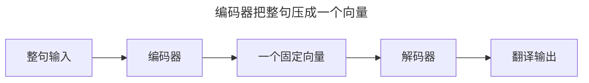
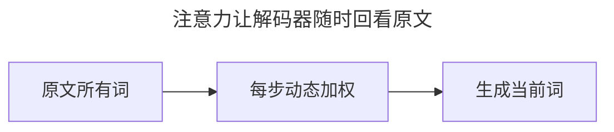
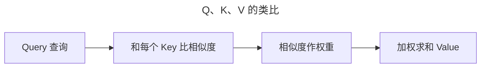
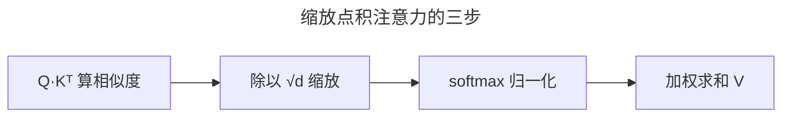
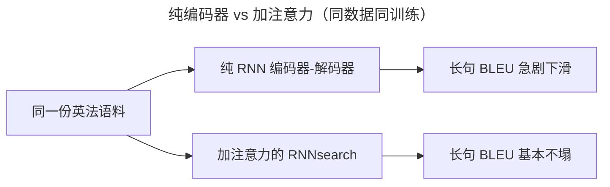
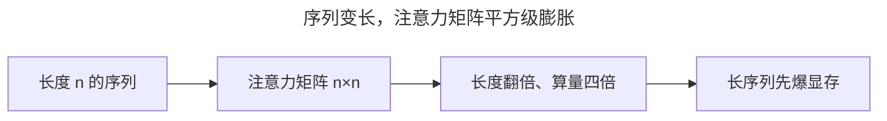
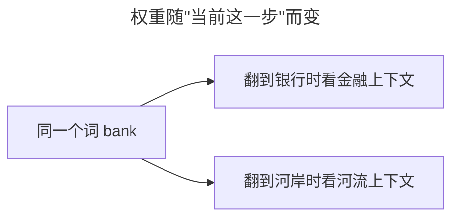
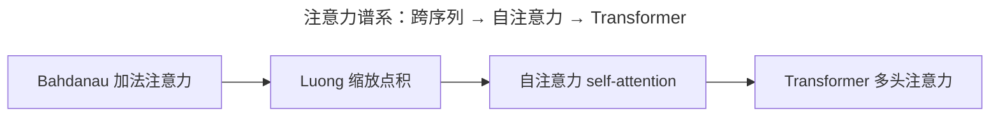

> 作者：轻松学AI
> 日期：2026-10-18
> 风格：通俗科普
> 状态：待发布

# 从零开始学深度学习 #18：注意力机制——让网络学会"看重点"

前三篇讲的 RNN 家族，统治序列建模很多年，但有个天生的瓶颈。这一篇讲那个取代它的思想——注意力机制。它简单到只有"加权平均"四个字，却成了此后十年序列模型绕不开的一块积木，Transformer 正是站在它上面。

## 一、问题由来：一整句话挤进一个向量

先看机器翻译的典型做法——编码器-解码器（Seq2Seq）。编码器把整句话读进去，最后压成一个固定长度的向量；解码器再从这个向量里"翻"出译文。



问题就在中间那个"固定向量"。不管原句五个词还是五十个词，都只能塞进同一个向量。RNN 的隐状态是"边走边覆盖"的：读到第 50 个词时，第 1 个词的痕迹已被反复冲淡，最后留下的向量说白了只是"最后几个词的摘要"。句子一长，前面的信息就挤丢了。Cho 等人在 2014 年就实测过：这种基本编码器-解码器的翻译质量，随句长迅速下滑。

痛点很直接——真实翻译里长句到处都是，一句三四十词，旧模型就开始漏信息、翻错位置：那个固定向量根本装不下。

## 二、核心直觉：别压了，随时回看原文

注意力的想法朴素到有点"作弊"：既然压不进一个向量，那就不压。解码器每生成一个词，都让它**回看原文的所有词**，自己决定"这一步该重点看哪些"。



比如翻译到"它"这个词时，注意力会让网络回头聚焦到原文里那个被指代的名词上。看的时候带着重点——这就是"注意力"三个字的由来。


## 三、机制：为什么加权平均真的能救命

旧做法里，解码器每一步拿到的都是同一个固定向量，从头到尾不变。注意力把它改成：解码器每一步拿到一个**专属的**上下文向量，它是原文所有词向量的加权平均——权重加起来正好是 1，权重越大的词，被参考得越多。


光看这个，还只是"是什么"。真正的问题：凭什么这样就能绕过信息瓶颈？答案藏在"权重可训练"这几个字里。

旧模型的固定向量是个死瓶颈：信息在编码阶段就被压定了，翻错了也改不了。而加权平均里的权重是**可微的软指针**，不是硬选择——硬选择（直接挑第 k 个词）不可导，梯度传不回去，"该看哪个词"就没法训练；软选择给每个词打一个 0 到 1 的分数，误差顺着这个分数反传，把"该看哪"这件事本身训练出来。这就是根本区别：旧模型让编码器赌一次"整句的摘要"，赌错了没得改；注意力让解码器每步重新决定"现在要看哪"，而且这个决定可导、能被翻译目标直接优化。

softmax 也不是随便选的。把分数归一成概率分布，和为 1，context 的量级就稳定了——不会随句子变长而越加越大；同时给出"注意力分布"的解释。

再用一个类比说清 Q、K、V 三个角色：把"查询"想成你在图书馆找书的**问题**，"键"是每本书的**标签**，"值"是书的**内容**。你拿问题去和所有标签比对相似度，相似度越高的书，内容就被参考得越多。



为什么要拆成三个而不是直接算内积？因为"匹配"和"取值"是两个不同的活：Q 和 K 负责算"哪里相关"，V 负责装"要搬走的信息"。让它们各自用不同的表示，模型就有更多自由度，同时做好"找位置"和"取内容"两件事。


## 四、手写核心：三行代码为什么就够

先交代谱系：最早的编码器-解码器注意力（Bahdanau 2014）用加法打分，即把两个向量拼起来再过一层网络；这里讲的缩放点积注意力，是后来 Luong、Transformer 的主流。二者思路一致，只是"算相似度"的方式不同。

具体公式，就是"点积算相似度，除以 √d 缩放，softmax 归一化，最后加权求和 Value"：

:::formula 缩放点积注意力
Attention(Q,K,V) = softmax( Q·Kᵀ / √d ) · V
Q：查询 ｜ K：键 ｜ V：值 ｜ d：向量维度
:::



手写出来也就三行：

```python
scores = Q @ K.T / (d ** 0.5)      # 算相似度
attn = torch.softmax(scores, dim=-1) # 归一化成权重
out = attn @ V                       # 加权求和
```

逐行拆开：

- 第一行 `Q @ K.T`：矩阵乘法算出每个查询和每个键的内积，也就是"相似度分数"。除以 √d 是缩放——维度 d 一大，内积变大，softmax 会过早饱和、梯度变小，除以 √d 把它拉回合理区间。
- 第二行 `softmax(dim=-1)`：沿最后一维（键那一维）归一化，让每个查询对所有键的权重之和恒等于 1，变成一份概率分布。
- 第三行 `attn @ V`：拿这份权重去加权求和所有值，每个查询得到一个"按需混合"的结果。

三行就够，还有个更深的原因：注意力没有循环依赖。RNN 要按时间步一步步串行，注意力里 n 个位置的两两分数却能同时算，整张矩阵一次乘法搞定。GPU 天生爱这种并行，这也是它后来撑起 Transformer 大规模训练的根。

## 五、实验：长句不再塌，数字很直接

Bahdanau 等人 2014 年在 WMT'14 英法翻译上做了对照实验：同一份数据、同样的训练流程，只差一个注意力。结果用 BLEU 分衡量（越高越好，数据来自论文 arXiv:1409.0473）：



- 训练句长上限 30 词：纯编码器 13.93，加注意力 21.50。
- 训练句长上限 50 词：纯编码器 17.82，加注意力 26.75。
- 在无未知词的句子上，注意力模型到了 34.16，已经逼近传统短语系统 Moses 的 35.63。

更说明问题的是长句曲线：纯编码器的 BLEU 随句长急剧下滑，注意力模型到 50 词以上都不怎么衰减。还有个反直觉的细节——只喂 30 词的注意力模型（21.50），比喂 50 词的纯编码器（17.82）还高，加注意力比"多喂更长句子"更管用。

配套仓库 dl-from-scratch 里跑个最小例子，把权重画成热力图，能看到模型翻到哪个词、眼睛盯在原文哪里，对齐几乎是一条对角线。

## 六、边界与代价：O(n²) 和显存先撑不住

注意力不是免费的，代价恰恰藏在"每个位置看所有位置"里。

n 个词，每个词都要和另外 n 个词算一遍相似度，注意力矩阵是 n×n。句子翻一倍，算量翻四倍。短句无所谓，长序列就是另一回事了：一个 2048 长度的序列，注意力矩阵有 2048×2048 ≈ 420 万个分数；单头、单层、fp16 下这块矩阵约 8MB，看着不大，但真实 Transformer 几十层、十几头，训练还要存中间激活，显存很快被 n×n 的表撑爆。这也是稀疏注意力、FlashAttention 的动机——FlashAttention 就是不把整张矩阵完整落进显存。



什么时候不合适：极长序列（几万 token）、低延迟小设备，或者位置关系本来就不重要的任务。这时候要么换稀疏/线性注意力，要么退回别的结构。注意力擅长"让模型学会该看哪"，不负责省算力。

## 七、一个常见误解：注意力并不"理解"

最容易搞错的一点，是把注意力当成"模型变聪明、真的读懂了语义"。

它其实不负责"理解"——只做一件机械的事：算出权重、加权平均。权重高不代表"这个词重要"，只代表"生成当前这个词时，它被参考得多"。同一句话里，"bank"这个词在翻成"银行"和"河岸"两步时，注意力会分别落到不同的上下文上，权重随"这一步"而变，不是这个词天生就"重"。



它不"懂"，只是把"该看哪"做成了可微分的加权平均。聪明的地方在"可训练"，不在"理解"。

## 八、延伸：下一步，让它看自己

这一篇的注意力是"跨序列"的：解码器回头看编码器的原文。把它转个向——让序列里每个词去看同序列的其他词——就是下一篇的主角自注意力（self-attention）。



从加法注意力到缩放点积，再到自注意力和 Transformer 的多头注意力，每一步都在上一步上改一点。理解了这篇的加权平均，Transformer 那篇你只需要消化"自己看自己 + 多头"，剩下的全是熟面孔。

注意力机制值钱的地方，一句话：它把一个"压缩信息"的难题，换成了一个"动态查信息"的机制，而且这个查询是可微分的。简单到四个字，深到撑起了此后十年。

- [Attention is All You Need](https://arxiv.org/abs/1706.03762)
- [《动手学深度学习》10 注意力机制](https://zh.d2l.ai/chapter_attention-mechanisms/index.html)
- [配套仓库 dl-from-scratch（transformer/attention.py）](https://github.com/Joneyao/dl-from-scratch)
- [Bahdanau et al. 2014：Neural Machine Translation by Jointly Learning to Align and Translate](https://arxiv.org/abs/1409.0473)
- [Luong et al. 2015：Effective Approaches to Attention-based Neural Machine Translation](https://arxiv.org/abs/1508.04025)
