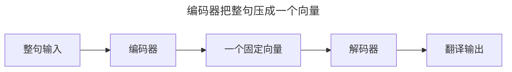
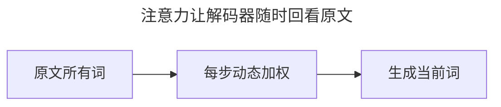
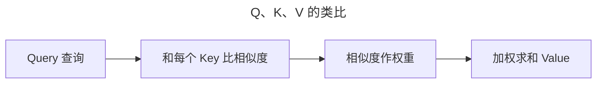
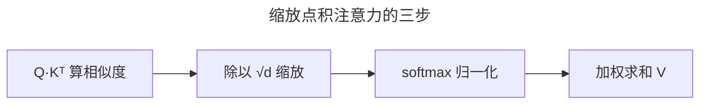

> 作者：轻松学AI
> 日期：2026-10-18
> 风格：通俗科普
> 状态：待发布

# 从零开始学深度学习 #18：注意力机制——让网络学会"看重点"

前三篇讲的 RNN 家族，统治序列建模很多年，但有个天生的瓶颈。这一篇讲那个取代它的思想——注意力机制。它简单到只有"加权平均"四个字，却彻底改变了深度学习。

## 一、RNN 的瓶颈：全压缩进一个向量

先看 RNN 处理机器翻译的典型结构：编码器把整句话读进去，最后压缩成一个固定长度的向量；解码器再从这个向量"翻译"出来。



问题就在中间那个"固定向量"——一句话再长，都得挤进这一个向量里。句子一长，信息就挤爆了、挤丢了。这就是所谓"信息瓶颈"。

## 二、注意力：随时回看原文

注意力的想法很朴素：别把整句压成一个向量了。解码器每生成一个词，都让它**回看原文的所有词**，自己决定"这一步该重点看哪些词"。



比如翻译到"它"这个词时，注意力会让网络回头聚焦到原文里那个被指代的名词上。这就是"注意力"三个字的由来——不是死板地平均看，而是有重点地看。


## 三、Q、K、V：三个字母说清注意力

注意力机制落实到数学上，就是三个矩阵：Query（查询）、Key（键）、Value（值）。


用一个类比：

把"查询"想成你在图书馆找书的**问题**；"键"是每本书的**标签**；"值"是书的**内容**。你拿问题去和所有标签比对相似度，相似度越高的书，内容就被你参考得越多。



算出来的"相似度"做一次 softmax，就变成了注意力权重——加起来恰好等于 1。权重越大的位置，被"参考"得越多。


## 四、缩放点积：注意力的数学

具体公式，就是"点积算相似度，除以 √d 缩放，softmax 归一化，最后加权求和 Value"：

:::formula 缩放点积注意力
Attention(Q,K,V) = softmax( Q·Kᵀ / √d ) · V
Q：查询 ｜ K：键 ｜ V：值 ｜ d：向量维度
:::

除以 √d 是为了防止向量维度太大时点积过大、softmax 饱和。手写出来也就三行：



```python
scores = Q @ K.T / (d ** 0.5)      # 算相似度
attn = torch.softmax(scores, dim=-1) # 归一化成权重
out = attn @ V                       # 加权求和
```

下一篇讲注意力的"自我"版本——自注意力，它让一个序列里的每个词去看其他所有词，正是 Transformer 的核心。

- [Attention is All You Need](https://arxiv.org/abs/1706.03762)
- [《动手学深度学习》10 注意力机制](https://zh.d2l.ai/chapter_attention-mechanisms/index.html)
- [配套仓库 dl-from-scratch（transformer/attention.py）](https://github.com/Joneyao/dl-from-scratch)
