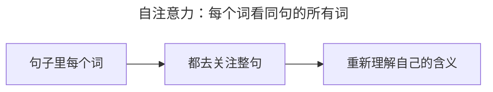
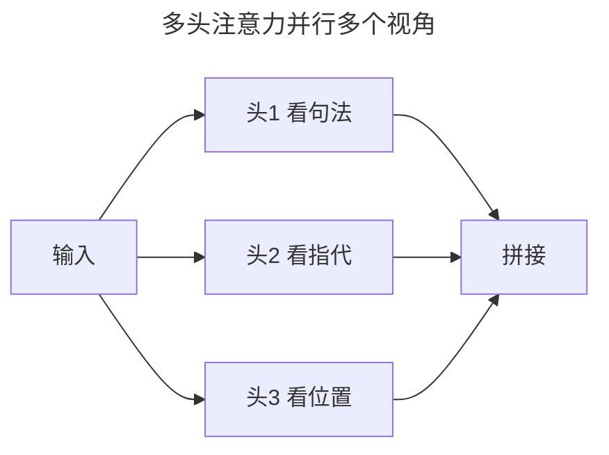
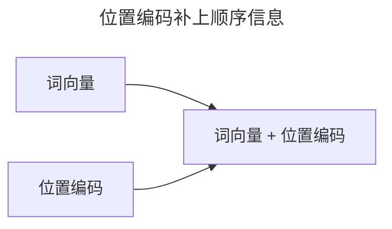

> 作者：轻松学AI
> 日期：2026-10-18
> 风格：通俗科普
> 状态：待发布

# 从零开始学深度学习 #19：自注意力与多头注意力

上一篇的注意力，是"解码器去看编码器"——两个序列之间的注意力。这一篇讲它的一个特殊而强大的变体：自注意力。

自注意力的"自"，指的是 Query、Key、Value 全都来自**同一个序列**——一句话里的每个词，去关注这句话里的所有词。


## 一、从"看别人"到"看自己"

普通注意力是跨序列的：翻译时，解码器的词去关注原文的词。自注意力则在同一个序列内部进行：



为什么需要这样？因为一个词的意思，往往取决于上下文。句子"The animal didn't cross the street because **it** was too tired"里的 "it"，到底指 animal 还是 street？自注意力让 "it" 去关注句中所有词，学出它最该指的是 "animal"。

## 二、多头注意力：多个角度同时看

单一注意力只有一个"关注角度"。但一个词可能需要从多个角度理解：句法上谁修饰谁、语义上谁指代谁、位置上谁和谁近……

多头注意力的做法：把 Q、K、V 拆成好几组（叫"头"），每组独立算自己的注意力，最后拼起来。



手写多头自注意力，核心是"拆头、各自算、再拼回"：

```python
Q = self.Wq(x).view(B, L, n_heads, d_k).transpose(1, 2)  # 拆成多头
...
scores = Q @ K.transpose(-2, -1) / (d_k ** 0.5)
attn = torch.softmax(scores, dim=-1)
out = (attn @ V).transpose(1, 2).view(B, L, D)            # 拼回
```

多个头并行，等于多个"专家"各从一个角度分析，最后综合。

## 三、位置编码：给模型装上"顺序"的感知

自注意力有个隐患：它同时看所有词，**分不清先后**。可"我打你"和"你打我"完全两回事，顺序必须表达。

解决办法是位置编码：给每个位置一个独一无二的向量，加在词向量上。




常见做法是正弦位置编码——用不同频率的正弦余弦给每个位置生成一个"指纹"。位置 1 和位置 2 的编码不同，模型就能感知到顺序。

## 四、看看自注意力实际"看"了什么

跑一个 6 个词的小句子，画出它的自注意力权重矩阵：


横竖都是句子的 6 个词，颜色深浅代表关注强度。每个词都有一条"自己的关注分布"——这就是自注意力在真实运作的样子。

到这里，注意力、自注意力、多头、位置编码都齐了。下一篇把它们组装成完整的 Transformer 架构。

- [Attention is All You Need](https://arxiv.org/abs/1706.03762)
- [The Illustrated Transformer（jalammar）](https://jalammar.github.io/illustrated-transformer/)
- [《动手学深度学习》10.5 多头注意力](https://zh.d2l.ai/chapter_attention-mechanisms/multihead-attention.html)
- [配套仓库 dl-from-scratch（transformer/self_attention.py）](https://github.com/Joneyao/dl-from-scratch)
