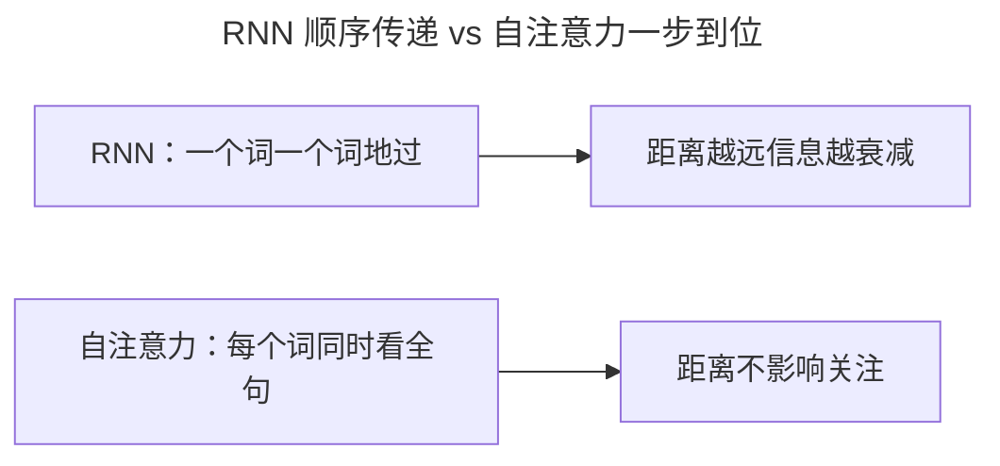
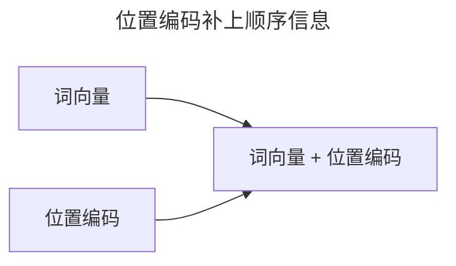
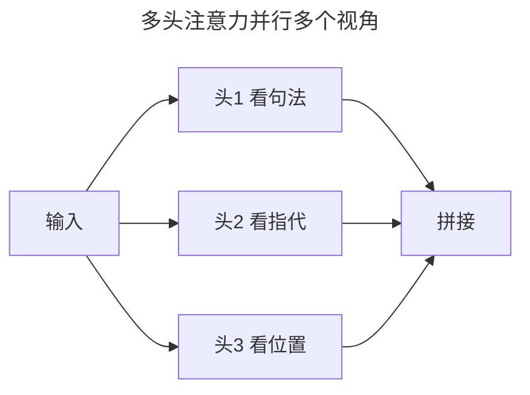
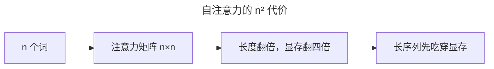
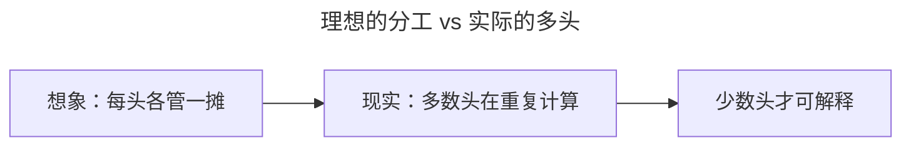
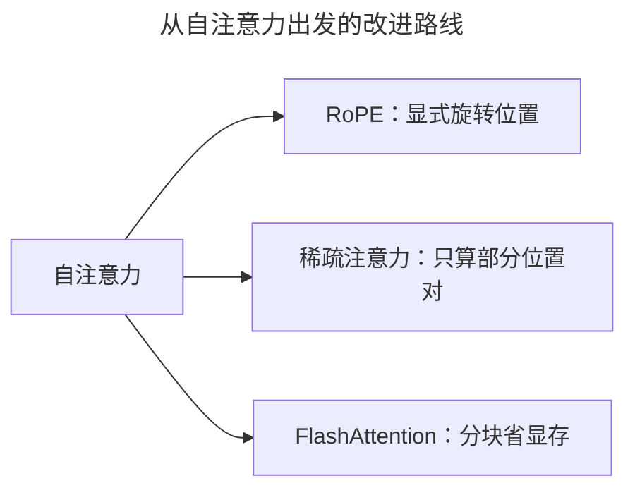

> 作者：轻松学AI
> 日期：2026-10-18
> 风格：通俗科普
> 状态：待发布

# 从零开始学深度学习 #19：自注意力与多头注意力

上一篇的注意力，是"解码器去看编码器"——两个序列之间的注意力。这一篇讲它的一个特殊而强大的变体：自注意力。

自注意力的"自"，指的是 Query、Key、Value 全都来自**同一个序列**——一句话里的每个词，去关注这句话里的所有词。

## 一、问题由来：RNN 被"顺序"困住了

自注意力不是凭空想出来的炫技，它是给循环神经网络（RNN）补短板补出来的。RNN 处理句子是一个词一个词地过：要理解第 100 个词，得先把前面 99 个都过一遍。这带来两个毛病。

第一，长距离信息会衰减。靠前的词经过几十次循环传递，等传到后面已经面目模糊——这和 #04 讲的梯度消失是同一类病：信息每传一步就打一次折。第二，没法并行。必须等上一步算完才能算下一步，GPU 一排计算核心只能干等。

所以面对"理解一整句话"这种任务，RNN 既慢、又容易忘。自注意力的出发点很直接：让每个词一步到位，同时看全句所有词，距离不再是障碍。



## 二、核心直觉：一个词靠上下文才知道自己是谁

为什么一个词非得去看别的词？因为孤立的词是含糊的。

句子 "The animal didn't cross the street because **it** was too tired" 里的 "it"，到底指 animal 还是 street？单独看这个词，永远答不上来。但人会自动回看整句，发现 "was too tired"（累了）这个描述，只配得上 "animal"（动物会累，街道不会）。

自注意力就是把这个"回看"做成了机制：让 "it" 去关注句中所有词，学出它最该指的是 "animal"。


## 三、机制 why：为什么"看全句"真的有效

直觉归直觉，自注意力到底靠什么算出"该看谁"？答案是三个向量。

每个词先被投影出三个向量：Query（我要找什么）、Key（我是什么）、Value（我有什么内容）。一个词想关注别人时，用自己的 Query 去和所有词的 Key 做点积，得到一个"相关分"。点积越大，说明两个向量方向越一致，越相关。再过一个 softmax，把分数归一化成加起来等于 1 的权重，最后用这些权重去对 Value 做加权平均——每个词就拿到了"按相关程度混合过的一句话内容"。

这里的关键是"动态"。CNN 的卷积核是固定的，不管来什么输入，同一个位置永远用同一个核；自注意力的权重却是每次现算的，由这一句的具体内容决定。同一个 "it"，在不同句子里关注的东西完全不同。信息也不用像 RNN 那样一层层接力，相关的内容直接一步到位——这就是它抓得住长距离依赖的根本原因。

有个细节值得单独说：为什么点积要除以 sqrt(d_k)？点积是把 d_k 个数加起来，d_k 越大，点积的方差越大。方差不压住，点积的绝对值就会很大，softmax 会被挤到 0 和 1 的两端——落到饱和区，梯度趋近 0（还是 #04 那个病）。除以 sqrt(d_k)，把方差拉回 1，softmax 才能留在有梯度的区间。这个细节就写在原论文的脚注里。

位置编码也藏着一个"为什么"。自注意力同时看所有词，分不清先后，可"我打你"和"你打我"是两回事。解决办法是给每个位置一个独一无二的向量，加在词向量上：




常见做法是正弦位置编码，用不同频率的正弦余弦给每个位置生成一个"指纹"。选正弦余弦是有讲究的：它有一个关键性质——任意固定偏移 k，位置 pos+k 的编码，都能表示成位置 pos 编码的一个线性变换（对每一对频率，就是一个旋转矩阵）。意思是模型不用死记"位置 7 长什么样"，只要学会"偏移 k 对应的那个旋转"，就能统一处理相对距离。后面流行的 RoPE 旋转位置编码，就是把这种"旋转"从隐藏性质直接做成了显式操作。

## 四、手写核心+对照：多头注意力

单一注意力只有一个关注角度。但一个词要从多个角度理解：句法上谁修饰谁、语义上谁指代谁、位置上谁和谁近。

多头注意力的做法：把 Q、K、V 拆成好几组（叫"头"），每组独立算自己的注意力，最后拼起来：



手写多头自注意力，核心就是"拆头、各自算、再拼回"：

```python
Q = self.Wq(x).view(B, L, n_heads, d_k).transpose(1, 2)  # 拆成多头
...
scores = Q @ K.transpose(-2, -1) / (d_k ** 0.5)
attn = torch.softmax(scores, dim=-1)
out = (attn @ V).transpose(1, 2).view(B, L, D)            # 拼回
```

第一行把 Q 拆成 n_heads 组，transpose 把"头"这一维挪到前面，让每个头独立算；第二行算点积再除以 sqrt(d_k)，就是上一节那个防饱和的缩放；第三行 softmax 归一化；第四行加权求和后拼回原来的形状。多头的价值在于：把本来一个 d_k 维的注意力，换成 n_heads 个更小注意力并行做，参数几乎不增加，却多了好几个观察角度。

## 五、实验：看看自注意力实际"看"了什么

跑一个 6 个词的小句子，画出它的自注意力权重矩阵：


横竖都是句子的 6 个词，颜色深浅代表关注强度。6 个词就有 6×6 共 36 个关注权重，每个词一行，行内加起来等于 1——这就是自注意力在真实运作的样子。

多头的真实情况要泼盆冷水。Voita 等人在英语到俄语的翻译模型上做过一个剪头实验：模型编码器一共 48 个注意力头，用可微的剪枝方法剪掉 38 个，翻译质量（BLEU）只掉了 0.15 分。也就是说，绝大多数头是可以剪掉的，少数头才真正在干重活。所以"多头各管一摊"更多是我们的一厢情愿，实证里分工远没那么清晰。

## 六、边界与代价：O(n²) 和它的软肋

自注意力不是白吃的午餐，它的代价直接写在复杂度里。

注意力矩阵是 n×n 的：n 个词，两两之间都要算一个相关分。序列长度翻一倍，这个矩阵的元素数量翻四倍，显存占用也跟着翻四倍。句子短时无所谓，一段几万 token 的长文档，这个 n² 会先把显存吃穿。



另一个软肋是位置编码的外推。正弦编码按位置绝对生成，训练时最多见过 512 个位置，推理时来了第 800 个位置，编码就落在没见过的区域，模型容易发飘。这也是为什么后来冒出 RoPE、ALiBi 这些新的位置方案。

多头这边同样有边界：既然剪掉大部分头都不掉点，堆更多头的收益会迅速递减，还白白增加计算量。

## 七、一个常见误解：多头"分工明确"

看上面的图，很容易以为头 1 管句法、头 2 管指代、头 3 管位置，各司其职。

实际情况没那么整齐。



研究发现多头往往高度冗余，很多头在重复计算几乎一样的东西，真正能解释清楚"这个头负责什么"的是少数。"专家分工"是便于理解的类比，不是严格的机制。所以别拿"每个头一定学到了一个明确的语言功能"去要求你的模型，它大概率会辜负你。

## 八、延伸：从自注意力到 Transformer

自注意力是 Transformer 的心脏，但单靠它还不完整——下一篇就把它和多层堆叠、前馈网络、残差连接组装成完整的 Transformer 架构。

再往后看，O(n²) 这个软肋催生了一整条改进路线：



RoPE 把旋转位置性质显式化，稀疏注意力只算一部分位置对，FlashAttention 用分块和重排把显存读写降下来。这几样都是后话，但它们的起点，全在今天说的"每个词看全句"这句话上。

到这里，注意力、自注意力、多头、位置编码都齐了。

- [Attention is All You Need](https://arxiv.org/abs/1706.03762)
- [The Illustrated Transformer（jalammar）](https://jalammar.github.io/illustrated-transformer/)
- [《动手学深度学习》10.5 多头注意力](https://zh.d2l.ai/chapter_attention-mechanisms/multihead-attention.html)
- [Analyzing Multi-Head Self-Attention: Specialized Heads Do the Heavy Lifting, the Rest Can Be Pruned（Voita et al., 2019）](https://arxiv.org/abs/1905.09418)
- [配套仓库 dl-from-scratch（transformer/self_attention.py）](https://github.com/Joneyao/dl-from-scratch)
