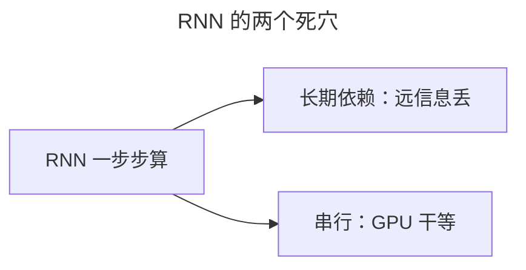
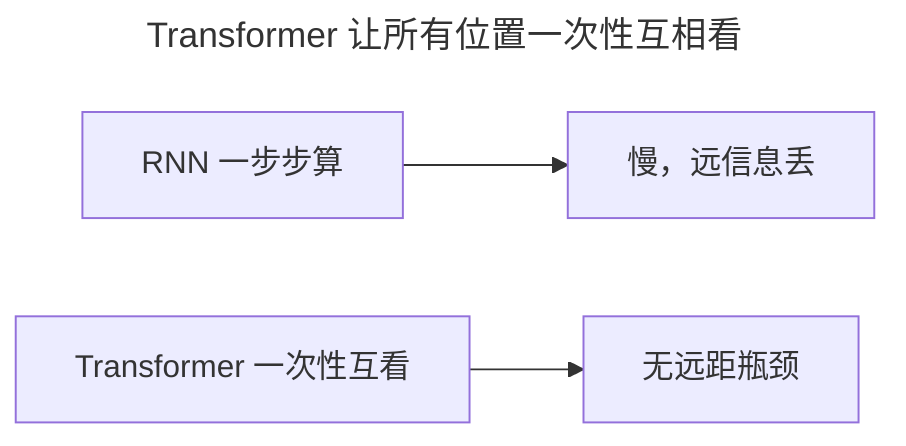
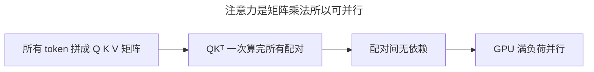
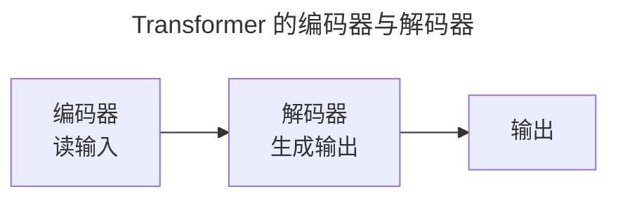
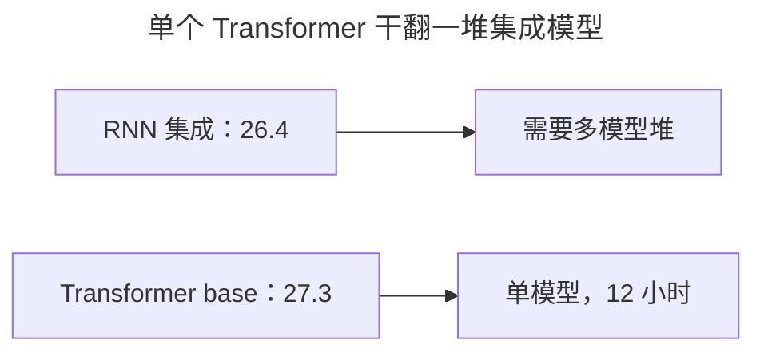
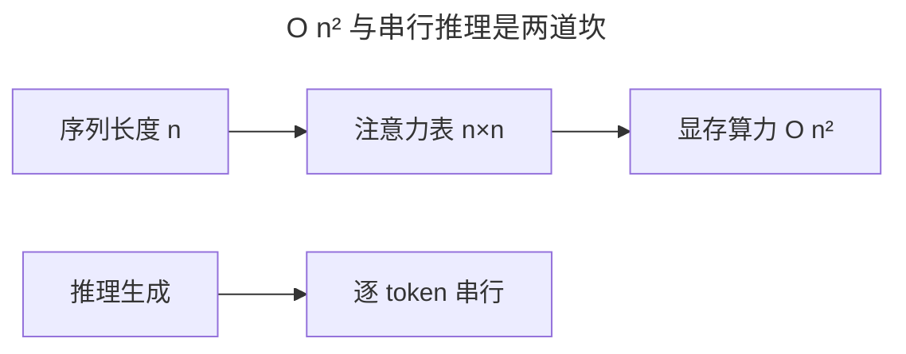
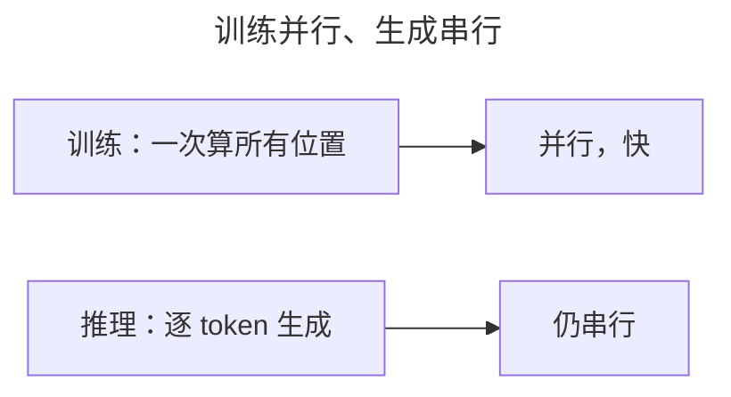
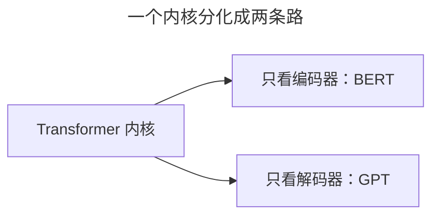

> 作者：轻松学AI
> 日期：2026-10-18
> 风格：通俗科普
> 状态：待发布

# 从零开始学深度学习 #20：Transformer——现代深度学习的基石

注意力、自注意力、多头、位置编码这些零件已经就位，现在把它们组装成 Transformer。它的全部秘密只有一句：用注意力替换循环，让序列从一步步算变成一次性互看——这正是它今天能堆到万亿参数的原因。

2017 年，谷歌一篇标题嚣张的论文《Attention is All You Need》提出了这个架构。把循环从网络主干里拿掉，此后 GPT、BERT、Llama 等主流模型都以它为骨架。

## 一、问题由来：循环为什么拖后腿

RNN 的天生缺陷，是必须"一步一步"地算：要处理第 50 个词，得先把前 49 个词依次过一遍。这带来两个问题：**长期依赖**（远处的信息传不过来），以及**算得慢**（必须一步步串行）。

这两个毛病在机器翻译里最要命。一句话里，动词和它隔了半句的主语可能相距几十个词；RNN 每传一步，早期信息就被压缩一点，传到后面基本只剩个模糊的影子。更要命的是，GPU 是为大规模并行矩阵运算造的，RNN 却逼着它一个时间步一个时间步地走，几千个核心里一大半都在空转干等。当年用 RNN 做翻译，一个模型训上几天是常事，想再加长序列、加深网络，成本和收益越来越不成比例。



Transformer 的答案很干脆：把"循环"整个扔掉，全用注意力。

## 二、核心直觉：让所有人一次性互看


让序列里所有位置**一次性**互相看。

把序列想成一条流水线。RNN 是让每个位置只跟它前面一个位置说话，话一个个传下去，又慢又丢信息。Transformer 直接让所有位置坐到一张圆桌上，每个人同时看到所有人——谁和谁有关系，一句话就能对上，不用隔着十几个人传话。



这就是"Attention is All You Need"——注意力一个机制，就够撑起整个网络。

## 三、机制：矩阵乘法为什么天生能并行

"一次性互看"不是口号，它背后是一串矩阵乘法。

每个 token 都被投影成三样东西：查询 Q、键 K、值 V。把整句话所有 token 的 Q、K、V 分别拼成大矩阵，注意力就浓缩成一个公式：

:::formula 缩放点积注意力
Attention(Q,K,V) = softmax(QK^T / √d_k) · V
Q：查询矩阵 ｜ K：键矩阵 ｜ V：值矩阵 ｜ d_k：键向量的维度
:::

盯住 QK^T 这一步：它一次性算出"每个位置"对"每个位置"的配对分数，是一张完整的 n×n 分数表。这张表不需要等前面的位置算完，GPU 上几百个核心同时处理矩阵的不同小块，一次就全出来了。

分母的 √d_k 也不是摆设。d_k 一大，Q 和 K 点积出来的数就跟着变大，softmax 会被挤向一头，输出几乎退化成 one-hot，梯度跟着趋近 0。除以 √d_k，等于把点积的方差压回 1，让 softmax 待在一个不饱和的区间，梯度才传得动。这就是论文里写死这步的原因，不是拍脑袋加的。

为什么 RNN 串行、矩阵乘却能并行？区别在数据依赖。RNN 第 t 步的隐藏状态，直接依赖第 t-1 步的结果，中间是一条死死的依赖链，拆不开。而 QK^T 里每个位置和其他位置的配对，互相之间没有依赖——token 5 和 token 8 的分数，跟 token 3 和 token 7 的分数八竿子打不着，全可以同时算。GPU 的 Tensor Core 更是专门为这种乘加运算造的，等于把整张注意力表塞进硬件加速器。



残差加 LayerNorm 补上最后一环。子层写成 x + F(x)：哪怕 F(x) 这一层学砸了，至少还有 x 原样传过去，梯度也多一条直通的捷径，不会在几十层里连乘到消失。LayerNorm 再把每个 token 的隐向量拉回均值 0、方差 1 的标准分布，防止数值越漂越大。两样东西合起来，才让"堆很多层"从赌博变成常规操作。

## 四、手写核心：一个 Transformer 块

结构图摆出来：




每个"块"里，就两样东西：多头自注意力加前馈网络，两边都挂上残差和 LayerNorm。手搭一个块，核心就这么几行：

```python
attn_out, _ = self.attn(x, x, x)      # 多头自注意力
x = self.norm1(x + attn_out)          # 残差 + LayerNorm
x = self.norm2(x + self.ffn(x))       # 前馈 + 残差 + LayerNorm
```

第一行把 x 同时当成 Q、K、V 喂进自注意力——"自己看自己"，多头就是拆成几个子空间各看各的。第二行 x + attn_out 是残差，norm1 把结果拉回标准分布，防止漂。第三行前馈网络逐位置地处理一遍，再残差、再归一化。三行拼起来就是一个完整块，编码器解码器就是几十个这样的块叠出来的。

## 五、实验：当年那串真实数字

Transformer 不是靠嘴说的。2017 年论文里的 base 模型，参数量 6500 万，只有 6 层编码器加 6 层解码器，8 个头，d_model 是 512。

这个"小"模型用 8 块 P100 GPU 训 12 小时，就在 WMT 2014 英德翻译上拿到 27.3 的 BLEU，英法方向 38.1——单枪匹马超过了此前所有需要做模型集成的方案（当时最好的集成模型是 26.4）。换成更大的 big 模型，英德推到 28.4。

BLEU 是机器翻译的通用评分，越高说明译文越接近人类参考译文。0.5 到 1 分的差距，在当年已经是实打实的领先。一个不靠循环、不靠集成的架构，用别人几分之一的训练成本拿下了新纪录。



（数字来自《Attention is All You Need》原文，见文末链接。）

## 六、边界与代价：并行不是免费的

Transformer 也不是万能。注意力是 O(n²)：序列长度 n，配对分数矩阵就是 n×n 一张表，显存和算力都随长度平方地涨。n 翻一倍，注意力那块的开销涨到四倍。所以早期 Transformer 的输入长度普遍卡在 512 上下，长文档得切开分块处理。

还有一处更反直觉：抛弃循环只对训练成立。训练时所有位置的答案都是已知的，可以一起算；推理要生成新文本时，解码器仍得一个 token 一个 token 串行地吐——每生成一个，都要回头和前面所有 token 重新算一遍注意力。

所以 O(n²) 也划出了它的适用边界：句子、段落这种几千 token 以内的场景，Transformer 是绝对主力；一旦要处理几万 token 的超长文档、整本基因组序列，平方级的显存会先一步爆炸，这时人们宁可退回线性复杂度的模型，或者用稀疏、分块这些变体去救。Transformer 统治的是"短到中等长度"的序列，这条边界至今没被真正突破。



这些代价，正是后来稀疏注意力、KV 缓存、窗口注意力这些优化的出发点。

## 七、一个误解：并行不等于推理快

很多人以为 Transformer 并行，所以它"什么都快"。其实并行吃的是训练的红利；推理时生成仍然是串行的——第 10 个 token 没出来，第 11 个就没法算。大模型推理慢，慢在自回归这条串行链上，矩阵乘本身并不慢。这也是为什么后来要搞 KV 缓存、投机解码，全是在给这条串行链提速。



## 八、延伸：一个骨架，两条路

从 2017 年那个 6500 万参数的 base 模型，到今天动辄万亿参数的 GPT，架构内核几乎没变。它最大的贡献，是证明"并行加注意力"能撑起任意深度的网络，把扩规模从玄学变成工程。



下一篇就讲这个内核如何分化出 BERT 和 GPT 两条路，最终长成今天的大模型。

- [Attention is All You Need](https://arxiv.org/abs/1706.03762)
- [《动手学深度学习》10.7 Transformer](https://zh.d2l.ai/chapter_attention-mechanisms/transformer.html)
- [配套仓库 dl-from-scratch（transformer/transformer.py）](https://github.com/Joneyao/dl-from-scratch)
