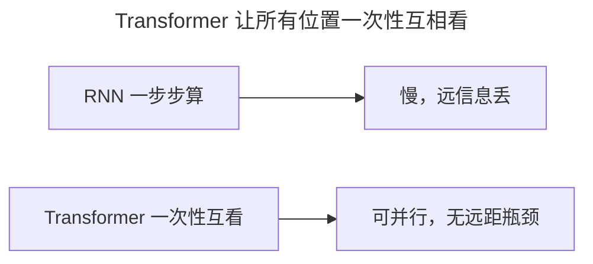
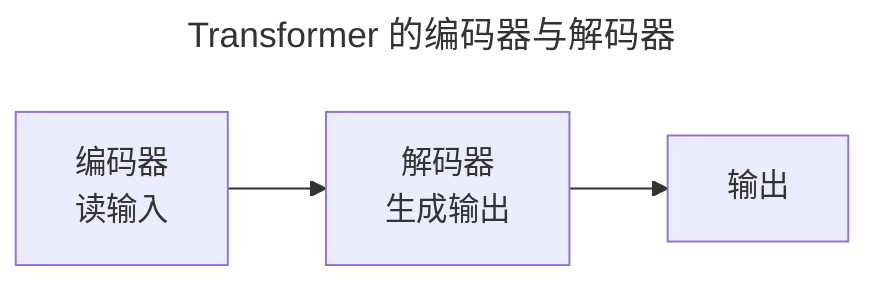
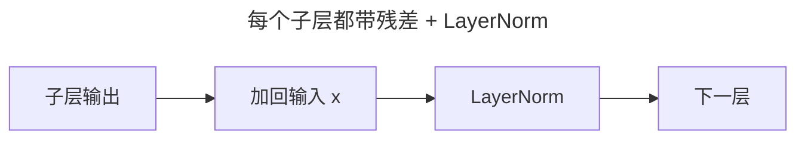
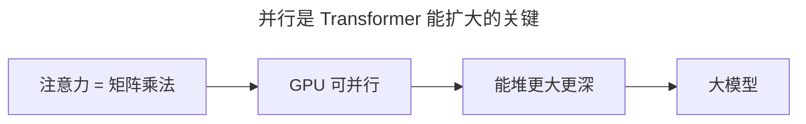

> 作者：轻松学AI
> 日期：2026-10-18
> 风格：通俗科普
> 状态：待发布

# 从零开始学深度学习 #20：Transformer——现代深度学习的基石

上一篇把注意力、自注意力、多头、位置编码都备齐了。这一篇把它们组装成完整的 Transformer。

2017 年，谷歌一篇标题嚣张的论文《Attention is All You Need》提出了这个架构。它彻底抛弃了 RNN，也成了今天几乎所有大模型的底座。

## 一、抛弃循环：不再一步一步算

RNN 的天生缺陷，是必须"一步一步"地算：要处理第 50 个词，得先把前 49 个词依次过一遍。这带来两个问题：**不能并行**（训练慢），以及**长期依赖**（远处的信息传不过来）。

Transformer 的答案很干脆：把"循环"整个扔掉，全用注意力。


让序列里所有位置**一次性**互相看。



这就是"Attention is All You Need"——注意力一个机制，就够撑起整个网络。

## 二、编码器-解码器 + 一堆块

Transformer 的主体，是由很多个相同的"块"堆叠起来的编码器和解码器：




每个"块"里，就两样东西：多头自注意力 + 前馈网络。没有循环，没有卷积。

## 三、残差 + LayerNorm：每处都加保险

还记得 #13 的残差连接吗？Transformer 里到处都用它。每个子层（注意力、前馈）之后，都加一条"残差 + 层归一化"：



这一招让深层 Transformer 也能稳稳训练。手搭一个 Transformer 块，核心就是这么几行：

```python
attn_out, _ = self.attn(x, x, x)      # 多头自注意力
x = self.norm1(x + attn_out)          # 残差 + LayerNorm
x = self.norm2(x + self.ffn(x))       # 前馈 + 残差 + LayerNorm
```

## 四、为什么它能堆到万亿参数

Transformer 真正厉害的地方，在于它解开了"并行"这个死结。

RNN 必须串行，所以哪怕 GPU 再强，也只能干等。Transformer 的注意力是矩阵乘法——所有位置同时算，GPU 能满负荷并行。训练速度大幅提升，于是人们才敢把网络往"更大"去堆。



从 2017 年的 Transformer 到今天动辄万亿参数的 GPT，架构的内核几乎没变。下一篇讲这个内核如何分化出 BERT 和 GPT 两条路，最终长成今天的大模型。

- [Attention is All You Need](https://arxiv.org/abs/1706.03762)
- [《动手学深度学习》10.7 Transformer](https://zh.d2l.ai/chapter_attention-mechanisms/transformer.html)
- [配套仓库 dl-from-scratch（transformer/transformer.py）](https://github.com/Joneyao/dl-from-scratch)
