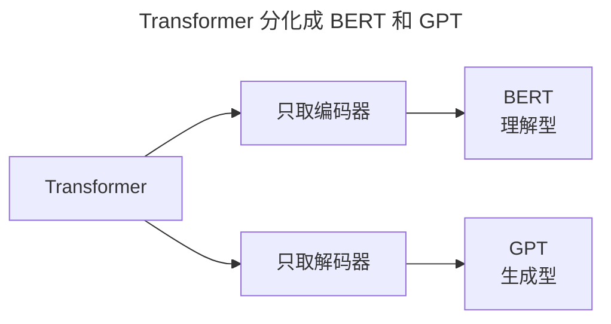
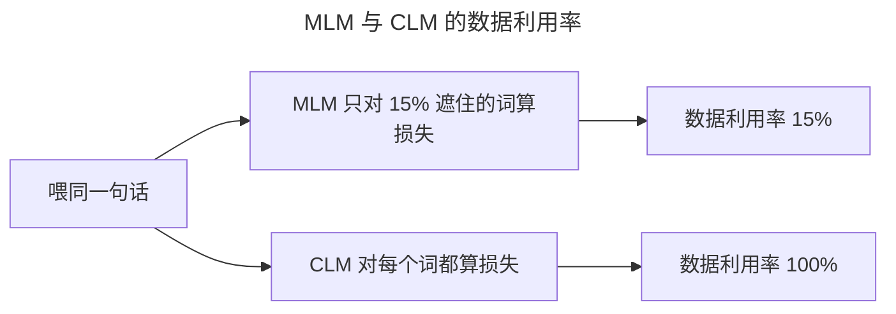
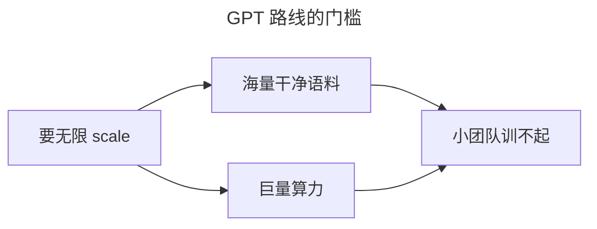
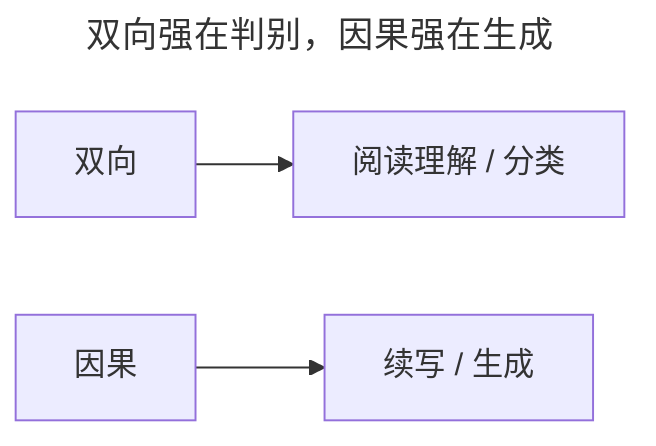

> 作者：轻松学AI
> 日期：2026-10-18
> 风格：通俗科普
> 状态：待发布

# 从零开始学深度学习 #21：从 Transformer 到 BERT 和 GPT

上一篇讲了 Transformer 的骨架。这一篇看它如何分化成两条路——BERT 和 GPT，并最终长成今天的大语言模型。先剧透结论：同样取自 Transformer 的两半，理解力更强的 BERT 却输了，GPT 反而长成今天的大模型——这篇文章回答这是为什么。

理解这一篇，你就理解了"大模型"这个词背后最核心的机制。

## 一、问题由来：NLP 为什么突然要"预训练"

2017 年之前，NLP 的主流玩法是每个任务单独训一个小模型：情感分析标几千条，机器翻译标几百万句对。标注又贵又慢，换个任务就得从头再来。word2vec 那类词向量虽然能复用，但它是静态的、不认上下文——"苹果"在水果和手机两个句子里长一个样，帮不上多少忙。

Transformer 出现之后（上一篇 #20 刚拆完），情况变了：它并行好、能堆深，给它海量没标注的文本，它能把语言本身先"读熟"。这就是预训练——先在大语料上无监督地学，再拿去做具体任务。BERT 和 GPT 是 2018 年几乎同时冒出来的两个答案，回答同一个问题：预训练，到底该怎么预。


## 二、核心直觉：完形填空 vs 成语接龙

BERT 像语文卷子的完形填空：把一个词抠掉，让你根据上下文把它填回去，所以它必须把左右两边都看完。GPT 像成语接龙：给你前半句，你接着往下写，写的时候只能看已经写出来的部分，未来的词不能偷看。一个是"看懂"，一个是"会说"。




## 三、机制：为什么"预测下一个词"是印钞机

先看 BERT 的完形填空，学名叫掩码语言模型（MLM）。做法是随机遮住 15% 的词，其中 80% 换成 [MASK]、10% 换成随机词、10% 保持原样，然后只对这 15% 的位置算交叉熵损失。注意这个 15%：一整句话里，只有 15% 的 token 真正产生梯度，剩下 85% 只是"旁观"的上下文，没贡献训练信号。

再看 GPT 的预测下一个词，学名叫因果语言模型（CLM）。损失是整句所有位置上的交叉熵——P(x₁)·P(x₂|x₁)·P(x₃|x₁,x₂)……每一个 token 都是被预测对象，没有一个闲着。同样吃一句话，GPT 能榨出 100% 的训练信号，BERT 只能榨出 15%，数据利用率差六倍多。

更关键的是"为什么能 scale"。预测下一个词不需要人工标注，任意一段互联网文本天然自带标签：前 n 个词是输入，第 n+1 个词就是答案。数据这一头是无限的。而且这个损失函数极其"顺滑"——只要多喂数据、多堆参数、多花算力，损失就按幂律稳定往下掉，不会卡住。这是 OpenAI 2020 年 scaling laws 论文观察到的规律。BERT 的 MLM 也有这个性质，但它被那个 15% 卡住了上限：同样的钱，GPT 每一分都花在刀刃上。

再补一个因果细节：为什么 BERT 不能直接用来生成？它训练时是"看两边补中间"，推理时遇到没被遮的普通文本，输出不是一个能从左到右逐词采样的分布，要生成得反复套 [MASK] 或者上别的花招。GPT 的因果 mask——每个词只看自己和左边——恰好让"下一步该说什么"这个条件概率永远定义得出来，生成是原生能力。这就是自回归和自编码两条路线的根本分野。





左图是 BERT 的 mask（每个词看整句，全是蓝色），右图是 GPT 的因果 mask（下三角，只能看自己和左边）。就是这一张 mask 的区别，决定了两种模型的性格。

## 四、手写核心：一张 mask 决定两种性格

两种模型的分野，落到代码上就一件事——注意力 mask 长什么样。配套仓库 transformer/bert_gpt.py 里，核心就这几行：

```python
def build_mask(mode, seq_len):
    if mode == "causal":                # GPT：因果，下三角
        return torch.tril(torch.ones(seq_len, seq_len))
    return torch.ones(seq_len, seq_len) # BERT：全 1，看整句
```

`torch.tril` 取矩阵的下三角：对角线及以下全是 1、以上全 0。训练时把注意力分数加上这个 mask（0 的位置记成负无穷再做 softmax），未来位置的权重就被压成 0。`torch.ones` 全 1 则是"每个词都能看所有词"。就这么两行，决定了模型是"不能偷看答案的作者"还是"读完全文再答题的读者"。


## 五、实验：BERT 没输在质量，输在赛道

看真实数字。2018 年 BERT 论文里，BERT-base 是 1.1 亿参数，BERT-large 是 3.4 亿；同年的 GPT-1 是 1.17 亿。两者当年其实是同一量级，而且 BERT 在 GLUE 这类理解榜单上霸榜一时——论"懂句子"，它当时是赢家。

分水岭在后面的规模。GPT 路线顺着 scaling 一路加码：GPT-2 最大 15 亿参数，GPT-3 冲到 1750 亿参数、训练语料约 3000 亿 token（见 GPT-3 论文）。而 BERT 路线最大的 BERT-large 停在了 3.4 亿。结论不是 BERT 理解得差，是它的范式没法像 GPT 那样顺着 scaling laws 无限加码——被那个 15% 和"补中间"的结构锁死了。


## 六、边界与代价：GPT 也不是免费的

GPT 路线的效果是拿天量干净语料加算力堆出来的：GPT-3 的 1750 亿参数、约 3000 亿 token，普通团队根本训不起。反过来，在小语料、小预算下，因果语言模型往往不如同样预算的 BERT 系模型去做分类、抽取这类下游任务——BERT 路线至今还活在这些场景里，便宜又快。

GPT 的代价在生成端：它按概率采样，不查事实库，所以会一本正经地胡说（幻觉）；因果 mask 下，第 1 个词永远看不到 100 个词之后的信息，局部决策可能短视。BERT 的代价则反过来：15% 的数据利用率、训练推理时的 [MASK] 不一致、不能原生生成，注定了它只适合"理解/判别"，不适合"生产文字"。

所以选型其实很清楚：做分类、向量检索、embedding，BERT 系（RoBERTa、DeBERTa）依然是好选择；做生成、对话、通用智能，GPT 路线是唯一答案。门槛也在这：想吃到 GPT 路线的红利，先得迈过数据和算力这道坎。



## 七、一个常见误解：双向不等于更强

很多人以为"BERT 能看两边，理解一定比 GPT 强，GPT 赢是资本硬堆的"。这里有个偷换概念：双向只在"判别一个已经给定句子的含义"上有优势；在"生成下一个词"这个任务上，双向反而是作弊——答案都看完了，还预测什么。所以 BERT 的强是阅读理解、分类的强，GPT 的强是写作、生成的强，两者根本不在同一场考试。GPT 赢的真相是任务本身适合无限扩展，跟"谁更聪明"关系不大。



## 八、延伸：到大模型，还差最后一步

这一篇把两条路看清了，下一个问题就冒出来：GPT 这种"只会续写"的模型，怎么突然会回答问题、写代码、听指令了？答案是 RLHF 和指令微调——把"续写"对齐成"照做"。这是收官篇 #22 要讲的。另外 BERT 路线没有死，它变身成编码器，活进了检索、embedding、分类的每一个角落。下一篇用一张全景图，把从感知机到大模型这 22 篇全部串起来。


到这儿，我们从感知机一路走到了大模型的门口。下一篇是系列的收官——一张全景图，帮你把这条 22 篇的路全部串起来。

- [BERT 论文：Pre-training of Deep Bidirectional Transformers](https://arxiv.org/abs/1810.04805)
- [Improving Language Understanding by Generative Pre-Training（GPT-1）](https://openai.com/research/language-unsupervised)
- [GPT-3 论文：Language Models are Few-Shot Learners](https://arxiv.org/abs/2005.14165)
- [Scaling Laws for Neural Language Models](https://arxiv.org/abs/2001.08361)
- [The Illustrated GPT-2（jalammar）](https://jalammar.github.io/illustrated-gpt2/)
- [配套仓库 dl-from-scratch（transformer/bert_gpt.py）](https://github.com/Joneyao/dl-from-scratch)
