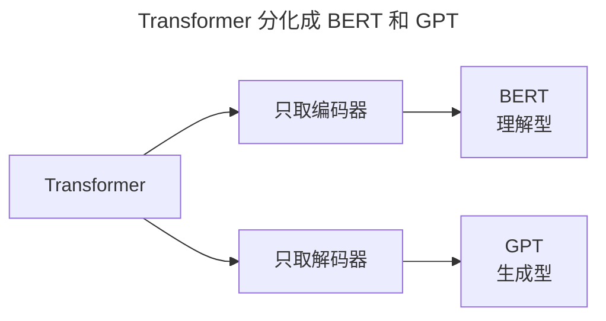
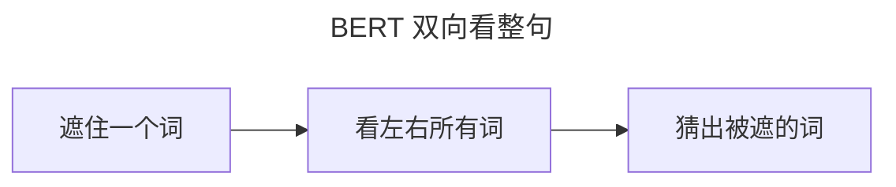
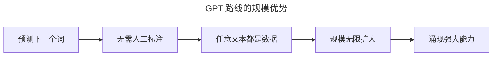

> 作者：轻松学AI
> 日期：2026-10-18
> 风格：通俗科普
> 状态：待发布

# 从零开始学深度学习 #21：从 Transformer 到 BERT 和 GPT

上一篇讲了 Transformer 的骨架。这一篇看它如何分化成两条路——BERT 和 GPT，并最终长成今天的大语言模型。

理解这一篇，你就理解了"大模型"这个词背后最核心的机制。

## 一、同一个 Transformer，两种用法

Transformer 有编码器和解码器两部分。有意思的是，后来的两大流派，各自只取了一半：

BERT 用编码器，擅长"理解"——读完一句再判断、填空、分类。GPT 用解码器，擅长"生成"——一个词一个词地往下续写。

## 二、BERT：看整句来"填空"

BERT 的训练方式，是"完形填空"：随机把句子里的某些词遮住，让模型根据上下文把被遮的词猜出来。

因为要"看上下文补空"，BERT 必须能同时看到左右两侧——所以它的注意力是**双向**的（每个词看整句所有词）。

这个"双向 + 填空"的设计，让 BERT 非常擅长理解任务：情感分析、命名实体识别、阅读理解。

## 三、GPT：只看左边猜下一个词

GPT 的训练目标更"朴素"：只预测**下一个词**。给它前面的话，猜接下来该是什么。

关键限制是：预测下一个词时，**不能偷看未来**。所以 GPT 的注意力是"因果"的——每个词只能看它自己和左边的词。

左图是 BERT 的 mask（每个词看整句，全是蓝色），右图是 GPT 的因果 mask（下三角，只能看自己和左边）。就是这一张 mask 的区别，决定了两种模型的性格。

## 四、为什么最后是 GPT 赢了

按说 BERT 理解力更强，但今天统治世界的是 GPT 路线。为什么？

因为"预测下一个词"这个任务，有一项无与伦比的优势：**不需要人工标注**。你手上任何一段文本，天然就是训练数据——"前 n 个词"是输入，"第 n+1 个词"是答案。互联网上无穷无尽的文本，全都能拿来训练，零标注成本。

而 BERT 的"填空"任务虽然巧妙，但规模上拼不过。于是"更大更强"的 GPT 一路狂飙，最终长成了今天会聊天、会写作、会写代码的大模型。

到这儿，我们从感知机一路走到了大模型的门口。下一篇是系列的收官——一张全景图，帮你把这条 22 篇的路全部串起来。

- [BERT 论文：Pre-training of Deep Bidirectional Transformers](https://arxiv.org/abs/1810.04805)
- [Improving Language Understanding by Generative Pre-Training（GPT-1）](https://openai.com/research/language-unsupervised)
- [The Illustrated GPT-2（jalammar）](https://jalammar.github.io/illustrated-gpt2/)
- [配套仓库 dl-from-scratch（transformer/bert_gpt.py）](https://github.com/Joneyao/dl-from-scratch)
