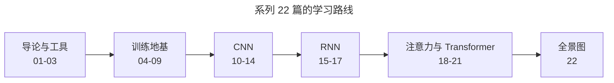
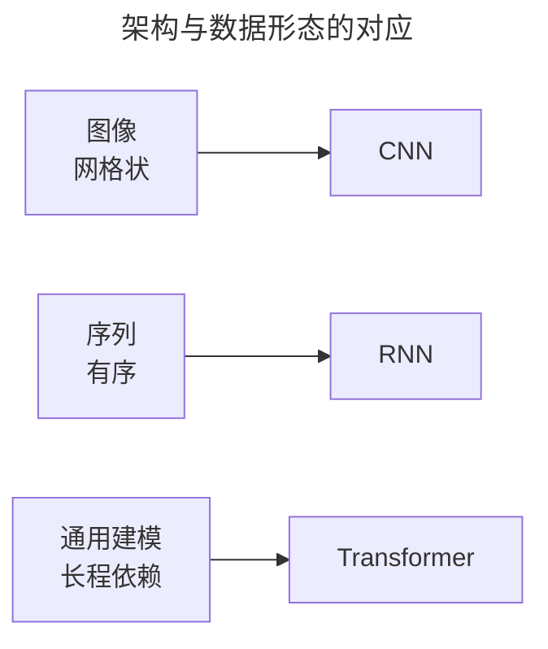
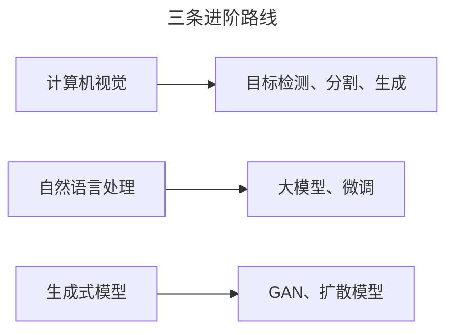

> 作者：轻松学AI
> 日期：2026-10-18
> 风格：通俗科普
> 状态：待发布

# 从零开始学深度学习 #22：深度学习全景图与下一步

这是《从零开始学深度学习》的最后一篇。

22 篇一路走来，我们从"什么是深"讲到了大模型的门口。这一篇不教新东西，而是帮你把整条路串成一张图——看清楚你手里现在有什么、还缺什么、下一步往哪走。

## 一、我们走过了一条什么路

回看这 22 篇，其实是一条清晰的递进线：

- **01-03**：弄懂"深"是什么、为什么爆发、以及 PyTorch 这个工具。
- **04-09**：解决深层网络训练三大难题——学得动（梯度/激活/初始化/归一化）、学得快（优化器）、学得好（正则化）。
- **10-14**：CNN，处理图像——卷积提特征、池化降维、架构堆深、残差破瓶颈、实战落地。
- **15-17**：RNN 家族，处理序列——RNN、LSTM、GRU。
- **18-21**：注意力与 Transformer——自注意力、多头、位置编码，以及 BERT/GPT 两条路。

## 二、三种架构，各管一种数据形态

整条路下来，最该记住的一个判断是：**不同架构，对应不同数据形态**。

图像有局部、平移不变的特性，用 CNN；序列有顺序、依赖前面，用 RNN；而要处理长程依赖、又要并行、又要通用，就用 Transformer。这不是死记硬背，是每种架构都顺应了某种数据的内在结构。

## 三、下一步往哪走

学完这套"地基"，你已经能看懂深度学习领域绝大多数的讨论。往前，有三条清晰的路：

- **计算机视觉**：从分类走向目标检测、语义分割。我们之前已经开过《从零开始学 YOLO》系列，那正是这条路上的一个应用。
- **自然语言处理**：从 Transformer 走向大模型，学微调、学 prompt。这是当下最热、也最贴近 GPT 的方向。
- **生成式模型**：GAN、扩散模型、文生图。这是"AI 画画"背后的原理。

**结语**

回想第一篇开头那个问题："深度学习为什么强？" 现在你能给出完整的答案了——

它靠的不是某一个算法，而是一整套让深层网络"学得动"的工程技巧，加上三种能自动提取特征的架构。而"层层提炼特征"这个思想，从头到尾贯穿了全部 22 篇。

系列到这里画上句号。但它不是终点，是起点。地基打好了，剩下的是选一条路，往下扎进去。

- [配套仓库 dl-from-scratch（全部 22 篇代码）](https://github.com/Joneyao/dl-from-scratch)
- [《动手学深度学习》](https://zh.d2l.ai/)
- [《深度学习》花书](https://www.deeplearningbook.org/)
