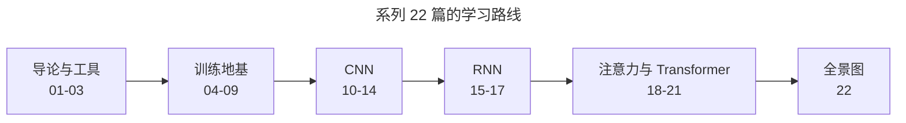
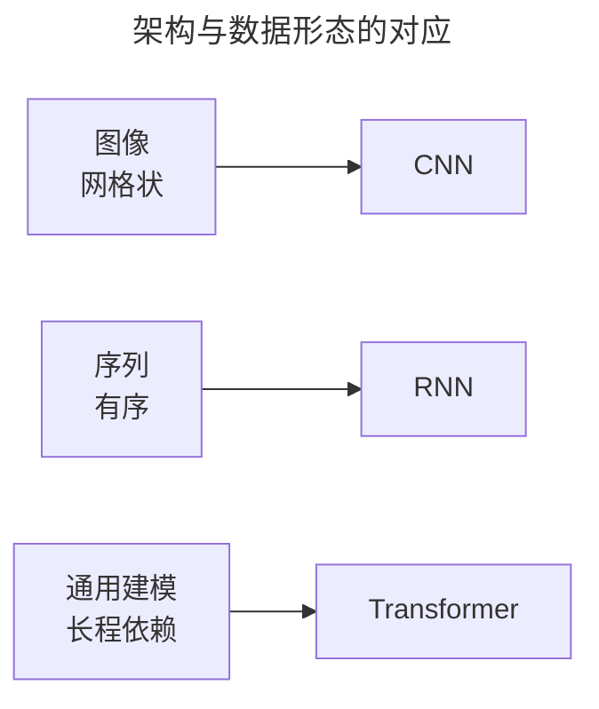
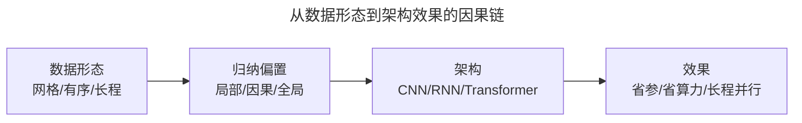
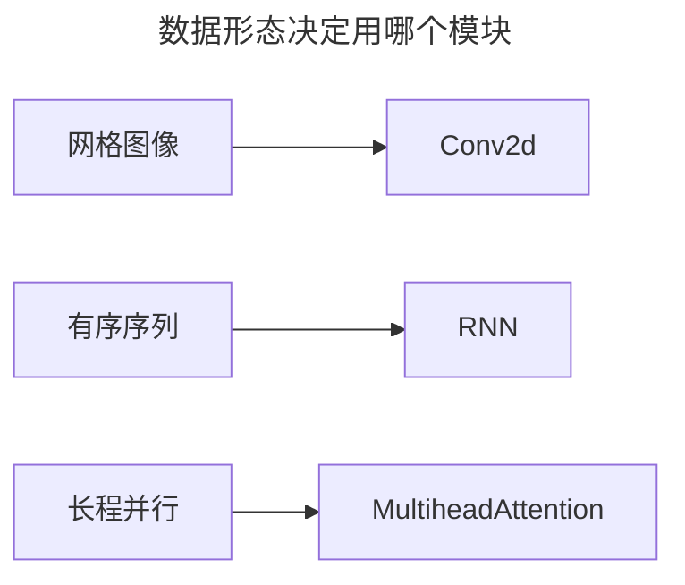
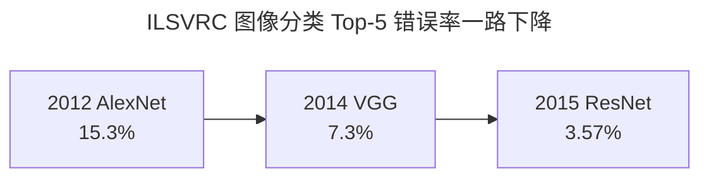
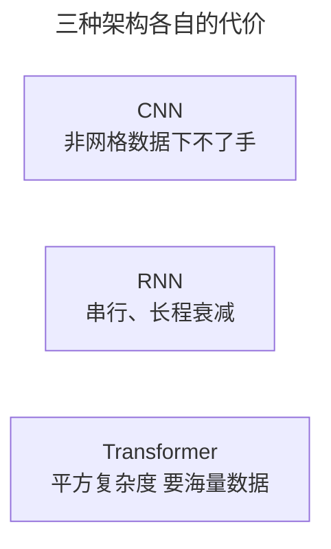
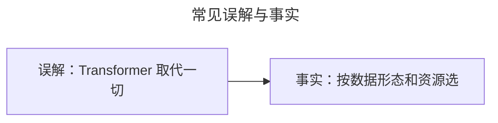
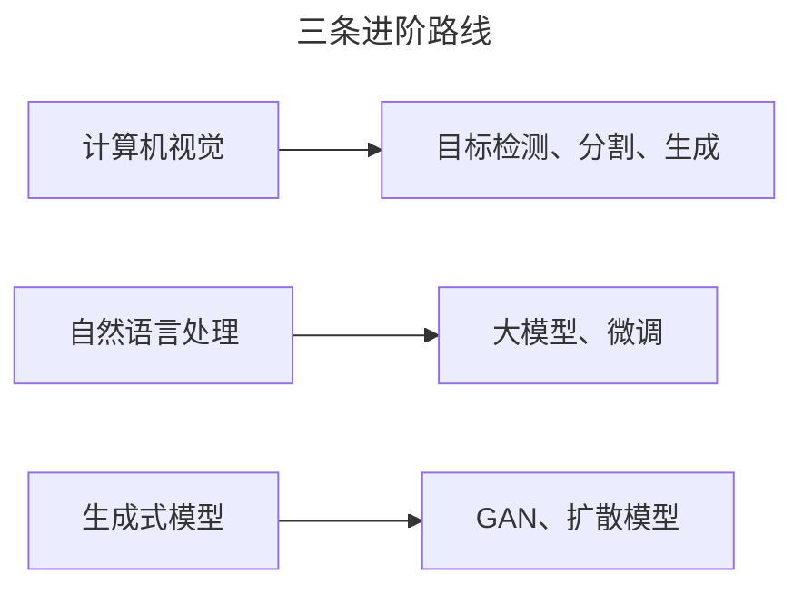

> 作者：轻松学AI
> 日期：2026-10-18
> 风格：通俗科普
> 状态：待发布

# 从零开始学深度学习 #22：深度学习全景图与下一步

这是《从零开始学深度学习》的最后一篇。22 篇一路走来，我们从"什么是深"讲到了大模型的门口。这一篇不教新东西，而是帮你把整条路串成一张图——看清楚你手里现在有什么、还缺什么、下一步往哪走。


## 一、问题由来：学了 22 篇，为什么还是不会选

先承认一件有点扎心的事：很多人把这 22 篇都读完了，每个公式单独拎出来也能看懂，可一拿到真实任务——"我这有 5 万张图要分类"还是"我有三年的销售流水要预测"——还是卡住：到底该上哪个架构？

卡点在于知识点是散的，彼此之间没连线。你背得住卷积怎么算、LSTM 的门怎么开、注意力怎么加权，却没人告诉你这三样是什么关系、什么场景该挑哪个。旧方法（一篇一篇地背）能让你"知道"，但没法让你"会用"。

这一篇就补这最后一环：把散点串成一张地图。先回头看一眼我们走过的路：



- **01-03**：弄懂"深"是什么、为什么爆发、以及 PyTorch 这个工具。
- **04-09**：解决深层网络训练三大难题——学得动（梯度/激活/初始化/归一化）、学得快（优化器）、学得好（正则化）。
- **10-14**：CNN，处理图像——卷积提特征、池化降维、架构堆深、残差破瓶颈、实战落地。
- **15-17**：RNN 家族，处理序列——RNN、LSTM、GRU。
- **18-21**：注意力与 Transformer——自注意力、多头、位置编码，以及 BERT/GPT 两条路。

## 二、核心直觉：三种架构，就是三把钥匙

把架构想成钥匙，数据形态是想开的那把锁。锁孔的形状是固定的：图像是一把"网格状"的锁，序列是一串"珠子穿起来、后面连着前面"的锁，长程依赖是"隔老远还要互相呼应"的锁。

拿错钥匙，硬捅也能动两下，但费劲还打不开；拿对了，轻轻一拧就开。整条路学下来，最该记住的就是这个判断：**不同架构，对应不同数据形态**。至于"串成一张地图"那个比喻，就留给下面这张对照表做辅助：



## 三、机制：架构为什么正好对上形态

对应关系不是巧合，是每种架构把一个**先验**焊进了结构里。这个先验，学术上叫"归纳偏置"——你提前假设了数据长什么样，模型就照着这个假设去学。假设对了事半功倍，假设错了白费力气。

**图像 → CNN**。图像是网格，相邻像素关系近、隔得远的关系弱（局部性），一只猫挪到画面右下角还是猫（平移不变性）。卷积恰好焊死了这两条：一个 3×3 的小核只在局部邻域里做加权和，天生只"看"附近；同一个核扫完整张图（权重共享），猫在哪都能被同一组权重认出来。附带的好处是参数量暴跌——一个 3×3×3 的核只有 27 个参数；换成全连接，把 32×32 的图像打平成 1024 维再连到下一层，一层就是一百万个参数，还顺手把像素的位置关系全扔了。这就是"顺应形态"换来的红利。

**序列 → RNN**。序列是"有序、前面决定后面"。RNN 用一个隐状态 h_t 把"从开头到第 t 步的历史"压成一个向量，递推 h_t = f(h_{t-1}, x_t)。这个递推天生是因果的：第 t 步只能看到 t 之前，看不到未来——对语言这种"下一个字只能靠上文猜"的数据，这正好。代价也写在递推里：它必须一步一步串行走，没法并行；信息每过一步就乘个系数，走远了的依赖会衰减，这正是 #04 那套连乘机制的正面翻版。

**长程 → Transformer**。RNN 最怕"第 1 个词和第 100 个词的关系"，因为它得穿过 99 步。自注意力直接让任意两个位置两两算一个权重，跳过中间所有路径——距离再远，关系也是一步算到。代价是复杂度变成 O(n²)（每个位置都要和所有位置比一遍），而且它没有"顺序"这个先验，得靠位置编码补进去；归纳偏置弱了，就得用更多数据去换。



## 四、手写核心：同一份数据，形态决定用哪个模块

把三种架构摆进 PyTorch，你会发现"形态"直接决定了你要 import 哪个模块：

```python
import torch
import torch.nn as nn

# 图像：3 通道 32x32 的网格 → 卷积核只在邻域滑动、权重共享
x_img = torch.randn(1, 3, 32, 32)
conv = nn.Conv2d(3, 8, kernel_size=3)

# 序列：长度 50、每步 16 维 → 隐状态递推，只能看过去
x_seq = torch.randn(50, 1, 16)
rnn = nn.RNN(16, 8, batch_first=False)

# 长程 + 并行 → 任意两个位置直接算注意力权重
attn = nn.MultiheadAttention(embed_dim=16, num_heads=2)
```



每一行干嘛，拆开看：`kernel_size=3` 的意思是"每次只看 3×3 的邻居"，这是局部性；同一个核扫全图，这是平移不变。RNN 那行的输入是 `(50, 1, 16)`——50 步、batch 1、16 维，隐状态 h_t 只从 h_{t-1} 和 x_t 递推，看不到未来。`MultiheadAttention` 不关心位置先后，只算"谁和谁关系强"，所以它得靠位置编码补顺序，长序列还会 O(n²) 地吃算力。这三行几乎就是这个系列的技术缩影：形态在变，你用哪个模块就跟着变。

## 五、实验：顺应形态，在真实榜单上差了多少

道理讲完，看数字。图像分类的权威榜单 ILSVRC（ImageNet 大规模视觉识别挑战赛）上，Top-5 错误率是这样被打下来的：



2012 年的 AlexNet 还带着全连接的影子，Top-5 错误率 15.3%；到 2014 年的 VGG 用纯卷积把网络堆深，降到 7.3%；2015 年 ResNet 靠残差把网络推到 152 层，压到 3.57%。同一张榜，三年几乎砍掉四分之三的错误率。这不是某个技巧的灵光一现，是把"局部、平移不变这些图像先验"持续焊进网络换来的结果。数字来自 ILSVRC 官方榜单，可以自己去 image-net.org 核对。

## 六、边界与代价：没有哪把钥匙是万能的

对应关系是"倾向"，不是"铁律"。每种架构都有它下不了手的场景，代价也明摆着：

- **CNN**：只认网格数据。换成社交网络的图、一张数据库表、点云这些"非欧"数据，卷积核无处下脚。就算在图像里，它的感受野是局部的，要看全图得一层层堆深；旋转、缩放它也不天然免疫，得靠数据增强补。
- **RNN**：串行递推没法并行，长序列训起来慢；长程依赖只是被 LSTM/GRU 缓解，没根除。
- **Transformer**：O(n²) 复杂度和内存，长序列直接吃不动；没有顺序先验要位置编码；归纳偏置弱，数据少的时候经常打不过 CNN——不少小样本医疗影像任务里，CNN 仍是更稳的选择。



所以别把"对应关系"记成"死规定"。真实的决策顺序是：先看数据是什么形态、有多少、算力多少，再挑架构。全景图给的是第一层判断，不是最终答案。

## 七、常见误解：Transformer 不是万能答案

最容易搞错的一点：以为 Transformer 已经把 CNN、RNN 全取代了，新项目无脑上 Transformer 就对了。



不是。Transformer 现在风光，是因为大模型这条路吃数据、吃算力，它弱的归纳偏置正好用海量数据补回来。但在图像、小数据集、低算力、流式低延迟这些场景，CNN 和 RNN 仍然是一线选择。挑架构看的是"数据形态 + 资源预算"，不是"哪个更新"。热门不等于适用。

## 八、延伸：三条路，选一条扎进去

地基打完，往前是三条清晰的路。别三线并行，选一条往下钻：



- **计算机视觉**：从分类走向目标检测、语义分割。我们之前已经开过《从零开始学 YOLO》系列，那正是这条路上的一个应用。
- **自然语言处理**：从 Transformer 走向大模型，学微调、学 prompt。这是当下最热、也最贴近 GPT 的方向。
- **生成式模型**：GAN、扩散模型、文生图。这是"AI 画画"背后的原理。

**结语**

回想第一篇开头那个问题："深度学习为什么强？" 现在你能给出完整的答案了——它靠的不是某一个算法，而是一整套让深层网络"学得动"的工程技巧，加上三种能自动提取特征的架构。而"层层提炼特征"这个思想，从头到尾贯穿了全部 22 篇。

系列到这里画上句号。但它不是终点，是起点。地基打好了，剩下的是选一条路，往下扎进去。

- [配套仓库 dl-from-scratch（全部 22 篇代码）](https://github.com/Joneyao/dl-from-scratch)
- [《动手学深度学习》](https://zh.d2l.ai/)
- [《深度学习》花书](https://www.deeplearningbook.org/)
- [ImageNet / ILSVRC 挑战赛](https://image-net.org/)
- [Attention Is All You Need](https://arxiv.org/abs/1706.03762)
